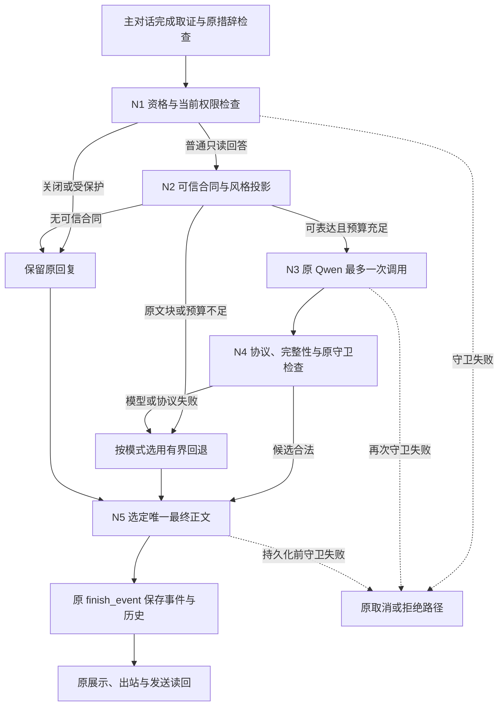

# R2 输出重写节点：架构与实现边界

任务：**AM-CONVERSATION-20261030-01 / R2**  
需求版本：**v1.1-exec**  
日期：2026-10-31  
实现包：`am-conversation-humanize`  
宿主审核基线：`5f8ddee379b3718d30240f5f5f3aa7a8d3331a17`  
交接所报源码基线：`8c25340dd5b9e97ec0354b19ab61f7e877401f9f`

本文说明已经写入代码的设计、可直接接入的接口和仍需本机补齐的部分。研究依据见 [01_调研依据.md](01_调研依据.md)，本机操作顺序与真实验收见 [03_Codex接入与真实验收.md](03_Codex接入与真实验收.md)。本文不是原服务已经更新或真人已经验收的证明。

## 1. 目标与本轮实际交付

用户希望机器人在完成事实判断之后，专门调用一次 LLM，把答案表达得像同事日常回答，减少台账抄录、系统时间戳、版本哈希和审核腔。本轮在普通回答的最后阶段加入一个独立、最多调用一次原 Qwen 的表达流程，并把最终文字确定在原事件和历史持久化之前。

**实际实现采用“可信完整句式 + 一次 LLM 选择与分组”。它不是让 LLM 对整段原答案自由改写。** 宿主先提供含完整业务含义的等价句式，Qwen 选择句式、组合方式及是否使用一个固定开头；程序只从这些句式还原正文。模型不能输出新的事实句、改写人名或日期、删除必需条件，也不能再调用业务工具。

这一设计已经把“自然表达”变成代码中可检查、可关闭、可测量的流程，然而**距离“四类真实问答都能自然、流畅地压缩，而且像本人说话”仍有差距**。人员分工中的可靠结构能产生自然句式；现有台账的自由进展、日期和待办常含跨句条件、否定与历史变化，默认编译器会保留完整业务块，甚至直接旁路。不能把这类原文投影算作 LLM 拟人化成功，也不能把本轮安全接线完成写成用户体验全部完成。

本轮应交付的结论分成三项：代码与接线是否成立；真实来源有多少内容能形成可信表达合同；Qwen 选择后的表达是否比固定句式更自然。前一项的通过不能替代后两项。

## 2. 为什么采用受约束表达

截图中的问题包含两个不同层面：一是面向用户的表达形态太机械，二是内部取证元数据直接进入正文。第二类问题可以通过明确字段投影处理；第一类问题还需要决定重点、语序、分组和说法。仅删除时间戳、替换几个标题，不能证明答案已经自然，也不能处理“预计”“首批”“尚未确认”等信息之间的关系。

另一方面，数字、人名和关键词都还在，也不能证明自由改写保真。例如“李工负责测试，王工负责采购”交换两个人的职责后，所有字词仍然存在；“预计首批到货，其他批次未定”被改成“全部到货”则改变了范围、时态与确定性。不能把正则检查或词袋比对当作语义证明。

| 方案 | 能解决的部分 | 主要限制 | 本轮决定 |
|---|---|---|---|
| 固定模板、正则清理 | 已识别的格式问题、字段标题和内部元数据 | 对复杂语义与个性化表达帮助有限；泛删可能伤及业务日期、型号和编号 | 仅用于确定的字段投影、协议检查及原守卫 |
| 一次 LLM 自由改写 | 表达空间大，有机会接近日常回答 | 可能遗漏条件、错配责任、改变完成状态；简单规则无法全面核实 | 未启用 |
| 自由改写后增加 LLM judge | 可补充语义检查和质量评价 | 第二次调用增加延迟，judge 仍可能判断错；不等于事实保证 | 可研究，未实施 |
| 宿主完整等价句式 + 一次 LLM 选择 | 将正文限制在已知语义范围内，可硬性验证必需信息、依赖和顺序 | 自然度受宿主句式丰富度限制；自由字段不能自动压缩 | 本轮已实现 |

这里的信任边界在**宿主编译出的完整等价句式**。程序能证明模型没有越过这组句式，不能单凭这一步证明宿主句式本身已经忠实于资料。来源解析、责任认定、日期类型、条件关系与多来源冲突处理，仍须由受信任的上游承担。

## 3. 五个末端逻辑节点

这五个节点由普通 Python 模块实现，不要求引入 LangGraph、第二个 agent 框架或新的消费者。主对话仍负责理解问题、取证、选择工具和形成原回答；表达流程只接管已经允许进入的普通回答出口。



| 节点 | 输入和执行内容 | 出口 |
|---|---|---|
| N1 资格与权限 | 检查宿主状态、当前身份、来源访问版本、是否 pending、是否已有本地效果、是否受保护、原绝对 deadline | 允许进入；原回复旁路；或抛出原权限/取消异常 |
| N2 合同与风格 | 从本轮授权 `read_evidence` 编译完整业务句；绑定 scope 和 source version；取得已批准风格；生成确定性回退 | `ReplyContract`；原文块投影；或无合同旁路 |
| N3 一次模型表达 | 只发送最小授权句式集合、当前问题、表达规则与合同指纹；复用原协调器和剩余预算 | 一份结构化选择结果；或有界模型错误 |
| N4 候选校验 | 校验精确 JSON 字段、指纹、句式索引、必需项、依赖、顺序、长度和危险标记；再走原宿主措辞检查 | 合法候选；确定性回退；或保留原已检查回答 |
| N5 最终选定与保存 | 根据 off/shadow/enforce 选定正文；再次守卫；返回原 `_finish` | 原事件结果与 assistant history 保存同一最终 reply；后续沿原出站链路 |

守卫失败与“模型输出不好”不是同一类失败。权限撤销、来源版本变化或取消不能通过返回旧文字来规避。

## 4. 状态、合同与模型出口协议

### 4.1 宿主输入状态

`AmOutputFinalizer` 的主要调用接口为：

```python
final_text = finalizer(
    ctx=ctx,
    event_id=event_id,
    user_text=user_text,
    draft=accepted_draft,
    read_evidence=tuple(read_evidence),
    deadline=original_monotonic_deadline,
)
```

| 状态 | 来自哪里 | 表达节点的使用方式 |
|---|---|---|
| `ctx` | 原身份与授权链路 | 使用当前 `session_id`、`source_access_version` 和项目访问能力；不授予新权限 |
| `event_id` | 原事件 | 关联合同和无正文指标；不创建新的业务事件 |
| `user_text` | 当前用户问题 | 选择响应字段和表达；发给表达模型的部分最多 1500 字符 |
| `draft` | 已过原检查的主回答 | 作为关闭、影子或未覆盖路径的返回值；不当作事实来源，不传入表达模型 |
| `read_evidence` | 原引擎本轮实际取得的授权结果 | 编译合同；不得绕过原取证流程再扩大检索 |
| `deadline` | 原请求的绝对单调时钟截止值 | 继承剩余预算；不重新计一个完整主请求时限 |
| `status/protected/pending_actions/has_local_effect` | 宿主控制状态 | 受保护时提前退出；模型无权把事务回复改标为普通回答 |

引擎补丁只在符合条件的普通回答分支调用适配器；适配器仍保留上述状态参数和检查，避免未来别的入口误接。

### 4.2 三种核心数据类型

`Claim` 是完整语义单元，字段为 `claim_id`、`variants`、`source_ids`、`required`、`depends_on`、`relation`。每个 `variant` 必须是含主体、业务关系及必要限定的完整表达。`source_ids` 是宿主追踪依据的绑定，不是自动查询能力，也不会发给重写模型。

`ReplyContract` 包含 `contract_id`、`claims`、`source_version`、`scope_key`、`forbidden_literals`、`preserve_order`、`max_chars`、`max_groups`、`origin` 和 `require_record_attribution`。最后一项用于强制保留“按现有记录”的来源限定。指纹使用完整合同的规范化 JSON 计算 SHA-256，因此合同内容、范围或来源版本改变后，旧选择结果不能复用。

`RewriteResult` 返回 `text`、`disposition`、`reasons`、`attempted`、`candidate_text`、`elapsed_seconds`、`contract_fingerprint`、`prompt_version`。适配器最后只把 `text` 交回原引擎；其他字段用于受控评价与无正文指标。

合同的代码上限为 1—24 个 Claim，每个有 1—8 个不同变体，每个变体不超过 5000 字符。至少存在一个必需 Claim；依赖必须存在、不能自依赖或形成环。合同正文上限允许 80—6000 字符，分组数允许 1—12；实际可采用的长度还受原宿主 `max_reply_chars` 限制。

### 4.3 与实际 schema 一致的示例

下例全部为合成资料，用于展示条件保留，不代表真实项目记录：

```python
from am_reply.types import Claim, ReplyContract
from am_reply.contracts import render_candidate

contract = ReplyContract(
    contract_id="demo:arrival",
    claims=(
        Claim(
            claim_id="first_batch",
            variants=(
                "首批预计11月6日到货，前提是样品检验通过",
                "在样品检验通过的前提下，首批预计11月6日到货",
            ),
            source_ids=("synthetic:arrival:1",),
            required=True,
            depends_on=("other_batches",),
            relation="milestone:estimate",
        ),
        Claim(
            claim_id="other_batches",
            variants=(
                "其他批次的到货时间还没确认",
                "其他批次什么时候到货，目前仍待确认",
            ),
            source_ids=("synthetic:arrival:1",),
            required=False,
            relation="milestone:unknown",
        ),
    ),
    source_version="synthetic-source-v1",
    scope_key="synthetic-session",
    preserve_order=True,
    max_chars=500,
    max_groups=3,
    origin="host_structured",
)

# 模型应返回这一形状的 JSON；此处用 Python 值生成实际合同指纹。
candidate = {
    "contract_fingerprint": contract.fingerprint(),
    "groups": [
        {
            "items": [
                {"claim_id": "first_batch", "variant": 1},
                {"claim_id": "other_batches", "variant": 0},
            ],
            "joiner": "semicolon",
        }
    ],
    "lead_in": "none",
}
text = render_candidate(contract, candidate)
```

合法输出正文为：

> 在样品检验通过的前提下，首批预计11月6日到货；其他批次的到货时间还没确认。

模型出口仅有三个顶层字段：`contract_fingerprint`、`groups`、`lead_in`。每组只有 `items` 和 `joiner`；每个 item 只有 `claim_id` 和从 0 开始的整数 `variant`。`joiner` 只允许 `semicolon` 或 `space`；`lead_in` 只允许 `none` 或 `record`，后者由程序渲染为“按现有记录，”。

当合同要求 `require_record_attribution=True` 时，模型只能选择 `record`，选择 `none` 会被代码拒绝；确定性回退也保留这个开头。默认旧台账编译器始终开启此项，因为读到台账不等于独立核实业务事实。结构化来源可按真实证据状态设置此项，不能把一次权限核验当成事实核验。

额外的 `text`、解释、工具调用字段、重复 JSON 键、未知 claim、重复 claim、越界索引以及布尔值冒充整数均被拒绝。JSON Schema 是第一层约束；本地校验会再次核实各 claim 实际有多少个变体，并检查模型 schema 未表达的依赖与完整性。

模型输入不含原草稿、完整对话历史、原始元数据、工具目录、source IDs 或身份 scope。它只看到当前问题、已批准表达指令、合同指纹、完整句式和必要的控制字段。

## 5. 完整语义单元、限定与依赖

“首批”“预计”“样品检验通过后”“尚未确认”不能被拆成可任意丢弃的装饰词。需要固定在每一个等价句式内部；即使 Qwen 选了另一个变体，这些含义仍然存在。责任关系也保持完整，例如“李工负责测试报告”与“测试报告由李工负责”，不把人名和工作分别交给模型拼接。

`depends_on` 用来保护跨块关系。上例中的 `other_batches` 虽然 `required=False`，但只要采用 `first_batch`，就必须同时采用它。代码会检查所选全部 Claim 的依赖，因此链式依赖也不能漏掉。确定性回退会从所有必需 Claim 出发，补齐依赖闭包，再选择每条的第 0 个变体。

有三个限制需要明确：

- 依赖字段只表达“选择这一块时也必须保留另一块”；它不能自动证明两个任意自由句之间存在怎样的逻辑关系。强相关条件应优先留在同一完整块内。
- `preserve_order=True` 保留宿主 Claim 顺序，避免模型重排时间线或条件链。若上游明确允许调整顺序，可以设置为 false，但不能把“能重排”等同于“能修改逻辑”。
- `max_groups=3` 表示最多三组，不表示严格三句话。一个完整原文块可以有多句话；若压成三句会损失条件，本轮不压缩。

所有 `variants` 都必须由可信宿主提供。不能先让另一个无约束 LLM 生成一批句子，再未经核对地标成可信变体；否则只是把风险移到了合同编译器。

## 6. 默认台账编译器的实际覆盖

`build_legacy_contract` 是对原宿主的保守适配器，不是通用语义解析器。它只处理可确定为单项目、单字段的普通查询。没有显式项目号时仍须仅有一个已验证当前项目；用户显式提及项目号时，必须与该项目已声明身份匹配，不能靠标题中的任意片段猜项目。

每份 `read_evidence` 必须可检查：非字符串、超过 100000 字符、不能解析为 JSON，均返回 `None`。出现无法识别的读工具结果、多个项目、同项目冲突快照、尚未合并的额外 `facts`，也不投影旧台账覆盖原主回答。纯项目列表目录属于已识别的例外。来源太长不是“没有新信息”；不能跳过它然后假装合同完整。

| 查询或资料形态 | 默认处理 | 是否有 LLM 自然表达能力 |
|---|---|---|
| 单项目“谁负责”，人员字段全为可识别的人名与正向职责行 | 每行形成完整责任句，两种等价说法；同名时保留用于区分的工号 | 可以；仍需真实自然度评价 |
| 人员字段含未知人员、否定、复杂前提、全局说明或不能识别的一行 | 整个人员字段保持完整块，不部分提取“容易”的行 | 无自由润色；原文块投影 |
| 自由文字的项目进展 | 保留完整字段 | 无自由摘要；原文块投影 |
| 关键日期、待办 | 保留完整字段；存在不同的项目进展时，连同完整进展依赖一起保留 | 通常无自然压缩；可能比用户想要的更长 |
| 结构化共享事实，由可信宿主明确给出责任、日期类型、待办状态及限定 | 可调用结构化 builder 形成多变体合同 | 接口已具备；真实来源映射仍需补齐 |
| 同时问多个字段、多个项目、原因、建议、风险或操作请求 | 返回 `None`，继续使用原主回答 | 未覆盖 |
| 问“最新”、新反馈或审批消息，或额外来源尚未合并 | 返回 `None`，避免用旧字段覆盖综合判断 | 未覆盖 |
| 主动问来源、依据、快照版本、采集或读取时间 | 旁路默认字段投影，让原链路回答溯源问题 | 不删去用户主动索要的信息 |

人员识别采用明确格式和职责白名单，不推断项目总负责人。原字段只有“组织与审批跟进”等分工时，不能改成“这个项目由某人总负责”。对同名人员的区分依赖当前字段中实际可见的信息，不能承诺跨全公司自动消歧。

所选字段超过 4800 字符时拒绝投影。日期或待办附带的进展超过 4800 字符，或两块合计超过 5600 字符时也拒绝；合同预估正文超过 6000 字符同样拒绝。这里采用完整旁路，没有“删掉后半段再继续”的策略。

对 `origin="ledger_source_block"` 的合同，pipeline 不调用 Qwen。`enforce` 使用完整块的确定性投影；`shadow` 保留原主回答；指标为 `source_projection / NO_EQUIVALENT_VARIANTS`，不是 `accepted`。外层空白或标点可能按渲染规则调整，因此完整块投影也不等于逐字输出；逐字请求另走保护旁路。

截图中的四个问题不能被统一标为本轮已自然化。尤其真实“项目进展”“关键日期”“有哪些待办”的效果，要看是否接上足够可靠的共享事实结构；仅靠目前自由台账字段，代码有意保留这一缺口。

## 7. 风格：通用要求与个人风格分开

默认 `StyleProfile` 的版本为 1，提供简体中文、直接回答、日常同事口吻、默认一到三句话、不编造亲历和承诺等要求。`profile_id="muyi-work-baseline"` 是配置标识；它**不代表已经读取、训练或学会用户个人说话方式**。

可选 `style_provider(ctx)` 由宿主注入，必须返回 `StyleProfile`。适配器要求 `approved is True`，且 `scope_key` 为空的通用配置，或与当前 `ctx.session_id` 相同的定向配置。核心进一步限制最多 12 条指令、每条最多 500 字符。

当前代码没有自动收集私人聊天、训练风格模型、检索其他用户样例或跨群复用个人风格。若要接近本人，需要本机在已有授权范围内接入确实由用户批准的表达规范或样例，并做本人评价。代码中的 approved 字段是宿主提供的控制信号，本身不能证明批准过程已经完成。

风格只能在合同允许的句式之间影响选择，不能降低事实完整性、改变权限或让模型声称“我已经联系了某人”。需要更丰富的个人表达时，应先扩充可核对的等价句式，而不是单纯加长风格提示词。

## 8. 原 Qwen、单协调器与共同截止时间

`CoordinatorRewriteModel` 直接使用原 `service.g.provider` 对应的协调器实例，通过它的 `complete()` 调用；没有创建 SDK 客户端、第二模型、网络直连或第二个 `ModelCoordinator`。原队列锁、跨进程锁、暂停状态和异常处理继续起作用。

调用包含 `json_schema`、`native_chat=True`、`max_tokens`、`timeout` 与 `_queue_timeout`。表达节点不提供业务工具，不进行多轮自我修复，也不在超时后换模型重试。`MODEL_BUSY`、`MODEL_PAUSED`、`STOP_UNKNOWN` 等状态不能由表达层解除。

| 配置 | 默认值 | 含义 |
|---|---|---|
| `mode` | `off` | 默认关闭；未配置 output_rewrite 时保持原路径 |
| `max_seconds` | 6.0 | 表达阶段最大初始预算，还要受原剩余时间收紧 |
| `queue_seconds` | 0.2 | 给原协调器的短排队上限 |
| `min_remaining_seconds` | 1.0 | 剩余表达预算不足时不调用 |
| `finish_reserve_seconds` | 0.3 | 在原截止时间内给收尾留出的预算 |
| `max_tokens` | 512 | 结构化选择结果的 token 上限 |
| `max_input_chars` | 12000 | 最小投影序列化后的字符预算 |
| `max_output_chars` | 5000 | 原始模型 JSON 返回的字符预算，非业务答案长度 |

实际计算为：

```python
remaining = original_deadline - monotonic_now - finish_reserve_seconds
timeout = min(max_seconds, remaining)
queue_timeout = min(queue_seconds, timeout)
```

`remaining < min_remaining_seconds` 时走回退。调用之后还检查耗时和剩余截止值，迟到候选不会采用。实际阻塞调用能否及时停止仍依赖原 provider 尊重超时；本轮没有增加能强制杀死底层推理的机制，真实模型排队与超时必须本机验证。

“最多一次”指**每次进入末端处理的完整尝试最多一次模型调用**。关闭、保护、无合同、预算不足和原文块投影是零次；已完成事件的重放也是零次。若进程在最终持久化之前崩溃，原事件之后重新处理可能再次产生模型调用；本轮不宣称跨崩溃精确一次计费或新增持久化模型任务队列。

6 秒是初始配置，不是实测延迟承诺，也不代表原三秒体验目标已满足。一次额外调用是否值得，要与固定句式基线比较自然度和实际端到端耗时。

## 9. 持久化、重放与授权时序

### 9.1 插入位置

原引擎普通回答分支先完成取证和执行措辞检查，再调用 `output_finalizer`，之后仍执行原 `_finish`。这样最终 `AgentReply.text` 在保存前已经选定。不能在 `text_ui.display` 或消息发送后另做一次改写，否则旧正文已进入模型历史，用户看到的却是另一份内容。

原 `ConversationStore.finish_event` 在同一数据库事务中保存 `conversation_events.reply_json` 与 assistant history。这是本轮沿用的原子边界。展示、出站记录、`rendered_text` 和外部消息发送使用原宿主后续边界，**不是与前述事件事务合成了一个新的分布式事务**。

普通回复沿用最终内容进入原展示；原展示层仍可能有既有文字替换或格式处理。真实验收应核对 reply、实际 `rendered_text` 和发送读回之间的绑定，而不是假定所有路径永远逐字相同。审批预览等具有既有展示规则的路径不进入重写。

### 9.2 权限检查不是一次性票据

适配器必须匹配：

```python
contract.scope_key == ctx.session_id
contract.source_version == str(ctx.source_access_version or "unversioned")
```

这两个字符串只用于绑定，不替代原鉴权。`unversioned` 是兼容占位值，不意味着没有版本的环境获得了同等来源追踪能力。

原引擎在调用前后执行 `_guard(ctx, "read")`；适配器在投影前、投影后、返回前执行注入的 guard；pipeline 在调用模型前、调用完成或失败后及返回结果前继续检查。原 `_finish` 和后续出站还保留原来源版本与身份核对。

因此，Qwen 已经生成候选但来源权限在此期间撤销时，guard 异常向原链路传播，不能把该异常当作 `MODEL_ERROR` 吞掉，也不能退回已经过期的原草稿继续发送。合同 fingerprint 命中也不能让旧授权重新有效。

### 9.3 重放与发送恢复

已完成事件由原存储直接返回最终 reply，不重新进入主模型或表达模型。发送失败后的恢复继续使用原已保存结果和原出站机制，不为了“更自然”临时生成第二份正文。原资料清理与有效期机制保留，本轮不建立另一份无期限对话存档。

## 10. 审批、写入、原文与元数据

### 10.1 必须保护的回复

主引擎补丁只接普通回答，并排除本轮已有 `local_results`、pending actions 和原措辞守卫刚刚替换的回答。取消、授权拒绝、知识候选、确认预览、执行成功回执、执行未知状态以及已批准正文沿原路径处理。

逐字、原样、完整正文、不要改写等请求由 pipeline 保护；“不要照搬原文”会先移除否定复制语义再判断，不能误当成要求逐字照搬。语言匹配只是补充，宿主明确的 protected 状态优先。

已确认内容的动作编号、版本、收件目标、预览摘要和实际执行正文绑定不能因文风改变。表达模型没有发送、挂载、排期、更新台账或重做本地记录的能力。一次表达错误不能触发业务重试。

候选还需通过原 `_unsupported_completion` 及原承诺措辞检查，并拒绝 `<at>` 类提及标记。原检查采用部分规则，可能误拒绝合法说法；本轮保留它。宿主拒绝候选时保留原已检查的回答，记录 `output_rewrite_host_rejected`，不能在指标里算最终采用成功。

### 10.2 元数据采用定点投影

对于普通业务查询，重写合同从业务字段建立，而不是把包含“资料观察时间、完整快照哈希、内部免责声明”的原草稿全文交给模型再要求删除。原始 snapshot、来源追踪信息仍可在宿主证据链中使用，不必每次展示在用户正文中。

默认编译器只将明确识别为内部 snapshot version、长度至少 32、且没有出现在任何业务字段中的精确值放入 `forbidden_literals`。不得用“看起来像哈希”“看起来像时间”的通用规则删除所有匹配文本；型号、工号、批次号、文号、数量和业务日期都可能是必要内容。

如果资料存在刷新失败、待更新或待核对标志，编译器添加必需的完整缺口说明，不能因为追求自然删掉实际不确定性。用户主动询问来源、依据、快照或读取时间时，默认编译器旁路，不隐去用户要求的溯源信息。

普通台账回复保留简短的“按现有记录”限定；这与每次输出微秒时间戳和长哈希是两件不同的事。去掉技术噪声不能把“资料如此记载”升级为“已独立核验”。

## 11. 三种模式与异常出口

### 11.1 模式的可观察行为

| 模式 | 模型调用 | 实际保存/发送文字 | 评价方式 |
|---|---|---|---|
| `off` | 0 | 原主回答 | 关闭基线；不记自然表达通过 |
| `shadow` | 符合条件时最多 1 次 | 始终保留原主回答 | 合法候选仅存在于 `RewriteResult.candidate_text`，可供受控评价 |
| `enforce` | 符合条件时最多 1 次 | 合法候选；或有效合同的确定性回退；没有可信合同时保留原回答 | 分别计 adopted、回退、原文投影与未覆盖；仍受原宿主二次检查 |

对有效合同，确定性回退使用所有必需项与依赖项的第 0 个完整变体。它可能比主草稿更清楚，也可能较长；不能不经人工比较就宣称拟人化成功。无合同或合同无效时没有可靠的替代文字，因此保留原主回答。

### 11.2 异常与回退表

| 情况 | 代码行为/代表原因 | 最终处理 |
|---|---|---|
| 配置字段、模式或预算非法 | 构造器拒绝，`OUTPUT_REWRITE_SETTINGS_INVALID` / `INVALID_MODE` 等 | 在接入/配置阶段暴露；不得静默启动另一套默认配置 |
| 关闭或宿主保护 | `disabled` / `protected_host_reply` | 原回答，0 次调用 |
| 缺少或耗尽共同 deadline | `shared_deadline_missing` / `shared_deadline_exhausted` | 原回答，0 次调用 |
| 合同编译或风格提供器异常 | `host_projection_unavailable` | 再次 guard 后保留原回答；不记录原始异常正文 |
| scope / source version / 风格作用域不符 | `contract_binding_mismatch` / `style_binding_mismatch` | 原回答，0 次调用 |
| 无可信合同、合同无效 | `NO_TRUSTED_CONTRACT` / `INVALID_HOST_CONTRACT` | 原回答，不记覆盖成功 |
| 原文单一块 | `source_projection / NO_EQUIVALENT_VARIANTS` | enforce 采用完整投影；shadow 原回答；0 次调用 |
| 预算不足、输入过大 | `INSUFFICIENT_SHARED_BUDGET` / `INPUT_BUDGET_EXCEEDED` | 按模式有界回退，0 次调用 |
| 原模型忙、暂停、未知停止、超时 | `MODEL_BUSY` / `MODEL_PAUSED` / `STOP_UNKNOWN` / `MODEL_TIMEOUT` / `TIMEOUT` | guard 通过才回退；不重试、不清除原暂停 |
| 其他模型异常、返回类型错误 | `MODEL_ERROR` | 有界回退；不把异常原文写进业务回复 |
| 候选迟到 | `REWRITE_BUDGET_EXCEEDED` | 丢弃候选，按模式回退 |
| 多余字段、遗漏必需项、遗漏依赖、改序、指纹或索引错误 | `UNEXPECTED_CANDIDATE_FIELDS` / `REQUIRED_CLAIM_OMITTED` / `DEPENDENCY_OMITTED` 等 | `rejected`，按模式回退 |
| 删除宿主要求的资料记载限定 | `SOURCE_ATTRIBUTION_REQUIRED` | 拒绝候选；回退同样保留来源限定 |
| 原宿主二次措辞检查拒绝 | `output_rewrite_host_rejected` | 保留原已检查草稿；单列最终未采用 |
| 身份过期、取消、撤权或来源版本改变 | 原 guard 异常传播 | 原控制路径终止；不能用旧候选或旧草稿绕过 |
| 诊断指标写入失败 | 指标回调异常不改变正文 | 不重试业务，不丢弃已决定的合法结果 |

指标默认只含 `mode`、`disposition`、`reasons`、`attempted`、耗时、合同指纹、提示词版本及长度，写入原请求计时记录。它们不含问题、句式、人名、候选全文或完整来源。`shadow` 候选不会自动存进原指标表；需要人工对照时，应在受控验收路径另外捕获结果，而不是新增无期限生产正文日志。

## 12. 模块职责与实际宿主修改

| 文件 | 责任 |
|---|---|
| [`src/am_reply/types.py`](../src/am_reply/types.py) | 合同、请求、风格、配置、结果和模型协议 |
| [`src/am_reply/compiler.py`](../src/am_reply/compiler.py) | 保守旧台账投影；结构化责任、日期、待办与完整块 builder |
| [`src/am_reply/contracts.py`](../src/am_reply/contracts.py) | 合同校验、严格 JSON 解析、完整性/依赖/顺序检查、确定性渲染与回退 |
| [`src/am_reply/model.py`](../src/am_reply/model.py) | 单次调用原协调器、受约束输出 schema 与表达提示词 |
| [`src/am_reply/pipeline.py`](../src/am_reply/pipeline.py) | 五节点控制中的资格、预算、调用、再检查与模式选择 |
| [`integration/am_output_rewrite.py`](../integration/am_output_rewrite.py) | 原 AM 上下文绑定、宿主依赖注入、指标接线及 finalizer 接口 |
| [`integration/host-output-rewrite.patch`](../integration/host-output-rewrite.patch) | 原 engine、legacy 两处实际接线差异 |
| [`integration/host_changes.json`](../integration/host_changes.json) | 固定基线对应的旧新片段、文件哈希与应用信息 |
| [`integration/install.py`](../integration/install.py) | 默认只读预检；精确基线匹配时可应用，冲突时要求局部合并 |
| [`tests/test_host_integration.py`](../tests/test_host_integration.py) | 加载补丁后真实原引擎与原 SQLite store，合成模型验证持久化与保护边界 |

`engine.py` 只增加可选 `output_finalizer`、普通分支接入、前后 guard 与候选再次检查。`legacy.py` 增加 `output_rewrite` 配置键、注入既有 `service.g.provider`、原 authorize 和原计时回调。未配置该键时不初始化表达器。

补丁按固定审核基线生成，不能整文件覆盖当前工作树。安装器会拒绝存在后续修改的宿主文件，Codex 应按差异局部合并，保留 R1-FIX1 之后的有效修改。安装器不修改运行配置、不迁移业务库、不推送、不启动或重启服务。

## 13. 扩展可信合同接口

自然度覆盖的优先扩展点是 `contract_builder`，不是放宽候选校验。它的签名与默认编译器一致：

```python
def trusted_builder(ctx, event_id, user_text, draft, read_evidence):
    # 1. 仅使用本轮授权资料和宿主已验证的共享事实。
    # 2. 核实问题对应项目、事实新旧、冲突及条件依赖。
    # 3. 无法保证完整时返回 None，不把 draft 当证据。
    # 4. 返回绑定当前 scope 与来源版本的 ReplyContract。
    ...
```

宿主注入方式为：

```python
from am_conversation.output_rewrite import AmOutputFinalizer

finalizer = AmOutputFinalizer(
    service.g.provider,  # 已存在的原协调器
    settings={"mode": "off"},
    guard=lambda ctx: bridge.authorize(ctx, "read"),
    metrics=bridge._timing,
    contract_builder=trusted_builder,
    style_provider=approved_style_provider,
)
```

以上变量是宿主接线位置，不是包内已经存在的工厂。默认 legacy 补丁会使用默认编译器和通用风格；自定义共享事实与个人风格接入需本机明确实现，并核对其作用范围。

已有 `role_claim`、`milestone_claim`、`todo_claim` 和 `intact_claim` 可复用。日期 builder 要求宿主明确区分预计、承诺、要求、实际完成、检查或未知；它不自行换算日期，也不从自由文字猜时间类型。待办 builder 只接收宿主已知未完成事项，不将历史记录自动转成待办。

优先补齐的真实来源能力包括：项目与人员唯一身份、事实更新时间、已核实的进展状态、日期类型与批次范围、待办状态与负责人、未决条件和冲突。必须先解决“事实单元是什么、限定在哪里、是否已经合并新来源”，再提供等价表达。共享事实文档与正式挂载目标尚未接好时，应明确记为覆盖缺口。

## 14. 验证现状、实施顺序与未实现内容

本包最新合成验证记录为 **58 项通过**：25 项对抗检查、11 项编译器检查、16 项真实原引擎/存储与安装器检查、6 项适配器检查。该数字是本轮包内验证总数，不能与旧 R1-FIX1 的 113 项相加称作新的统一业务验收。

其中真实加载原引擎与 SQLite store，说明测试并非只把输出字符串互相比一遍；但模型仍为合成接口，来源、身份变化与外部效果采用隔离测试设置。**真实 Qwen 调用、原服务更新、飞书实际投递、手机显示与本人自然度验收仍待本机执行。**

建议实施顺序是：核对当前源码及后续修改并局部合并；保持 off 运行相关离线回归；在原协调器上使用合成业务事实跑真实模型探针；补齐共享事实合同；在已获准范围内 shadow；完成原稿、固定句式、LLM 结果三路比较后，定向 enforce；最后核对实际出站与桌面、手机及真人评价。具体门槛和证据字段见验收文档。

以下能力**未实施**，不能混入本轮已完成清单：自由整段摘要、第二个 LLM judge、自动多轮修复、自动训练个人风格、自动读取私人聊天、通用跨来源语义合并、所有进展和待办的自动语义拆分、跨崩溃精确一次模型调用，以及全量用户或所有群默认启用。

“接近真人”应通过对照评价来判断。固定句式 B 路若已经足够自然，LLM 的 C 路没有明显收益，就应减少无价值调用并改进合同；不能把成功返回 JSON 当作自然度通过。若进展、日期、待办仍主要落入原文投影，本轮可报告安全接线和限定范围表达成立，但用户原目标仍为部分完成。

## 15. 原宿主来源与追溯

原服务边界依据固定审核文件核对：

- [R1-FIX1 当前交接](https://github.com/Catcherog/project-workbench-review/blob/5f8ddee379b3718d30240f5f5f3aa7a8d3331a17/AM-CONVERSATION-20261030-01/R1-FIX1/00_%E5%BD%93%E5%89%8D%E4%BA%A4%E6%8E%A5.md)。
- [原 engine.py](https://github.com/Catcherog/project-workbench-review/blob/5f8ddee379b3718d30240f5f5f3aa7a8d3331a17/AM-CONVERSATION-20261030-01/R1-FIX1/source/am-conversation-r1/src/am_conversation/engine.py)：完成分支、原 guard 与 `_finish`。
- [原 store.py](https://github.com/Catcherog/project-workbench-review/blob/5f8ddee379b3718d30240f5f5f3aa7a8d3331a17/AM-CONVERSATION-20261030-01/R1-FIX1/source/am-conversation-r1/src/am_conversation/store.py)：事件结果与历史持久化、重放与来源绑定。
- [原 legacy.py](https://github.com/Catcherog/project-workbench-review/blob/5f8ddee379b3718d30240f5f5f3aa7a8d3331a17/AM-CONVERSATION-20261030-01/R1-FIX1/source/am-conversation-r1/src/am_conversation/legacy.py)：原 provider 注入、展示、outbox、rendered_text 与发送核验。
- [原 text_ui.py](https://github.com/Catcherog/project-workbench-review/blob/5f8ddee379b3718d30240f5f5f3aa7a8d3331a17/AM-CONVERSATION-20261030-01/R1-FIX1/source/am-conversation-r1/src/am_conversation/text_ui.py)：普通展示与受保护预览差异。

测试所用固定文件的 Git blob SHA 与精确来源见 [`tests/fixtures/SOURCE_REFS.json`](../tests/fixtures/SOURCE_REFS.json)。本轮新增代码以包内文件和最终交接提交为准；本机当前工程若与固定审核基线不同，应记录实际合并差异与加载结果，不把本文件的基线说明当作运行环境已经一致的证明。
