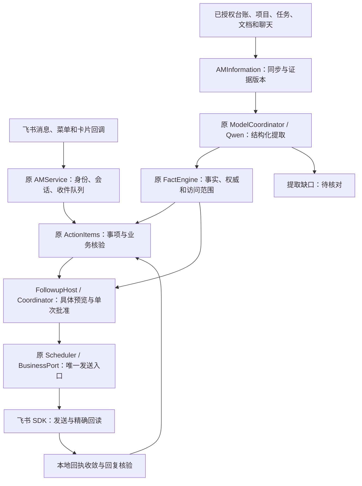
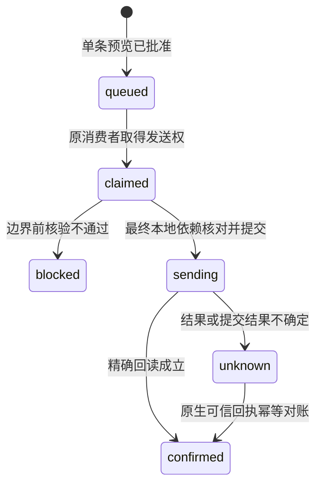

# AM 单条跟进：当前架构、详细设计与本轮实现

任务：AM-FOLLOWUP-20261102-01 / R1-FIX1-GPT。需求增量：v1.1-implementation。

## 1. 本轮分工与边界

用户最新要求：**“现在架构是什么样的，然后你直接完成详细架构设计和代码开发，codex来跑真实环境验收。”**

本轮由 GPT 完成设计、代码和隔离验证；Codex 在真实工程中集成，执行原服务、原 Qwen、飞书、手机和业务验收。该要求替代先前仅由 GPT 审核、Codex 编写补修代码的分工。已存在的真实业务外发、隐私和发布边界继续有效。

交付的是可审查的源码增量与测试，不表示本机服务已安装。原工程业务源码提交、审核仓库提交、本包本地实现提交是三个不同对象，见 `00_当前交接.md`。

## 2. 已核对的当前架构

当前系统是一个原 AM 宿主中的分层实现。它已有真实资料同步、事实候选、原生事项、预览批准、发送和精确回读能力。本轮沿这些边界修复一致性与恢复。

### 2.1 各层的职责和权威

| 层 | 主要代码 | 保存内容与决定范围 |
| --- | --- | --- |
| 入口与身份 | `am_service.py`、`am_query.py` | 验证原租户、应用、人员、会话和查询范围；接收命令及已认证回调 |
| 资料同步 | `am_information.py`、`am_info_sync/store.py`、原适配器 | `sources / observations / objects / jobs / gaps`；保存原始来源、当前版本、保留期限和覆盖缺口 |
| 模型提取 | `info_extraction.py`、新增 `info_semantics.py` | 只经原模型协调器提取候选；明确维度、引文和覆盖检查；失败进入原 gaps |
| 事实查询 | `am_info_sync/facts.py` | 复用原可见性、当前版本、权威、来源映射及保留策略；模型内容为 unconfirmed |
| 业务事项 | `fs_agent/action_items.py` | 原事项 ID、负责人、时限、状态、反馈和核验人；正式关闭仍走原验证路径 |
| 跟进准入 | `am_followup_host.py`、`am_followup/followup.py` | 引用、精确披露、已送达预览、一次批准、冻结全文与收件目标、跨渠道屏障 |
| 原生发送 | `fs_agent/scheduler.py`、原 BusinessPort / Feishu Port | 原 plan、approval、occurrence、request UUID、SDK 发送及回读；保留唯一消费者 |
| 故障收敛 | 新增 `am_followup_recovery.py` | 以原生 sent/verified 为持久待处理条件，核对采用关系，幂等更新 intent，不再发一次消息 |
| 来源与回复状态 | 新增 `am_followup_state.py`、原事项页面 | 原子采用、当前依据重审、回复身份和原文 TTL、旧孤项定向处理 |
| 展示 | `am_ux.py`、`am_views.py`、`am_business.py` | 原事项详情、重审依据卡片、反馈可见性；保留既有页面风格 |

事实库与 AM 业务库保持各自职责。跟进相关附属表只保存绑定、语义、批准和恢复状态，原 ActionItems 仍是事项唯一权威。

### 2.2 有效基线

本轮根据固定审核材料重建受影响源码：R2-FIX2 → R3 → Followup R1，并叠加最新 R4 的 12 份运行时源码。关键固定入口：

- [Followup R1](https://github.com/Catcherog/project-workbench-review/blob/3eb75504515f483b0fc284db5930ee13db12588c/AM-FOLLOWUP-20261102-01/R1/00_当前交接.md)，对应源工程提交 `73c1f9e11ec8b1ea9c3e36060a2522fab3676480`。
- [R4](https://github.com/Catcherog/project-workbench-review/blob/0641a282584a68f60ddaf198326fc431ba67ee13/AM-HARNESS-20261031-01/R4/00_当前交接.md)，对应源工程提交 `9255a70154ca82c0b9e2c0dbdb14a90cf94cbbde`。
- 本地可复现组合基线 `31f744ab4bef1c675a12f5deed28e83241cd74f7`，仅为本次开发仓库的提交号。

R4 的末端表达和训练观察继续保留。本轮不替换其运行时文件，不把训练观察当成业务准确性证据。

## 3. 不变的设计约束

1. **单一发送者。** 原 Scheduler 和 SDK 保持唯一；新模块不启动消费者、发送线程或另一套 outbox。
2. **单条批准。** 批准对应已实际送达的本人预览，绑定实际回调身份、消息、会话、对象、全文、来源及时间窗；普通“收到”、查看、修改或停止不构成批准。
3. **资料内容没有执行权。** 模型输出、来源中的命令、工程师“已完成”、聊天中的审批表述，都不能自行批准外发、改变正式核验或关闭事项。
4. **本机当前证据可撤销。** 来源版本、ACL、披露、目标、事项或批准发生相关变更时，旧预览不能继续发送。
5. **不确定发送结果保留。** unknown 不能按未发送处理；只接受精确原生回执完成对账，不按同文搜索猜测、不重新分配 UUID 重发。
6. **原文保留期限不延长。** 回复原文和待核对摘录受到原 24 小时及实际来源期限约束；本地页面与 outbox 有效期不晚于所展示原文。这里约束本地保存与新投递，不宣称能撤回已经送达的飞书消息。
7. **保护配置保持。** 原 Qwen、原协调器、唯一消费者、600 秒查询身份、`ledger_write=false`、`response=legacy`、旧重写 off、`goal_tracking=false`、末端表达 off。配置开关的真实字节与运行状态由 Codex 安装前后核对。

## 4. 数据模型与业务状态

### 4.1 事项身份与关联

`action_items.id` 是原生事项 ID。导入使用 `producer + external_id` 识别候选；经明确审核的项目、对象、行动、上下文等形成 canonical identity，并通过 `action_aliases` 关联原事项。不能靠相似正文合并两条任务。

`action_semantics` 保存当前引用、维度声明和历史未知状态；`action_semantic_history` 保存版本历史。一个旧事实过时，并不要求新建事项。`followup_bindings` 固定预览所依赖的精确引用、目标和正文；`followup_adoptions` 把一个 intent 固定映射到原 plan / approval / occurrence。

### 4.2 分开呈现四种状态

| 维度 | 示例 | 可得出的结论 | 不能自动得出的结论 |
| --- | --- | --- | --- |
| 执行 | planned / in_progress / blocked / done | 工作执行描述及其证据 | “计划今天开测”不是实际已开测 |
| 回应 | pending / acknowledged | 对某次具体跟进有无回应 | 回复“收到”不是交付或验收 |
| 交付 | pending / delivered / unknown | 与约定 deliverable 对应的交付自报或证据 | 样机到仓、方案发出不等于测试完成 |
| 验收 | pending / accepted / rejected | 核验人及核验依据的业务结果 | 工程师自报完成不能自行关闭事项 |

收到实质回复后，页面呈现“自报更新，待核实”及保留期内原文。原 ActionItems 的核验规则保持：只有授权核验人和有效核验依据才能关闭。

### 4.3 发送状态独立于业务状态

这是核心路径图；原 failed、paused、revoked、superseded 等状态继续存在。confirmed 仅表示这条跟进发送已核实，不表示业务完成。

## 5. F01：发送前的最终依赖检查

### 5.1 为什么需要最终本地检查

原流程依次检查来源、人员与会话；目录查询可能较慢。如果在目录查询期间已提交本地来源更新或撤权，只检查原计划与暂停状态仍可能发送旧正文。

本轮保留慢速实时读取，随后建立一个明确的本地发送边界：

1. 所有平台目录、会话、资料刷新和披露成员查询在数据库事务外完成。
2. 依次取得 **AM Store mutex → Information `BEGIN IMMEDIATE` → coordinator AM `BEGIN IMMEDIATE`**。
3. 用原 FactEngine 在当前 Information 连接中核对引用及可见性；用同一 AM 事务核对原披露行、绑定、事项、计划、批准、暂停及时间窗。
4. 比较已批准的依赖快照；只有完全一致才提交 `claimed → sending` 和 `crossed_send_boundary=1`。
5. 释放两库保护，进入原 SDK create。

Information 事务用于阻止别的本地连接在最终核对后、发送状态提交前写入依赖变更。它不写业务数据。AM 事务是唯一发送状态写入，因此不需要跨库分布式提交。

### 5.2 精确依赖范围

检查包括：事实 ID、来源/对象/版本、值哈希、原文可用性、来源 ACL、披露字段/用途/对象、相关覆盖缺口、正文、canonical ID、refs 集合、事项和语义版本、原计划与批准。

无关项目或无关来源变化不撤销本次批准。不能用“全局任何数据变化就阻断”替代精确检查。

`FactEngine.query(connection=...)` 仅能借用属于原 Store 的活动连接；不另开事务、不提交调用者事务。网络调用不得进入持锁区。

### 5.3 失败分类与实际原子性边界

最终只读超时、平台 LedgerError、本地核验失败发生在发送状态提交前，且持久边界可确认未跨越时，记为 blocked 并释放对应发送屏障。普通异常不会因此产生“可能已发”的假 unknown。

若发送边界已提交，或无法确认提交结果，则保留 unknown。`BaseException` 类进程中断不被吞掉。最终数据库退出异常也不能把已提交发送状态误写成确定未发送。

这个机制保证**本机已经观察并提交的变更**与本地发送边界有顺序。远端权限变化和 HTTP 发送不能与本地 SQLite 形成原子事务；边界之后的变化以实际回执及 unknown 规则处理。

## 6. F02：候选采用的单事务设计

导入先验证完整嵌套 schema，包括身份、事项字段、负责人列表、事实引用、历史和历史完整度，再进行人员与来源核对。模型或外部输入不能提供未经核验的正式状态。

原 `ActionItems.create()` 增加可选共享连接；默认调用保持兼容。创建/复用事项、alias、当前语义、历史、候选 adopted 状态在同一原库事务提交。bind、adopt、record_claim 和来源重审均统一 AM mutex → Information 事务 → AM 事务的顺序，并借用前一事务查询当前事实，避免跨连接锁序反转。任一校验或数据库写入失败，全部回滚，不留下可执行但未绑定的事项。

相同候选确认重放返回原事项 ID；改变同一导入身份的内容须走明确修订和重新审核。不同 producer 使用同一 canonical identity 时，项目、描述、要求、负责人、期限和期限类别须一致，不能静默丢弃第二张候选卡所展示的要求。历史缺失或不能用原生精确回执证明的记录保留 legacy_unknown，阻止发送。

### 6.1 旧版孤项兼容

仅处理 source 的 producer/external_id 能精确回指候选、却没有 alias/semantics 的旧失败导入事项。启动检测核对原 create 操作和内容，保存恢复映射与不含原文的迁移审计，并暂停该项。后续从原候选审核入口接回同一 ID。

多项冲突、内容不一致或证据不足保持待审，不自动新建第二项。原已发记录及 unknown 保留；后来的人工暂停或修改不由迁移撤销。安装前后真实库是否存在此类数据由 Codex 读回核验。

## 7. F03/F04：调度公平性和回执恢复

### 7.1 无进展记录不能占住调度扫描

`dispatch_occurrence()` 只在原生发送状态、尝试数、回读状态、消息 ID 或错误状态实际变化时报告进展。被前轮 unknown 屏障挡住而没有状态变化的记录返回 False；原 Scheduler 继续扫描其他事项。

重启时 coordinator unknown 与 native ready/confirmed_not_sent/sending 不一致的精确采用记录会收敛为 native unknown。保留 request UUID、message ID 和屏障，不把它重新放回可发送队列。

### 7.2 持久待对账条件

原生 occurrence 已 `sent/verified`，对应 intent 仍 `unknown/sending`，本身就是持久待处理条件。进程即使在两次本地提交之间退出，这个条件仍可发现。

恢复核对 occurrence/plan/item/intent/preview 采用关系、三处 UUID、payload 指纹、全文、目标、mentions、message ID 和已核实状态。仅精确一致时调用 coordinator 幂等对账。错映射保持 unknown。

新增 `followup_result_retries` 只保存本地重试提示：首次 5 秒，逐步增加，最长 300 秒。即使提示写入失败，持久待处理条件仍存在。一个坏映射或临时数据库失败不阻塞其他记录。

恢复没有网络搜索、重新发送或新 UUID。超过原批准截止时间、发送开关已关闭，仍可确认已经发生的历史发送；这不是新的外发授权。原 native verified 不因后续本地回调异常降级。

## 8. F05：来源重审和旧批准失效

原事项页增加 **“重审跟进依据”**。流程显示当前依据、新增/移除的精确来源对象和字段版本；用户确认后替换当前 refs 集合，而不是把过时事实永久追加到新事实中。

重审保留原 item ID、canonical identity 和语义历史。旧声明按版本进入历史，不再以过期事实参与当前状态或发送依据。全部尚未发送的旧预览/批准失效，新的外发仍需重新预览和单条确认。

已经跨发送边界的 unknown 不因重审而清除；停止或修改只能阻止未来动作，不能声称历史消息未发送。被明确中止、尚未越界的 claimed 记录在同一事务释放自身屏障，以便合法新预览继续。重审卡片本身绑定事项、语义和来源版本；源再次变化须重新打开卡片。包含事实正文的卡片沿原 query grant / query delivery 链绑定权限 epoch 和最早证据 TTL，覆盖入队后的撤权。

## 9. F06：工程师回复与原文保留

收到回复时，原生入口校验原应用、租户、发送者和会话。处理前再次用当前 incoming message ID 平台回读，核对 sender/chat/body/parent、创建时间及未删除状态，与原已发送跟进建立精确关联。

当前回复本身可以构成私聊会话证据，不再依赖一条已经过期的最初问候。旧问候过期后不会为了核验去重新读取已过保留期原文。

核验后的回复链接、反馈身份和原生 item_feedback 在一个事务提交；重复入站或重启重放不重复创建反馈。中性反馈摘要可留存；正文放原库附属 TTL 表，到期清理，不复制到长期 operation 结果或迁移日志。

页面显示回应状态、自报更新和待核实标记。原文详情的到期时间不晚于当前回复自身期限。回复“已完成”、提供交付材料或“收到”都不自动通过业务验收。

## 10. 明确业务维度与覆盖检查

### 10.1 继续使用原 Qwen

`BoundedCoordinatorExtractor` 升级到 `am-native-bounded-v3`，仍是原 ModelCoordinator、native_chat、单次最多 6 个候选、1024 输出 token。没有第二模型、模型兜底发送或扩大授权。

schema 增加 response、action_request、delivery、acceptance、context、constraint；明确计划为 plan/reported，预测为 forecast/forecast。行动请求保留为 proposal 候选。模型结果仍由原 FactEngine 写为 unconfirmed。

### 10.2 保守覆盖检查的能力边界

新增检查识别有限的明确中文业务短语，要求关键原话同时存在于 quote 和 value，并放在匹配的维度/类型中。它能阻止已发现的明确漏项或错误归类静默发布，不会自动补写事实，也不猜项目、人员和日期。

这是**有限显式信号检查**。未命中规则、人工编写正确结构能通过、冻结旧输出被拒绝，都不证明真实模型在新提示词下准确。条件、否定、跨句归属、其他语言和隐含语义仍需人工标准答案与真实模型验收。保守误报会进入待核对。

F12 这类明确项目未定的请求保留为来源级缺口；上下文恰好只有一个项目也不能自动归属。资料不完整、token 范围不足或覆盖失败时，本次候选全批不入库，原 extraction gap 保存短错误码。

### 10.3 待核对入口与保留边界

本人私聊输入 `/info 待核对`，读取当前有权访问的 extraction gaps，并展示最多 30 项的当前原文片段。群聊和非本人不能使用该入口；禁用或撤权来源不进入计数或正文。

同一 Information 事务返回 ACL epoch 与已展示原文最早到期时间。响应绑定该 epoch，原 notify/delivery 再核对；响应 expires 收紧至原文期限，避免排队回复延长保留时间。过期显示“需重新提供”，不从历史版本补原文。

本轮不自动重跑所有历史 done/dead 提取任务。Codex 用新观察版本或明确批准的定向重处理跑验收；旧未确认候选不因模型提示词升级获得新权威。

## 11. 原生使用路径

| 场景 | 用户操作 | 保存结果 | 失败时呈现 |
| --- | --- | --- | --- |
| 导入待办 | 从原候选卡审核项目、负责人、内容和历史 | 原事项与绑定一起保存 | 保留候选；缺资料或历史不伪装完整 |
| 准备跟进 | 打开事项，生成群或私聊单条预览 | 冻结本次全文、目标、来源和有效期 | 精确说明待核对来源、收件人或会话 |
| 批准发送 | 在已送达卡片点“确认并发送本次” | 一个 intent 与一条原生 occurrence | 旧卡、改动或过期不执行 |
| 来源更新 | 打开“重审跟进依据”，检查变化并确认 | 同事项替换当前依据、留历史 | 新证据再次变化则重新打开 |
| 收到回复 | 工程师精确回复原消息 | 回应、自报更新及待核实反馈 | 身份/正文/父消息不一致不归入事项 |
| 解析漏项 | 本人 `/info 待核对` | 查看来源缺口，补充明确归属/资料 | 过期原文需要重新提供 |
| 结果未知 | 查看原发送记录并做精确回读 | 有证据才收敛 confirmed | 保留 unknown，后续同注意对象不重发 |

## 12. 安装、回退与可观测性

Codex 从真实当前分支核对 R4 及后续有效修改，在隔离分支应用本包 delta。不能将脱敏审核副本整文件覆盖生产源码，更不能覆盖配置、运行库或真实身份映射。

附属表采用兼容新增方式，原表权威保持。安装前备份运行数据库和配置；在原维护流程中停止唯一消费者、安装已核对源码、启动原服务，核对加载字节与 PID/消费者数。单独记录新增表、迁移识别数量及旧孤项处理结果。

若真实验收失败，先使用原暂停/停止能力阻止新外发，保留发送记录和 unknown，再恢复上一份已核对代码。不要恢复旧数据库覆盖安装后的真实回执；数据恢复必须逐条核对，不能用回滚掩盖已发送动作。

诊断优先记录 request UUID、intent/occurrence/item ID、状态、边界标志、错误码、版本/hash 和时间。普通日志不存业务原文、密钥或完整私人消息。真实业务证据只在已授权位置保留，公开审核使用脱敏最小材料。

## 13. 验证分层与完成定义

本包 `02_验证结果.md` 给出对应实现版本的实际测试、退出码和限制；`03_Codex真实环境验收.md` 给出真实验收步骤。需要分开判断：

- **代码正确性：** 原反例变为正确行为；事务、并发、身份、TTL、幂等及恢复回归通过。
- **工程兼容性：** 同组合基线与本轮实现跑同一套原工程测试，逐个比较失败和跳过，不拿总数掩盖新失败。
- **真实集成：** 原服务唯一消费者、实际 SDK/目录/回执/数据库版本和真实时延核对。
- **模型准确性：** 新提示词下真实原 Qwen 的逐条完整输出，对照业务标准答案；覆盖检查拒绝不等于业务通过。
- **手机与业务：** 用户实际看到卡片、确认本次、工程师收到精确内容并回复、本人看见待核实反馈、核验人按依据完成业务验收。

只有最后两层证据具备，才能对外声称业务验收通过。
