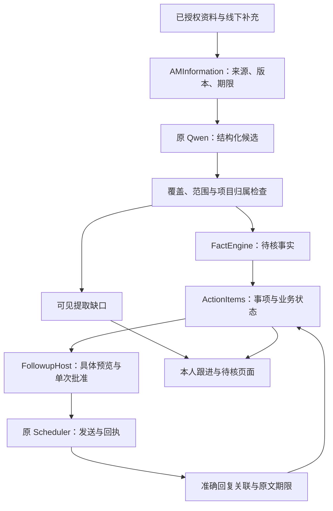
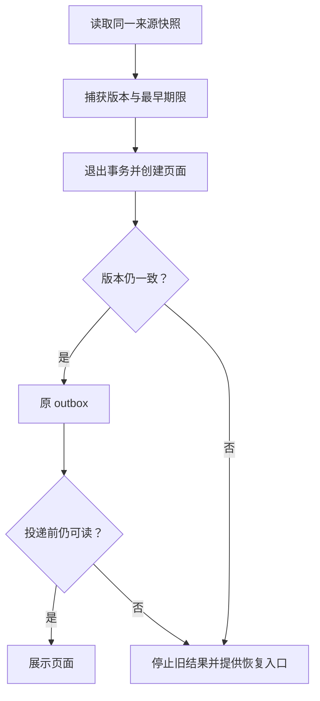

# 当前架构、完成度与 R1-FIX2 详细设计

## 1. 完成度的对象和口径

本次衡量的目标是：**从已授权信息形成有依据的待办与进展，牧翊核对一次具体跟进，AM 通过群聊或私聊执行，回复准确回到原事项，最终由有效业务核验决定关闭。**

当前已经完成单条主干的工程连接，并通过本人限定合成事项的真实闭环。阶段定位为“受控联调与准确性收敛”。最终可用性仍取决于来源覆盖、理解准确性、独立工程师真实业务以及持续运行。

现有需求没有冻结的加权完成度分母。测试通过数、文件数和功能入口数不直接换算成总完成率。本表分开记录代码、真实链路和业务结论，避免同一局部通过被多次累计。

| 能力 | 已实现或已观测 | 当前完成状态 | 尚需通过的关口 |
| --- | --- | --- | --- |
| 已授权信息接入 | 原资料同步、版本、访问范围、保留期、缺口记录已接入；本轮执行端读到 23 项目，19 身份已核实、4 未核实 | 主干已有代码和限定实读 | 全部相关来源的及时性、身份与覆盖完整性 |
| 信息转事实候选 | 原 Qwen/协调器提取，FactEngine 保持 unconfirmed；本包补覆盖与归属检查 | 代码完成，真实准确性未通过 | 重跑原 13 场景及独立样例，分别检查漏项、错归属、错分类、误拒 |
| 候选转正式跟进事项 | 原 ActionItems、精确身份、事务采用、历史未知状态及来源重审已接入 | 主干实现，原机专项有证据 | 真实业务事项采用、变更与冲突由用户核验 |
| 一次批准后群聊/私聊跟进 | 原生预览、意图、唯一调度发送、准确回执已接入 | 群测试及本人私聊限定通过 | 独立工程师与业务消息验收 |
| 回复归入原事项 | parent/root、发送者、会话、当前消息核验；收到和实质进展分开 | 本人两条精确回复通过 | 独立工程师、多事项交错与实际协作场景 |
| 原文与待核展示 | 本人手机可查看原文和待核标签；期限不晚于原文 | 本人限定通过 | 独立人员手机与实际跨期清理 |
| 日常跟进入口 | 原自然入口发生过 SOURCE_ACCESS_CHANGED；本包新增精确入口及恢复页 | 本地代码补齐，现场恢复待验证 | 原机“我的跟进”、恢复按钮、手机操作和耗时 |
| 业务核验和关闭 | 回复与自报不自动关闭，原核验路径保持 | 保守边界已通过本次观察 | 真实交付、核验人、有效验收依据及正式关闭 |
| 长期稳定与异常恢复 | 本地 SQLite、线程、第二连接、原生回执收敛已有隔离证据 | 隔离验证有基础 | 真实 unknown、崩溃恢复、同有效卡双击、跨 24 小时行为 |

本表只涵盖本次跟进主线。末端拟人化、后训练、文档生成等平行任务需要各自固定证据，不能根据本轮私聊成功上调其验收状态。

## 2. 当前架构

这一结构继续使用原 AM 宿主、原信息库、原事项库和原调度器。模型负责候选表达，持久状态和外发决定由原服务及明确授权管理。各层不重复保存另一套权威事项，也不新增消息消费者。

### 数据及状态的责任

| 对象 | 权威位置 | 保持的含义 |
| --- | --- | --- |
| 来源、当前版本、原文期限 | Information sources/observations/objects/gaps | 资料是否当前、可读、完整；资料中的文字本身没有执行权 |
| 候选与事实 | 原 FactEngine | 模型候选 unconfirmed；引文、来源与权威同行 |
| 事项及负责人 | 原 ActionItems | 正式事项 ID、负责人、交付和核验状态 |
| 跟进预览与批准 | 原 FollowupCoordinator | 精确正文、目标、来源、操作者、时间窗及一次批准 |
| 实际发送结果 | 原 Scheduler/SDK/回执 | sent/verified、unknown 及请求 UUID，不等同业务完成 |
| 回复与反馈原文 | 原事项反馈与短期原文表 | 收到、实质自报与验收分离；原文期限不延长 |

“计划开始”“实际开始”“收到提醒”“材料到货”“材料交付”“审批结果”“业务验收”继续独立表达。用户的沟通风格可以在展示层优化，但不能改变这些事实身份。

## 3. 本轮实际问题与设计决定

### 3.1 覆盖不能由模型自报 complete 决定

上一轮 NEGATION 漏掉此前完成说法不成立，MULTIPROJECT 漏掉未明归属的信息；两者仍 complete=true 且覆盖规则零匹配。v4 保持原 JSON 接口，在提取之后增加有限的来源分句与范围检查。

处理顺序如下：

1. 核对 JSON 根结构、候选字段类型、6 项上限、value/quote 长度及 allowed subject。
2. 保持原引文连续逐字校验，来源/对象/版本由代码附加。
3. 从原文确定可识别业务分句及其位置，不把模型选出的引文当作完整来源清单。
4. 检查各业务分句是否有对应候选；明确业务内容不能用空候选或其他分句代替。
5. 建立否定/更正、条件及转述范围。保护范围内的正向词组由整体语境检查接管。
6. 对每条候选核对其接触到的范围。完整的一条不能掩盖另一条截去条件的候选。
7. 核对精确项目题名、允许 subject 及明确归属未知；不从唯一上下文项目推断归属。
8. 任何已识别缺口沿原 worker 整段转入 gaps，零部分候选发布。通过的内容仍为 unconfirmed。

这套门禁增加本地计算，不增加模型调用。原 `ModelCoordinator.complete`、native_chat、1024 max_tokens、既有 schema 和输出 6 项上限保持。

### 3.2 语义范围为何同时检查 quote 和 value

| 来源 | 有问题的输出 | 本轮要求 |
| --- | --- | --- |
| 材料尚未完成 | quote 完整，但 value 为“材料已完成” | 否定在两处均保留，否则待核 |
| 设备到场后才能测试 | 单独提取“测试已开始” | 条件和结果属于同一候选 |
| 之前“已经完成”的说法不成立 | quote 只截“已经完成” | 保留更正范围 |
| 工程师说材料已交付 | 只展示“材料已交付” | 转述者与内容同行 |
| 明确甲项目材料已交付 | subject_id 指向允许列表中的乙项目 | 按同分句精确题名核对归属 |
| 两项目事实后又有“它已完成”且归属未明 | 只保留前两条并声明完整 | 整段产生归属待核缺口 |

检查本身不证明业务真实性。模型正确输出“工程师说已交付”，也只形成自报内容；正式验收仍由权威来源和核验人决定。

### 3.3 分类兼容与缺口解释

不依赖一个任意的字段选择拒绝完整信息：实际开测记录缺失允许 progress/acceptance；审批并未撤回的范围说明允许 review/constraint。负向评审仍归 review，未开测仍归 progress。

| 原因 | 用户可理解的说明 |
| --- | --- |
| subject_unresolved | 资料中的项目归属尚未明确，需要核对 |
| negation_or_correction_uncovered | 否定或更正未完整保留，需要核对 |
| condition_scope_uncovered | 条件与后续结果未完整保留，需要核对 |
| attribution_uncovered | 转述者与原话未一起保留，需要核对 |
| semantic_model_incomplete | 模型未完整提取，具体原因尚未确定 |

历史 semantic_budget_incomplete 仍兼容显示。新输出的 complete=false 本身不足以诊断预算不足，因此不继续制造这个解释。

## 4. 日常入口与错误恢复

本人在当前租户/应用的私聊发送精确“我的跟进”，允许指定末尾标点时，进入原 ux_work。保持原用户鉴权、items 开关及 outbox 投递校验；不调用模型、不刷新台账，不新建发送意图或批准。

路由优先级仍尊重既有业务：精确事项回复首先关联原提醒；活动资料收集继续由 collection 接收；带 parent/root 的未匹配消息和其他自然语句进入原路径。非本人不会因同一句话获得管理权限。

SOURCE_ACCESS_CHANGED 后保留旧来源内容拒绝。恢复页由可信入站身份重新构造，只有固定说明和“重新打开我的跟进”“项目查询”，不复制旧事实、旧 snapshot、旧表单、旧批准或旧交互版本。原事件和原期限保持。点击按钮只重新读取导航，不能恢复过期批准。

该修复覆盖代码上能确认的错误提示二次失败。现场首次来源 epoch 为何变化，需要 Codex 对原事件和阶段记录继续核对；本地补丁未证明它的完整生产根因。

## 5. 来源派生页面的一致性与期限

dashboard 原来先读字段，创建页面时才绑定届时来源版本。这会在读取后撤权的窗口给旧数据绑定新版本。本轮改为：身份读取在锁外完成；按 AM mutex → Information transaction 读取原事项的当前事实、同一来源 epoch 和显示字段所依赖原文的最早期限；退出所有读事务后再生成页面。

页面 expires 不晚于显示字段依赖原文的最早期限。一个旧来源不再可读时，其字段由原 FactEngine 过滤并待核，其他有效来源继续显示。信息层不可用时只显示已登记事项和静态待核提示。

发送前的精确依赖检查、unknown 屏障、原生回执幂等收敛及单次批准不在本轮改动范围。页面快照与实际外发使用各自已有核验，不能把读取恢复当成外发批准。

## 6. 性能与可用性

本人此次有效点击为 1793605546.0794728，实际发送为 1793605586.849，差约 40.77 秒。该数字来自两个固定证据的时间戳，包含其间所有阶段；尚无各阶段占比，因此不能直接归因于模型、鉴权或网络。

本轮精确导航确定性地减少一次通用对话路径和台账刷新，但实际手机首屏时间仍须测量。Codex 应利用原 am_request_timings、am_latency_anchors 和原生发送记录，分别记录排队、来源读取、身份/目标核对、发送、回读；缺失时间保留未知。单次样本不计算有代表性的 p95。

## 7. 仍未解决的能力边界

1. 有限句法和业务词汇检查不能证明通用语言理解；隐含矛盾、未知别名、跨句指代及非中文表达仍有未覆盖边界。
2. 严格逐字范围可能保守拒绝正确同义改写；真实复测必须同时看漏项与误拒率。
3. 同一句短引文在多个项目分句重复时，当前 schema 没有 occurrence 选择器，保持待核。
4. 长、混合、歧义或超过 6 项的来源继续整段待核；不以发布部分事实冒充完整理解。
5. 来源可见不代表来源完整同步。23 项中 4 项身份未核实保持独立缺口。
6. 本人测试不覆盖独立工程师真实消息、业务核验和持续运行；实际跨期清理、平台 unknown 与崩溃恢复继续待验收。

## 8. 下一阶段如何收敛

先在原服务验证本包，再使用原 13 场景和未用于本轮开发的独立变体评估。逐例保存完整输入/原输出/候选或缺口/各字段人工判断，区分来源归属、事实覆盖、字段分类、条件否定、业务权威、误拒和延时；不能用 JSON 合法率或门禁接受率替代准确性。

随后的真实验收采用现有授权范围内的一名独立工程师、一个真实事项：核对事实与责任人 → 本人预览批准 → 一条群聊或私聊跟进 → 工程师准确回复 → 手机查看原文及待核状态 → 有效业务核验。具体外发由原卡确认完成。

Codex 负责本机集成、实际运行及如实回传；模型或业务反例回到 GPT 继续设计与开发。每轮围绕真实反例补齐，保留已通过主干和后续有效源码。
