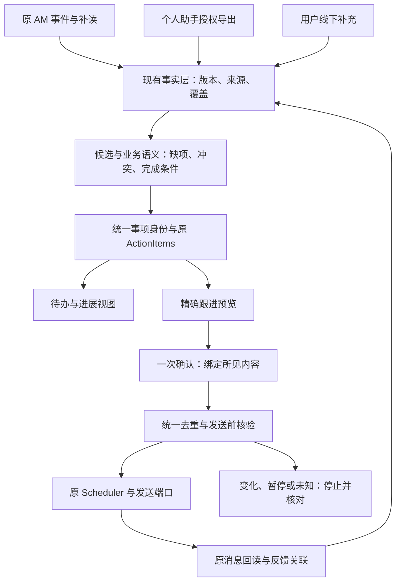
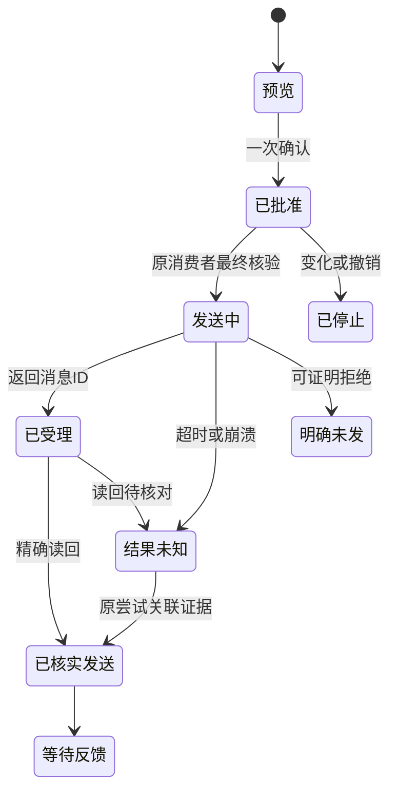

# AM 待办与项目进展融合架构

任务：AM-FOLLOWUP-20261102-01 / R1  
需求版本：v1.0-design  
日期：2026-11-02（Asia/Shanghai）  
状态：设计与隔离参考实现；原 AM 接入、真实 Qwen/飞书与业务验收待执行。

## 1. 结论与目标

采用“共享事实和事项身份，AM 统一执行已批准跟进”的方案。

个人助手继续从实际可读、已授权的信息中整理候选，保留线下输入。AM 沿用原信息层、ActionItems、Scheduler、ReminderService 和 BusinessPort。两者通过稳定事项身份、来源版本和统一跟进记录协作。不能仅让两边各建一个“相似待办”，再各自催一次。

最终用户体验是：看到可信的简短待办与进展 → 选择“让 AM 跟进” → 在一个预览内核对对象、正文、时间和次数 → 一次确认批准本次发送 → AM 发出并核对消息记录 → 后续反馈回到同一事项。查询、草拟和发送分别具有清楚的状态，但不向用户展开后台每个技术步骤。

本轮先完成单次精确批准。原 Scheduler 已有周期规则，下一阶段可复用其固定规则授权；本包不另实现周期发送器，也不把一次批准解释成循环授权。

## 2. 证据依据与当前边界

输入附件为《飞书信息监控与AM待办跟进融合评估_20261102(1).md》，重点采用第八至十三章；第一至七章用于校验读取边界和业务语义。没有读取附件内私聊的原始消息、飞书原件或额外附件。附件中的案例属于用户提供的当时观察，不是本轮重新核验的实时项目状态。

本轮定向实读审核提交 `9ef8076b32ecb5800c70a4f531fa2a859fb6c790` 的相关源码与记录。入口记载源码 `aab37396ea86b6e742eed79369583801664d1f35`；它是固定脱敏审核副本，不能当成用户本机当前工作树。

已读实现包括：

| 模块 | 实读能力 | 本轮处理 |
| --- | --- | --- |
| `am_info_sync` | 注册来源、Observation、版本、水位、缺口、重叠补读、候选事实、权限过滤 | 继续作为来源与事实层 |
| `ActionItems` | 事项、负责人、期限性质、反馈、暂停、核验关闭、版本 | 保留原 ID 和状态；增加语义附属记录 |
| `Scheduler` | 计划、批准、实例、静默窗、unknown、回读 | 保留唯一调度与发送实例 |
| `ReminderService` | 送达预览绑定、群和成员核验、版本批准、发送守卫、未知核对 | 继续复用群跟进 |
| `BusinessPort` | 群消息和主人私聊、结构化 @、原 SDK、回读 | 新增独立 `recipient_p2p` 目标 |
| 个人通知 | 事件/计划内去重、原 outbox、回执记录 | 接入跨生产者业务动作去重 |

现有 `received` 不关闭事项，`submitted` 不等于核验完成；已有良好约束保留。待补的是消息事实到具体事项/交付对象的映射，以及跨系统身份与外发依赖。

旧记录为 798 通过、27 失败、退出码 1；本轮没有重跑旧工程。27 项包括旧导航前置失配，也包含本人私聊、不可信 actor、禁写批准语义相关断言，不能简单称为“全部无关”。详见 `02_integration.md`。

已记录的原 Qwen、唯一消费者、600 秒查询身份、`ledger_write=false`、`response=legacy`、旧重写 off、`goal_tracking=false` 继续作为需要保留的已知基线。实现本功能不依赖启用未验收的通用目标跟踪或表达重写。

## 3. 产品视图

### 3.1 默认只展示三类信息

1. **需要你决定**：确实等用户回应、决策，或跟进发送待确认。
2. **AM 跟进中**：已经批准，正在等待发送、核对结果或等对方反馈。
3. **供你了解**：一般进展、材料到位、已消除风险等，可合并摘要。

每条默认显示项目/事项、最新可证明进展、下一步、责任人或缺项，以及来源核验时间。来源、完整历史、覆盖缺口和具体限制放在展开区。首屏不重复展示采集器名称、规则 ID、token、状态机内部枚举。

示例（合成，所有发送均尚待批准）：

> 测试准备｜样机已到仓，计划今天开测，实际是否开测待确认。  
> 建议：向已核实的测试负责人确认开测与阻碍。  
> [让 AM 跟进] [查看依据]

另一个示例：

> 发布｜稿件和版本已齐，尚未看到发布记录。  
> 建议：核实是否已发布；已发布则补记录。  
> [让 AM 跟进] [查看依据]

不能用“尚未看到”生成“肯定没做”，不能以已读/收到关闭执行事项。

### 3.2 一次确认到底确认什么

点击“让 AM 跟进”后展示：

| 字段 | 用户看到的内容 |
| --- | --- |
| 对象 | 确切人员与私聊，或确切群与 @ 人员 |
| 正文 | 将实际发出的完整内容 |
| 次数 | 本次 1 条；不自动追加另一渠道 |
| 时间 | 立即或清楚的计划时间；静默窗影响在此显示 |
| 后续 | 对方反馈后记录进展；未核实结果不会自动重发 |
| 限制 | 有业务意义时显示，例如不附原始受限文件 |
| 操作 | **确认并发送本次**、修改、暂不跟进 |

确认前可以改稿。改收件人、正文、附件、来源依赖或披露范围后，需生成新预览。批准后内容冻结，不再调用 LLM 改写。纯排版也默认走新 payload hash；暂不引入难以解释的“相似即等价批准”。

批量时每行是独立动作，可勾选，一次确认选中的行。结果必须逐行返回“已核对发送/等待时间/依据更新需重看/未执行/结果未知”，不能因为两条成功就称整个批次成功。

缺负责人、项目身份或确切会话时，只要求补充相应缺项。补充身份不等于批准发送。普通“收到/OK”不能被泛化成批准任意草稿；只有原 AM 已绑定的预览回复/按钮回调才能授予本次动作。

### 3.3 渠道选择

- 同一事项、同一跟进轮次、同一责任人，默认只选一个渠道。
- 群内同步适合多人共同知悉；需要个人补信息的事项可私聊，前提是精确身份和应用可达性已核实。
- 群消息中的 @ 人员不是全部受众；群内其他成员也能看到正文，必须按整个群的披露范围评估。
- 群里已催过再转私聊，或再扩大到领导/另一群，是新的升级决定，不能自动推导。
- 周期规则即便后续开放，也不自动换人、换群或升级渠道。

## 4. 总体架构

### 4.1 两种部署路径

**R1 最小接入：** 在 AM 原进程内增加语义/准入逻辑；调用原存储与服务，不另起机器人长连接、独立 scheduler 或并行网络发送器。个人助手按明确授权把最小候选/证据引用导入 AM，AM 返回同一事项 ID 和跟进状态。

**后续分布协作：** 个人助手与 AM 不在同一环境时，通过用户控制的、经身份验证的导入/查询接口提交候选。AM 是唯一跟进准入服务；不能假定云端助手可以直接访问 Studio 的 SQLite。接口不可达时保留“待同步”，不得本地另发同一跟进。传输身份、网络部署和凭据由原环境验证，包内没有假装已连通的 endpoint。

业务事项、读权限和写权限不因跨系统同步扩大。不要恢复已暂停的 dot-live；网页采集可以作为授权补充，但不是新 AM 常驻采集的默认实现。

### 4.2 唯一权威记录

- 来源原文/对象：原来源 + `am_info_sync`。
- 执行事项：原 `action_items.id`。
- 计划和发送实例：原 `reminder_plans` / `reminder_occurrences`。
- 回执：原发送尝试与真实 `message_id`。
- 新增准入信息：事项别名、证据依赖、披露策略版本、跨生产者注意对象占用、精确批准映射。

包内 `EvidenceLedger` 的 `ef_*` 表用于隔离运行领域规则；生产将规则映射到原 FactEngine/ActionItems，不并行维护第二套权威事项。`FollowupCoordinator` 表是准入/去重记录，不能成为绕开原 occurrence 的第二发件箱。

## 5. 从消息到准确待办

### 5.1 处理节点

1. 原宿主完成事件/会话鉴权，检查来源登记、时间范围和访问权限。
2. 正常化原始消息身份、来源版本、时间、附件引用及完整性。
3. 原 Qwen 可提取候选事实、请求、承诺、风险；精确引文必须存在，输出仍是候选。
4. 使用来源结构化映射、用户明确输入或可信业务审核确定可用字段。引文匹配不等于语义正确。
5. 匹配具体业务对象和动作，不仅按项目标题匹配。
6. 更新受支持的字段；冲突并列；没有依据的字段保留未知。
7. 按完成条件生成/更新事项与简短视图。
8. 仅对新请求、重要变化、决策和已配置提醒窗口建立跟进建议。

无需让用户逐条手工确认所有原始消息：可信结构化来源可按明确字段映射更新；低风险普通进展可表述为“对方报告”。负责人、对象、业务完成、外发限制等高影响推断不允许仅靠模型自信度升级为事实。用户本次选择并确认具体问询，可形成经过审核的动作。

### 5.2 事实维度与完成条件

| 维度 | 示例状态 | 典型依据 |
| --- | --- | --- |
| 执行 | 未知、计划中、进行中、受阻、完成、取消 | 实际执行反馈/记录 |
| 回应 | 无需回应、待回应、已回应 | 绑定到原请求的收到/OK/回复 |
| 交付 | 待交付、已交付 | 该事项约定的具体交付对象 |
| 验收 | 不适用、待验收、通过、未通过 | 原 verifier 与规定依据 |
| 上下文进展 | 方案已发、样机到仓、发布材料齐备 | 相关材料或事件，不直接关闭执行事项 |

交付必须绑定对象。测试方案已交付，不能把“确认开测”事项标成 submitted；应记录 `plan_delivery`，开测仍待确认。多个工程师/专业成果仍保持独立对象和审核责任。

审批通过时，撤除旧“待提审”行动，审批对象保持通过；关闭原因是“旧动作已满足/过时”，不是“审批撤回”，也不是项目结项。

完成不能只由 `state=done` 一字段决定。最少记录完成规则、执行依据、若要求验收则验收依据/核验人。取消、暂停、用户知悉分别处理。模型与普通收到回执不能调用关闭业务接口。

### 5.3 项目进展回答

默认回答“当前阶段 → 最近明确进展 → 尚待核实/阻塞 → 下一步与责任人”。只显示有证据的日期，统一 YYYY-MM-DD。没有可计算的正式 WBS 分母/权重就不输出百分比；测试计划和实际日期分开。

查询优先读当前受权限过滤的投影，不每次扫描所有会话或调用 LLM。每个字段保留来源、来源时间、核验时间、authority、未确认/冲突/过期标志。

旧事实仍可展示为“截至某时已确认”；当前读取故障时明确提示新增变化未核实。局部失败只影响依赖该范围的结论与发送，不能清空全局待办，也不能用其他页面成功声明恢复。

## 6. 时间、覆盖、权限与依赖

### 6.1 四类时间

计划触发、实际采集、来源消息时间、正文业务时间分别保存。内部存带时区的 ISO/UTC 或原规范的 Unix ms；跨模块 adapter 明确单位，不混用秒和毫秒。展示使用 Asia/Shanghai。

页面 GMT+9 的来源时间可转换到北京时间；正文“10点前”保留原文，只有业务日期和时区已知才形成准确期限。`deadline_kind` 区分 requirement、commitment、estimate、check、unspecified。系统拟定的“下次检查时间”不能变成工程师已承诺的截止时间。

原 9:00/14:00 本人提醒、P1 半天节奏和18点后延至工作日上午的偏好可以继承到个人通知；不能据此给工程师默认同样的自动催办频率。公司工作日由原 Calendar 的经核验版本驱动，不能只用星期一至五替代。

### 6.2 读取覆盖

覆盖键至少包含 producer、source_type、scope_id。消息、日历、网页、CLI补读和不同会话各自记录。失败/跳过不推进水位；部分成功只推进能证明完整的独立子范围。原观察入库和相应水位尽量同一事务；不要把墙上时钟当水位。

使用近期重叠读取与原始消息 ID 去重。相同文本不等同一消息；同 ID 编辑是新版本。无可靠 ID 的网页记录保留 provisional 标记和稳定导入号，不声称 ID 级完整去重，不直接外发。

历史缺口使用显式 gap，恢复某页面不自动关 gap。关闭缺口需对应补读范围与证明。发送前仅核对该事项必要依赖和范围；单个无关旧缺口不应无限阻塞所有工作。

### 6.3 三种独立许可

1. 可以读取哪些源。
2. 可以把哪些字段/原件向哪些人或群披露。
3. 用户批准当前哪一次动作。

`Source.readers` 是读取范围，`output_chats` 是原回答目标边界；不等同附件级、字段级、用途级的完整外发授权。工程师跟进需要新增披露规则版本；“读得到”不能推出“发得出”。

原文件禁止外发时，即使出现新的测试概述，也不能推断原限制解除。可先对适当内部负责人询问正式可对外版本；不能附原件，不能在没有明确外部许可时转给合作方。

R1 参考证据检查对混合私人来源采取保守限制。需要将某个安全问询导出时，由可信原系统形成经审核的披露投影并保留来源依赖，再批准发送；不要删除私密依赖、伪造 public 标志来绕过检查。本包不声称实现任意文本自动脱密。

### 6.4 精确失效范围

批准绑定：tenant/app/owner、canonical task、task version、来源对象及内容版本、ACL版本、外发策略版本、目录/群成员快照、正文 hash、渠道和目标集合、允许时间、次数与停止条件。

任何依赖发生业务含义变化，旧批准停止。负责人变更、撤回、完成、取消、来源冲突、权限收紧、目标群成员/可达性变化都需重核。新的无关消息不必全局取消所有批准；依赖图定位受影响动作。

`EvidenceBridge` 同时校验持久本地快照和可信实时 attestation；默认没有“全通过”生产 gate。刚生成本地快照不证明飞书仍新鲜；实时接口失败或策略版本变化会阻止发送。模块自带 HMAC 防内容被换，不替代原 SDK 回调验证、账户身份与实际预览送达绑定。

## 7. 避免两套系统重复催办

### 7.1 稳定事项身份

推荐 `tenant + project_ref + business_object_id + action_code + cycle_id` 确定 canonical task。标题、LLM文案和联系人显示名不参与身份判定。缺字段时保留候选，不能用“未知项目”占位调用旧 ActionItems.create。

个人助手 legacy_id、原消息对象和原 action_items.id 作为 alias 映射到同一 canonical task。相似文本只能生成待合并建议；人工确认映射后才合并。重名、不同批次测试和同项目不同交付物不能自动并成一项。

### 7.2 三层去重

1. **来源层**：原消息/对象身份 + 版本。
2. **业务动作层**：canonical task + purpose + 经后端确认的跟进 episode + 每个实际注意对象。
3. **网络尝试层**：固定原 occurrence/request UUID + 已核实消息 ID。

业务动作键不含草稿 hash、plan_id、producer 或渠道。重新措辞、另一系统建计划、由群切私聊，不能制造一个“新动作”。多人群消息对每位 @ 人员分别占用注意对象键，避免拆成私聊后再次询问同一个人。

episode 来自已验证的新请求、明确提醒时窗或人工升级操作，不允许模型随机生成。跨 episode 还有未决发送屏障：同事项/同人存在 sending、unknown 或已受理未核实，下一轮也不能再次发送。

### 7.3 主发送者与切换

迁移前建立完整映射清单：事项、当前跟进者、最后实际发送、未知尝试、原计划与下一时窗。已发送记录和 unknown 先导入/绑定；没有历史 ID 的提醒标 legacy_unknown，核实前保守阻断同一动作。

交接顺序：停止旧执行端对选定事项的新发送 → 核实未决动作 → 为同一事项转移准入归属/世代 → AM启用 → 两边查询统一状态。恢复旧端也按同样步骤，不能删除新表或换UUID当成回滚。

如果个人助手暂时接不上统一登记服务，允许它继续生成本地候选，但该范围保持单一发送责任。只有双方都遵守同一登记入口，才能声称跨系统去重已落实。

## 8. 发送与故障语义

发送成功、消息被读、对方回应、事情完成是四种状态。回执只说“已发出并核对消息记录”；不伪称对方已读或已完成。

外部发送与SQLite事务无法天然原子化。先保存准入/claim，再进入原发送边界，最后持久回执；任何不确定都留 unknown，由原尝试只读核对。没有匹配消息不证明没发；超出平台去重窗口也不能以新UUID重发。

暂停/撤销：未进入发送边界的动作停止；已进入请求过程的动作标明进行中、尽力阻止后续步骤，并返回真实回执。不能承诺撤销恰好抢在网络请求前，也不能说已送达消息自动撤回。恢复需要新预览，原批准不复活。

旧 `BusinessPort.send` 会调用原 guard 两次。**新 `before_send` 是一次性边界，只能在最后一次原 guard 通过后、实际 SDK create 调用前执行一次。不能直接把它塞进原可重复 guard。**

## 9. 自然表达与性能

准确数据先确定，再生成简短问题。常用跟进语句不需要每次额外调一次模型。

本包的 `rendering.py` 支持六类有限问询：确认开测、确认发布、确认可对外版本、收集估时、核实执行条件、一般进展。可选Qwen调用只在确认前选择允许引用的事实ID和语气。输入只含该收件人可见信息；输出不能选择对象、添期限、加附件、批准发送。

未实现任意自由文本语义验证，不把有限模板称作“完全拟人化”。后续自由稿件需评测否定、承诺强度、日期、范围和动作保真，并在批准前完成。发送中不做新改写；原R2仍关闭。

优化顺序：事件触发增量提取 → 已核实投影供查询 → 有变化再草拟 → 预览前按需补读依赖 → 批准后使用冻结内容。不要每次点击读全台账/所有会话/多次调用Qwen。

需要分别测量查询耗时、草拟耗时、预览送达、确认受理、实际发出与回读；异步“收到请求”不能算跟进完成。性能目标是本轮建议待实测，不沿用3秒目标宣称通过。

## 10. 代码与实现范围

| 文件 | 已实现 | 原环境还需做 |
| --- | --- | --- |
| `evidence.py` | 版本、冲突、原文span、候选/接受、四维语义、对象绑定、水位、缺口、受审恢复 | 映射原FactEngine/ActionItems与可信Qwen/结构化提取 |
| `identity.py` | canonical身份、持久alias、跨租户与改绑阻断 | 导入原真实事项及双方历史 |
| `rendering.py` | 有限可读草稿、披露筛选、严格模型选择契约、结构化@ | 原Qwen Provider接线、真人措辞验收 |
| `followup.py` | 持久精确批准、跨生产者/渠道去重、跨轮unknown屏障、暂停/撤销、回读契约 | 同原事务/occurrence及最终send guard串接 |
| `bridges.py` | 持久证据绑定、服务端覆盖依赖、完整正文/目标绑定、live政策版检查 | 实时来源与披露 attestor |
| `confirmation.py` | 复用实际预览回读、回调对象/选中行/清单绑定、一次批量批准 | 原SDK验证及真实卡片/会话delivered记录reader |
| `transport_contract.py` | group与recipient_p2p请求封装、目录pin、精确消息回读归一化检查 | BusinessPort新p2p分支、原SDK与真实记录 |
| tests/demo | 合成单元、并发、故障与跨模块运行 | 真实Qwen、飞书、手机、独立人和业务验收 |

所有运行时代码只使用Python标准库，没有引入新LLM框架、Web服务器、外部队列或网络客户端。`pyproject.toml` 的 setuptools 仅用于可选安装；直接 `PYTHONPATH=src` 即可运行。

## 11. 实施阶段与验收

1. **接入前定向核验**：记录原实际版本/功能开关/身份权限/27失败影响。既有有效改动保留。
2. **只读影子**：候选与人工事实对照；评估错误完成、错人、错日期、漏待办与缺口误报。
3. **本人预览**：待办、修改、单次/批量确认、暂停和unknown真实闭环；不会因生成预览触发外发。
4. **限定跟进**：已明确对象的一次群@、一次工程师私聊，读回真实ID；重复确认、双渠道与故障复现。
5. **业务验收后扩展**：决定是否开启有界周期和更多来源。既有一次批准不能充当该授权。

建议首轮金标准至少50个消息片段/多轮情景，覆盖附件七类语义、正常/反例/失败；这个数量是建议设计，不是用户已同意的硬验收门槛。需要同时报告适用样本、可判断样本、正确数、缺项保留数和不可判定数。不得把全拒绝当准确率100%，也不得把投影/回退记作自由表达成功。

发送类硬不变量在指定验收集上必须零违规：未批准不发、错对象不发、受限原件不外发、旧批准不换内容、unknown不盲重发、收到不完成。事实抽取的召回/精确率、可执行覆盖率与人工用时应一起报告。样本结果不能保证生产永无错误。

完整可执行验收清单见 `03_acceptance.md`。GPT本轮测试只证明所交付参考代码在合成场景中的行为；任何数字都不能替代原AM和飞书的真实验收。

## 12. 官方平台依据

截至本轮查阅的公开官方资料：

- [消息事件与API概述](https://open.feishu.cn/document/uAjLw4CM/ukTMukTMukTM/reference/im-v1)：接收/已读/撤回事件属于不同事件。
- [接收消息](https://open.larkenterprise.com/document/uAjLw4CM/ukTMukTMukTM/reference/im-v1/message/events/receive)：应用接收的单聊指发给机器人的消息，群消息取决于实际权限；消息去重应使用message_id，不能只依靠event_id。
- [获取会话历史消息](https://open.feishu.cn/document/uAjLw4CM/ukTMukTMukTM/reference/im-v1/message/list)：权限、所在群、历史可见性与保密模式会影响可读范围。
- [官方SDK CreateMessageReqBody](https://larksuite.github.io/oapi-sdk-java/com/lark/oapi/service/im/v1/model/CreateMessageReqBody.Builder.html)：相同uuid的去重有时间边界；不能代替永久业务去重和unknown核对。
- [发送内容结构](https://open.feishu.cn/document/server-docs/im-v1/message-content-description/create_json?lang=zh-CN)：富文本与结构化@构造参考。

部分开放平台页面动态渲染，本轮依据官方检索摘录、SDK文档和已读AM代码交叉判断。旧SDK文档的窗口约定是设计依据，Codex仍须核验原实际SDK/当前API及权限；不能声称官方文档说明了本应用当前已获全部权限。未把第三方博客作为技术能力证明。

