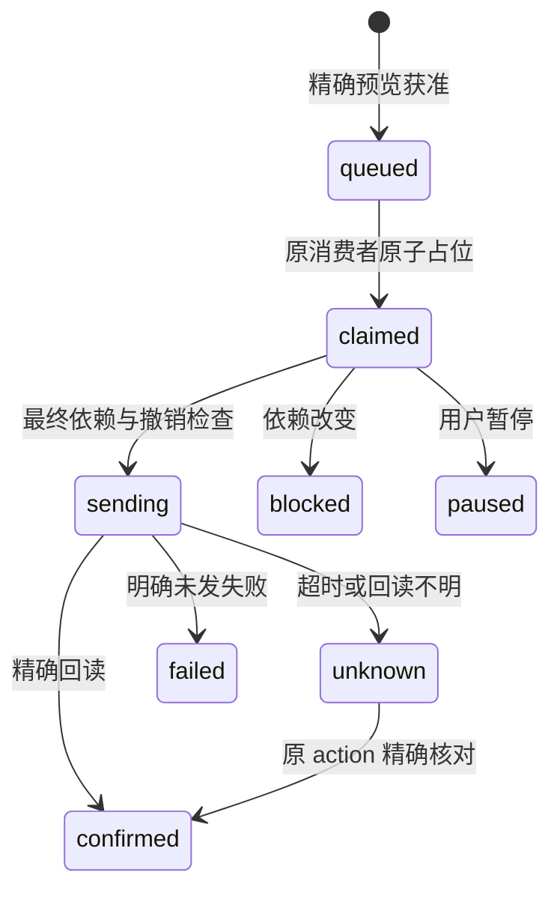

# 跟进编排核心接口与接入边界

任务：`AM-FOLLOWUP-20261102-01 / R1`。本文件说明 `src/am_followup/followup.py` 的实际代码。它是可运行的**单次跟进准入与执行意图登记簿**，没有网络客户端、后台消费循环、定时任务或真实飞书权限。它不代替原 AM `ReminderService`、`Scheduler`、`ActionItems`。

## 1. 接入位置

原 AM 获取信息并产生候选事项 → 既有项目/ActionItem 身份归一 → 证据和披露边界核验 → 本模块预览与本次批准 → 原 AM 唯一消费者取到意图 → 原发送服务按既有草稿、授权、消息回读逻辑执行 → 精确回执写入本模块。

原发送服务继续负责实际调用飞书。个人助手、原 `Scheduler` 和新待办入口必须共用这个登记簿（或把其同等唯一约束迁入原 AM 数据库），否则只会实现新模块自己的去重，不能声称旧路径与新路径已经统一。不要同时启动“新 follow-up worker”和旧 Scheduler 各自发送；`dispatch_once` 必须由原唯一消费者调用。

**部署前仍需补齐的实际桥接：**

1. 原签名回调、租户、600 秒身份语义与固定 owner 校验生成 `Actor`；前端传入的 `owner_id` 或 `verified=true` 不是身份依据。
2. `Preview` 必须实际发给该 owner，并把原 AM 的 `preview_message_id`、`card_id`、草稿 revision/content hash 与本模块 `preview_id/content_hash` 关联。只有来自对应已展示卡片的本人回调才调用 `approve`。本模块 token 证明快照未变，**不证明用户已看到预览**。
3. 原 `ReminderService`/`BusinessPort` 中新增 `recipient_p2p` 的独立精确路由。旧 `owner` 含义保持“配置的所有者本人”，不能把它泛化成任意工程师私聊。
4. 原通知、原调度和个人助手提案都使用同一 canonical task、episode 和关注对象 ID。迁移时先停旧执行入口的发送权，再切入登记簿；保留旧消息 ID 与未决 `unknown` 记录。
5. 真实适配器在原 provider 网络调用前调用本模块 `before_send`，同时保留旧版本/取消/权限 guard。不能创建一个稍后绕过 guard 的后台发送。

## 2. 实际数据类型

| 类型 | 关键字段与用途 |
| --- | --- |
| `Actor` | `tenant_id/user_id/session_id/expires_at`。由已验证的原宿主产生；模块再次检查配置 owner、租户和有效期。 |
| `Target` | `kind=owner/recipient_p2p/group`、精确目标 ID、`attention_ids`、群 `mention_ids`、目录版本与有效期。R1 仅支持内部对象，拒绝 `@all`。 |
| `EvidenceSnapshot` | 每项来源版本、对应 ACL 版本、任务版本、批准披露范围。键集合必须完整，不接受只有正文没有来源。 |
| `SendWindow` | UTC `not_before/expires_at`、业务时区、明确工作日期、时段、日历版本；默认北京时间 09:00—18:00。日期必须来自受信任日历或明确选择，不由 LLM 判断法定工作日。 |
| `Draft` | canonical task、purpose、episode、精确正文、Target、EvidenceSnapshot、SendWindow、producer；R1 固定 `send_followup`，无附件外发能力。 |
| `Preview` | 单次精确草稿、内容 hash、随机预览 ID、有期限的 HMAC token；默认有效 600 秒，上限 1800 秒。 |
| `DispatchRequest` | 不变正文及目标、授权 hash、稳定 `request_uuid`、意图 ID、generation。供原 AM 发送适配器使用。 |
| `ReadbackEvidence` | 精确请求/action/消息映射、目标、正文 SHA256、@对象、回读证据 ID、观察时间；不能用同文搜索替代。 |

正文与 @对象分开。正文中显式 `<at...>` / `<mention...>` 被拒绝，真正的群 @ 必须由原 AM 适配器从核实过的 ID 生成。R1 不支持附件、外部合作方、无限周期授权、自动升级到其他群、自动修改台账。

冻结 dataclass 并不是跨信任边界的认证机制。`EvidenceGate`、`RecipientGate`、`Actor` 和 `ReadbackEvidence` 的生产者必须是原后端可信适配器；演示中的恒真 gate 只能用于隔离测试。

## 3. 稳定业务身份与两层去重

### 3.1 新消息、旧待办与提醒窗口

```python
episode_id = coordinator.register_episode(
    tenant_id="tenant_demo",
    task_id="canonical_task_demo",
    purpose="request_update",
    trigger_key="verified_request:source_event_demo",
)
```

`register_episode` 仅供后端调用。`trigger_key` 必须是核实的新请求/新事件，或原 Scheduler 明确获准的提醒窗口。不能用模型生成的随机数、草稿版本、重新措辞或单纯来源采集时间制造新 episode。支持的 purpose 为 `request_update/request_decision/request_deliverable/owner_notice`；分类仍应由受控业务规则确定。

### 3.2 同一轮次的长期去重

`followup_attention` 唯一键：

```text
tenant + canonical_task + purpose + episode + attention_person
```

键中没有 producer、计划版本、正文版本、来源版本和通道。个人助手与 AM 重复建草稿、同人从群 @ 改为私聊，均会占用同一注意键。多人群消息必须一次占齐所有人的键；若有人已被跟进，不擅自删除这个人后发送余下内容，而是返回整条未发结果。

`already_reserved` 的含义是“这条新预览没有发送，也没有替换先前正文”，绝不能显示成“新内容已发送”。用户重复点击**同一个**已批准 token 返回原意图，不续期、不生成第二次发送。

### 3.3 跨轮次的不确定结果屏障

仅有 episode 去重还不够：旧发送结果未知时，新提醒窗口可能再次发送。因此代码另有 `followup_delivery_barriers`：

```text
tenant + canonical_task + purpose + attention_person
```

原子 claim 时占用这组键；`claimed/sending/unknown` 期间跨 episode、跨群/私聊都不能再发。审批时先查，dispatch 再查，因此即使两个新旧 episode 都提前排队，也不能同时发送。精确回读确认、明确未发送的失败，或确定未过发送边界的阻止，才解除这层屏障。普通超时、进程重启、重复启动和日期跨天均不解除它。

同一 episode 的长期键仍保留；解除不确定屏障不等于允许重发原轮次。

## 4. 核心方法

构造器：

```python
coordinator = FollowupCoordinator(
    db_path,
    signing_key=secret_bytes_at_least_32,
    owner_ids={tenant_id: verified_owner_id},
    evidence_gate=current_evidence_gate,
    recipient_gate=current_recipient_gate,
)
```

`signing_key` 从原宿主密钥配置读取，不写入代码或 GitHub；数据库路径必须是持久化文件，拒绝 `:memory:`。原数据库迁移由 Codex 对照现有 schema 实施。表名均加 `followup_` 前缀；若采用独立 SQLite 文件，不宣称与原 AM 数据库已形成一个事务。

| 方法 | 行为 |
| --- | --- |
| `create_preview(actor, draft)` | 复制可变输入，检查数据、身份、episode、来源及对象；保存不可变精确预览。无外发。 |
| `approve(actor, preview_id, token, displayed_hash)` | 核验身份、HMAC、精确内容、期限及当前依赖；在同一 SQLite 事务消费批准并登记一次意图/注意键。 |
| `approve_batch(actor, requests)` | 最多 50 条，逐行原子批准，逐行返回成功或错误；不把部分成功说成全部成功。 |
| `dispatch_once(tenant, intent, sender, worker_id=...)` | 原消费者调用。原子 claim，检查跨轮次屏障，原端口在真实发送前再次 guard。 |
| `pause(actor, intent)` / `revoke(...)` | 未发送可停止并 fence 旧 claim；发送中/未知返回 `in_flight_not_recalled`，已送达保留历史事实。 |
| `recover_in_flight(tenant, old_worker_id)` | 把旧 worker 的 claimed/sending 标 unknown，并增加 generation；不自动重试、不续租回收成 queued。 |
| `reconcile(tenant, intent, readback)` | 仅供原 AM 精确回读回调；校验请求、action、消息、对象、正文与 @，unknown → confirmed。无重发。 |
| `get_intent(actor, intent)` / `audit(actor, object)` | 按 owner+tenant 读状态及最小审计事件。审计不复制原私聊全文。 |

`supersedes_intent_id` 仅允许一次**明确批准**替换尚未越过发送边界、未被 consumer claim、注意对象集合完全相同的旧意图。旧意图记 `superseded`，历史保留。`unknown`、sending、confirmed 不能用替换创建一个可再发的新意图。新对象/新用途需要明确新范围；R1 不偷偷扩大原批准。

## 5. 原发送服务端口

```python
class ExistingAMSender(Protocol):
    def dispatch(
        self,
        request: DispatchRequest,
        before_send: Callable[[], None],
    ) -> SendOutcome: ...
```

实现顺序必须是：

1. 将 `request.intent_id/request_uuid` 原子关联到原 AM 的持久化 action；重复关联取同一个 action，不另建一条。
2. 复用原精确草稿和授权机制；正文、对象、群 @ 集合必须与预览一致，不能在批准后再让 LLM 改写。
3. 原 provider 调用前执行 `before_send()` 以及旧取消/权限 guard。该 guard 重新读取来源与 ACL、任务版本、目录、授权期限、静默时间，原子检查未撤销并标记 `sending`。
4. 用原 AM 网络发送能力发送一次。原客户端如支持平台幂等 uuid，映射同一个稳定值；若不支持，真实验收记录该限制，不能声称端到端 exactly-once。
5. 只有发送响应关联到的消息 ID 或原 action 明确关联的消息 ID，经平台回读确认目标、正文、@集合后，才能返回 `confirmed`。
6. 网络异常、仅返回 accepted、回读缺失/不符、适配器没有执行最终 guard，均保持 `unknown`。原服务负责核对，不能根据“未收到成功响应”重发。

原 `BusinessPort.send` 已会调用旧 guard 两次。**保留这两次旧检查，不要直接用本模块的一次性 `before_send` 替换或无条件组合旧 guard。** 应在最后一次旧 guard 通过后、SDK create 之前，单独调用本模块 hook 一次；重复调用会被 `send_guard_already_used` 拒绝，并把已越边界的结果保守记为 unknown。

`ReadbackEvidence.correlation` 只接受 `send_response_message_id` / `existing_am_action`。这些字符串本身也不是证明：宿主必须保留 `source_record_id` 所引用的精确回读记录与映射证据。本模块不联网核验一份 Python 对象的真实性。

R1 没有“扫描最近消息同文即判已发”、没有“未知一定时间后重试”、没有“未找到即未发”。对无法唯一关联的 unknown，只给用户状态与核对入口。

## 6. 状态与撤销的准确含义



`queued` 尚未到批准时间或静默窗外时保持排队；超过绝对授权期限则 blocked。静默逻辑不自动制造第二天授权；有效期不足时重新预览批准。周期性后续跟进应后续在原 Scheduler 上单独设计有限授权，本 R1 没有开放。

发送线性化点是最终 guard 持久化 `sending` 的事务提交。此前 pause/revoke 会阻止操作并 fence 旧 claim；此后已有外部调用可能开始，不能声称完全撤回。撤销结果会区分 `unsent_stopped`、`in_flight_not_recalled`、`historical_only`。

## 7. 已覆盖的隔离验证与限制

`tests/test_followup.py` 使用临时 SQLite、模拟时钟和内存 sender，覆盖精确授权、不同 owner/tenant、token 变化/过期、来源和 ACL 变更、已完成任务、收件人失效、原 owner 通道不可误作工程师私聊、双 producer、群与私聊重叠、跨 episode unknown 屏障、多人群不能部分发送、两连接批准、两个 consumer 并发、重启 fencing、超时、精确回读、撤销竞争、工作日/静默时间与逐行批量结果。

这些不是飞书实测，不证明已启用到真实原 AM。真实环境必须验证：原卡片展示与回调身份、平台权限、实际群 @、工程师私聊可达性、旧发送接口是否支持稳定 uuid、真实 readback 解析、源事件及时性、跨数据库崩溃恢复及旧路径是否全部接入共享登记簿。

来源事实库、该登记簿、原 action 库和飞书是不同事务边界。R1 通过版本快照、最后 guard、稳定 action 映射与 unknown 屏障减少竞态，无法保证网络外部副作用与所有数据库原子提交。源编辑事件晚到、权限变更晚到、平台响应丢失仍需真实故障验收与明确展示“待核对”。

本模块不内置加密、保留期清理、数据库备份、主从部署或多节点 PostgreSQL 锁；宿主需沿用现有受限目录与数据管理机制。不能把临时测试库直接当生产数据库迁移方案。

