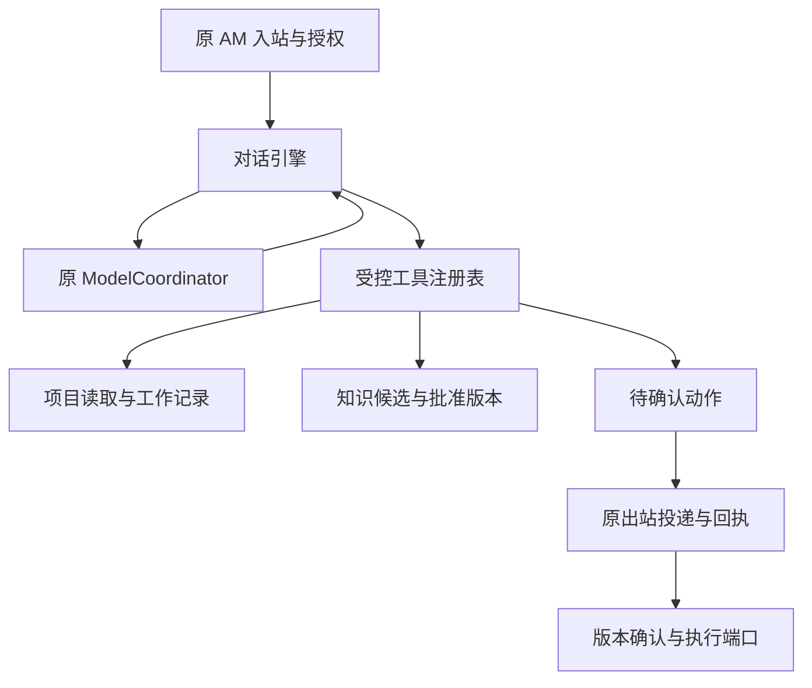
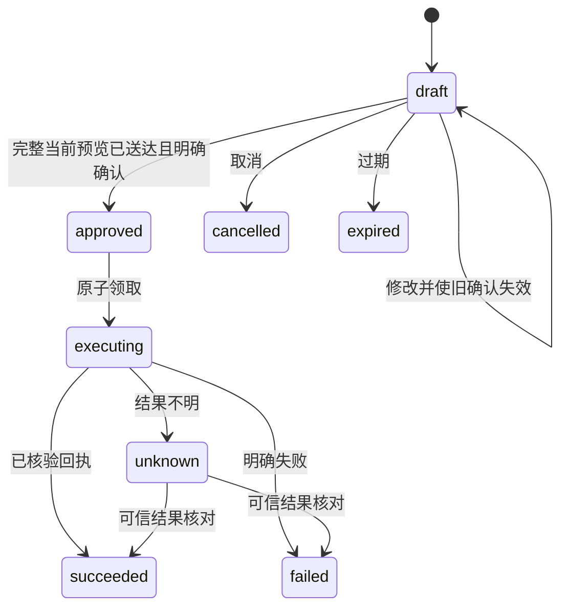

# AM 对话工作代理架构 · R1

## 目标与设计选择

目标是让他人在日常工作范围内，能用自然语言与 AM 交流项目事实、补充进展、确认下一步，并获得接近所有者处理方式的回应。语气模仿只是其中一项；真正需要持续积累的是工作原则、判断案例、公司业务与准确的当前状态。

R1 将这些能力落到现有 Python AM 工程：保留单一飞书入站、原有权限检查、单一模型协调器和原出站队列，新增对话、知识与事务状态模块。现有模型是否达到所需理解水平，必须用真实运行结果判断，不能由框架设计替代。



图中的实际外部执行端口在 R1 生产适配器内尚未绑定；完整协议通过合成端口验证。

## 模块分工

| 模块 | 职责 | 不承担的职责 |
|---|---|---|
| `types.py` | 可信身份、授权项目、模型与回复类型 | 从模型文本推断真实身份 |
| `model.py` | 严格 JSON 协议、工具 schema 验证、原协调器调用、字符预算 | 直接访问业务系统或创建新模型 provider |
| `engine.py` | 上下文编排、有界工具循环、确认/取消、事件重放、回复检查 | 直接改台账或自行发消息 |
| `prompts.py` | 版本化行为指引与工作原则草案 | 假定已了解全部公司规则和个人习惯 |
| `store.py` | 对话、焦点、工作笔记、事件、待执行动作的 SQLite 持久化 | 替代正式项目系统 |
| `knowledge.py` | 可见性、候选、批准、修订、检索与来源 | 根据单次聊天自动修改模型参数 |
| `learning.py` | JSONL 导入、稳定键、逐行事务、dry-run | 接受知识文件定义角色/身份/权限 |
| `tools.py` | 受信工具注册、参数校验、读取/本地记录/外部执行分类 | 相信模型自称“我有权限” |
| `legacy.py` | 对接原 AM 授权、项目快照、跟进事项、出站与回执 | 启动第二个消费者、发送器或调度器 |
| `metrics.py` | 不含正文的分段耗时 | 证明飞书客户端完整端到端体验 |
| `evaluation.py` | 合成场景调用真实模型、记录自动检查与人工标准 | 自动宣称符合所有者判断 |

## 一次普通对话如何执行

1. 原服务接受飞书私聊文字，取得可信的 tenant、app、actor、chat、thread 和原项目查询权限。
2. 新入口建立 `AccessContext`。身份、管理人身份与项目权限只来自服务器配置与授权结果，模型无法指定。
3. 引擎先领取事件。同一事件同一内容的完成结果可重放，不重复调用模型或重复做动作；内容或范围冲突被拒绝。
4. 读取当前范围内的项目焦点、开放工作笔记、批准知识和有限历史。没有明确焦点时，不自动把多个项目专属知识混进首次提示。
5. 调用原 `ModelCoordinator.complete`，要求严格的回答或工具调用 JSON。模型不能直接执行任何函数。
6. 主程序校验工具名、参数、权限、项目范围和轮数限制后执行。模型输出的身份字段、未知工具或多余参数会被拒绝。
7. 回复和状态持久保存，由原出站通道投递。真实投递记录与对应事件、正文、权限范围绑定，才用于“预览已经送达”的确认。

上下文保留完整消息、完整来源和限定条件；超出预算时明确要求缩小问题范围，不把关键事实切成半句。模型适配器还校验整体输入、输出及工具 schema 长度。

## 模型协议与接入理由

原模型封装的 `.chat()` 路径包含无工具场景约束，所以本包调用既有协调器 `.complete()`，使用受约束 JSON 传递工具提议。宿主程序负责实际工具执行。模型底层仍使用原本的 Qwen 调用和协调器，并保留其忙碌、暂停、停止结果不明等错误语义。

每轮返回二选一：

```json
{"type":"answer","text":"报告还在汇总，预计日期尚未转为确认承诺。"}
```

```json
{"type":"tool_calls","tool_calls":[{"id":"c1","name":"read_project","arguments":{"project_id":"p17"}}]}
```

不会接受混合回答与调用、未知字段、重复 JSON 键、重复调用编号、NaN、围栏或额外 JSON 文本。`ScriptedModel` 只用于协议和状态测试。

## 状态分层

### 1. 项目当前事实

通过原 `query_projects` / 项目端口读取。项目名称、原字段、快照版本、观察时间、stale/刷新失败信息随结果保留。旧聊天和用户口述不能自动变成正式计划或验收结论。

### 2. 会话与工作笔记

SQLite 按 tenant/app/actor/chat/thread 隔离。当前授权指纹与历史内容绑定，授权变化后不借旧历史泄露已不可见的资料。项目焦点跨重启保存，撤权后不返回旧焦点。

工作笔记有项目、标题、细节、绝对日期、状态和版本；支持两个项目分别跟进、暂停、关闭和取消。日期必须包含时区，模型必须先完成自然日期解析，信息不足时追问。

这些记录可帮助跨天接话，但尚未接成正式 `action_items` 或提醒调度；创建笔记不能表示已经通知负责人。

### 3. 知识与判断案例

知识种类为 business、rule、fact、case、style。适用范围为 tenant、project、private。每条记录有来源、观察时间、逻辑键、不可变版本与状态。

只有批准的活跃版本进入日常检索。新候选不覆盖现行规则；批准新版本后旧版本变为 superseded。管理人身份也不会突破私有会话边界。后续用真实案例逐步补充“背景—判断—行动—结果—适用边界”，比仅添加口头禅更有价值。

### 4. 待执行动作



动作包含完整参数、预览、版本、摘要、有效期和执行结果。模型只能提出动作或修改草稿；“确认执行”等控制语句由服务端识别。多个待处理动作不能凭一句“发吧”猜对象。

宿主必须在原出站确认成功后调用 `acknowledge_presentation`，且正文、动作编号、当前版本和完整预览一致。旧版本被修改后需要重新展示。执行使用稳定动作 ID 作为端口幂等键。成功结果须含 `verified=true` 和可核验的 `receipt_id`；未核清的结果不会自动重发。

R1 的动作协议和合成通知端口可运行；`LegacyConversationBridge` 明确拒绝启用尚未绑定的真实外部执行。

## 权限和原系统约束

- 原 `flags.query` 关闭时不能通过对话入口绕过。
- 原普通私聊查询继续遵守 600 秒身份缓存规则；新增管理或执行操作通过原管理身份检查。
- 读取、工具执行和发送保留原项目范围约束；同事只能读取其授权项目与本人被指派的跟进事项。
- `ledger_write=false` 不被修改；知识导入或对话记录不能改变该开关。
- 原 `/project` 等命令、卡片、附件和群聊没有被新路径接管。后续迁移时需要保持原能力并补足群内受众范围判定。
- 新增存储位于原服务根目录 `state/am-conversation-r1/`，主数据库文件使用仅用户可读写的权限。

## 可观测性与评价

`JsonlMetrics` 只记录 event_id、阶段与秒数；legacy 适配器接入原 request_timing。服务端 model/tool 的 p50/p95 有助于定位慢在哪里，不能替代“消息进入飞书到用户看到完整回答”的时间。

自动验证重点是隔离、状态变化、幂等、修订确认、回执、失败与恢复。模型评估另行检查：

- 是否查了应查的项目事实；是否保留“首批/预计/待批准”等限定。
- 是否只追问影响下一步的信息；是否记住了上一轮已经给出的内容。
- 对延期、依赖、责任与验收是否作出符合用户原则的判断。
- 回复是否自然简洁；遇到证据不足是否准确说明。
- 对同一场景，用户修改后的回复与行动能否形成新的待审案例。

当前措辞检查只覆盖部分“未执行却声称执行”的表达，合法改写可能被保守阻止。其局限已写入 review 测试，真实模型评价时应保留原回复与命中原因，再决定更好的事实校验方式。

## 后续演进顺序

先完成当前 Studio 的增量合并和真实 Qwen 合成场景评价；再绑定原跟进/发送/提醒业务端口；随后逐项迁移旧卡片能力，并补自然语言反馈晋升、附件教学、群聊受众、知识审阅和延迟优化。语气和判断调优依据真实修改案例进行。没有质量证据前，不把“像本人”的目标写成已达成结果。
