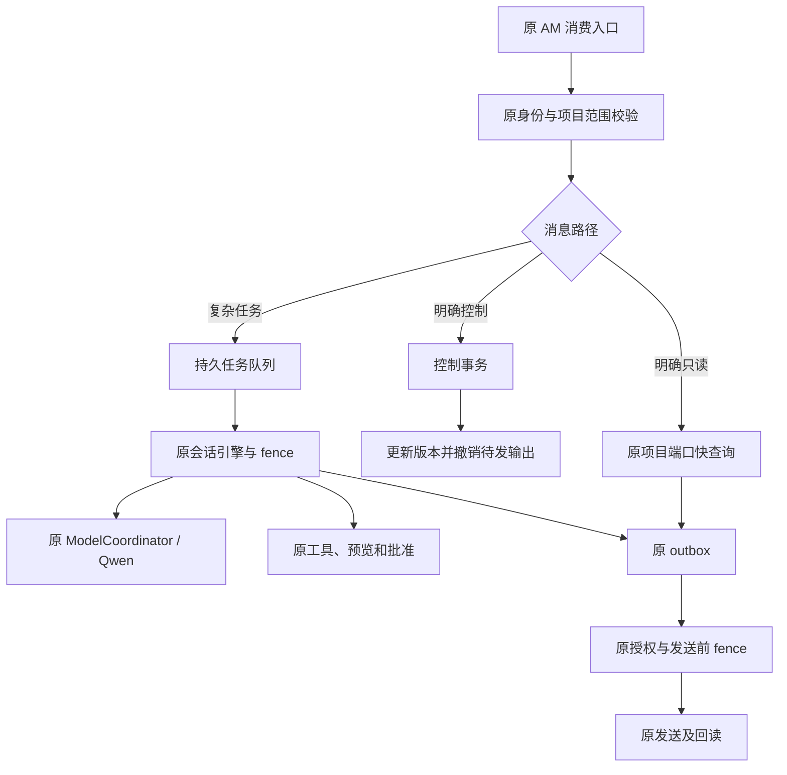
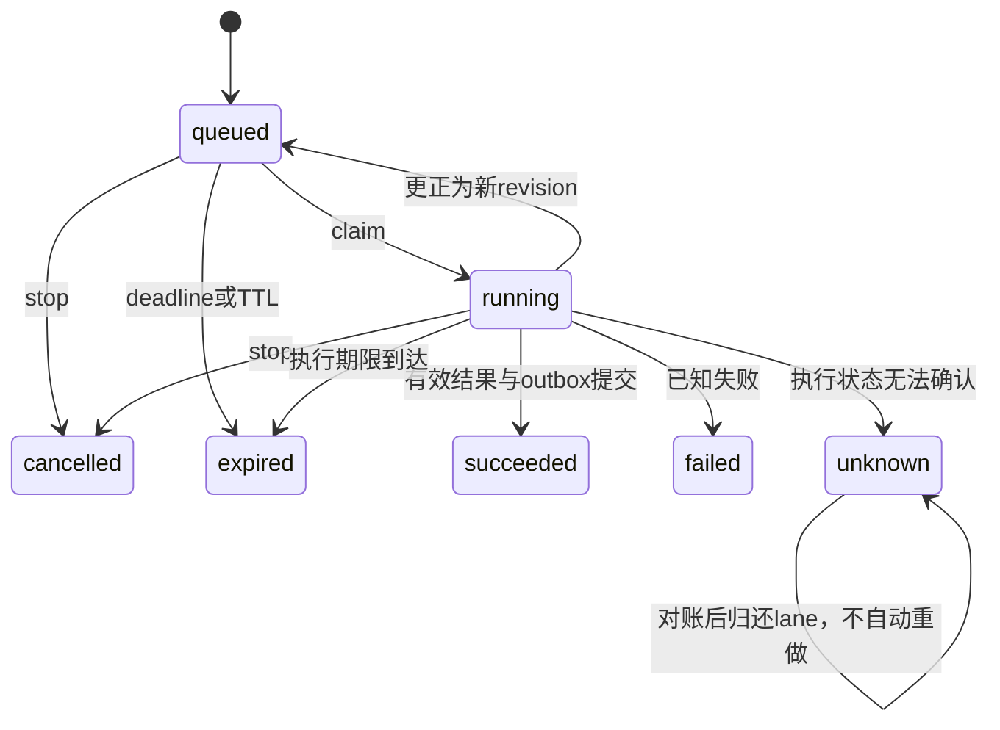

# AM Harness 详细设计

## 1. 目标与架构决定

目标是让现有 AM 更快地回答明确查询，让运行中的长任务能接受更正和停止，让排队、恢复与输出提交有可验证的状态，并控制长对话的来源、权限与上下文成本。

实现选择保留 Python 会话引擎。OpenAI 和 DeepSeek 的资料提供了会话/turn 分离、事件与状态持久化、运行中输入、工具执行边界、上下文整理和可观测性等设计参考；本包没有宣称兼容它们的私有协议，也没有把它们的完整 runtime 移植为 AM 的第二个执行器。具体官方来源见 `04_资料依据.md`。

本次针对固定 AM 源码作出的判断：现有系统已经有明确工具注册表、按需能力发现、原子动作状态、版本预览、outbox、同会话锁、权限与信息来源边界。新增层应补齐任务级生命周期和跨阶段检查，避免复制这些已有业务权威。

这里有两个读取通路。Phase 1 先在原引擎内部启用快查询，可减少模型调用。完整接线后，独立只读入口在持久排队之前运行，因而不等待长模型会话锁。复杂请求进入持久队列；控制消息在原入口完成身份校验后直接修改任务状态，不进入模型队列。

## 2. 信任与数据所有权

| 数据/决定 | 权威来源 | 新层允许做什么 |
|---|---|---|
| tenant、app、actor、chat、thread | 已鉴权的原入口与 `AccessContext` | 生成 scope key、比较与隔离 |
| 当前项目权限 | 原 AM grant / ledger port | 每个阶段重新核对，不从摘要恢复权限 |
| 项目事实 | 原项目端口、信息层及来源版本 | 带来源/状态/TTL 选取和缓存 |
| 运行目标、revision、cancel epoch | 持久任务库中的已鉴权事件 | 排队、更正、停止、抛弃旧结果 |
| 工具 schema 与 owner 限制 | 原 `ToolRegistry.resolve` | 再调用原校验，附加执行预算 |
| 正式动作批准 | 原 action 版本、展示回读、accepted hash | 保持原边界，不由任务控制代替 |
| 是否已发送 | 原 outbox、平台回执及回读 | 记录 fence 和派送状态，不自行猜测成功 |

`Scope` 包含五个字段。其 key 使用与原 `AccessContext.session_id` 一致的规范 JSON + SHA-256。项目权限不塞进身份主键；权限会动态变化，由当前宿主 authorizer 负责复核。队列 snapshot 是待执行输入，不是长期授权凭据。

本包只处理当前 AM 业务范围内的信息。没有连接个人账户记忆，没有扩展资料收集范围，没有新增给他人发消息的授权。

## 3. 持久任务与执行代次

### 3.1 核心对象

`RunSnapshot` 保存任务 ID、Scope、原始事件 ID、当前输入、revision、cancel_epoch、状态、优先级、排队时间、执行 deadline、内容 expires_at、结果与错误码。内容过期后清除输入、结果和原始 Scope，保留最小事件哈希墓碑，防止重投恢复旧正文或重复产生效果。

`Fence` 包含 `run_id + scope_key + revision + cancel_epoch + generation`。前三类变化分别解决不同问题：

- revision：要求改变后，旧计划和旧回复失效。
- cancel_epoch：停止后，即使文本没变，也禁止继续提交旧任务。
- generation：同一 revision 在明确未派发后重排，新 worker 不能被旧 worker 的迟到结果覆盖。

`Lease` 包含随机 token、generation、worker ID、claim 时的 RunSnapshot 和到期时间。运行中的 guard 同时核对任务版本与当前 lane。只比较任务 ID 不足以防止旧进程继续执行。

### 3.2 状态与转换

任务状态和模型占用分开。更正会把新 revision 放回队列，但旧模型可能仍在运行；取消也不能立即释放 lane。旧 worker 真正返回后，持有正确 token/generation 才能归还它的 lane，旧结果则被丢弃。

lease 超时不表示模型已经停止。超时 lane 进入 `quarantined`，重启后仍保留隔离。`resolve_quarantine` 必须由可信宿主对该 lease 的停止证明作验证；只保存证明 hash，不保存潜在敏感的证明正文。恢复不会清除原 provider pause，不会自动重跑 unknown 动作。`release_not_dispatched` 则要求证明当前执行尚未派发模型或工具，才允许安全重排。

### 3.3 排队语义

本包的 lane 序列化本 harness 管理的**模型型会话 turn**。原 `ModelCoordinator` 仍负责全部 Qwen 调用者的最终互斥，包括未接入新队列的后台任务。没有宣称已经替换全系统调度器。

默认最多排队 32 项，优先级由可信宿主决定；aging 按等待时间提高有效优先级，避免持续新任务让旧任务饥饿。deadline 在排队期间继续消耗。超时任务不会在几分钟后突然执行旧指令。默认执行预算 120 秒，新任务内容 TTL 600 秒，并取原来源更早的过期时刻。

## 4. 取消和更正的准确语义

### 4.1 明确控制语法

当前可识别 `停止当前任务`、`取消当前任务`、`停止当前生成`、`停止生成`、`取消任务 <run_id>`、`停止任务 <run_id>`，以及 `更正当前任务：...`、`修改当前任务：...`、`当前任务改为：...`。多个任务并行排队时可用 `更正任务 <run_id>：...` 或 `修改任务 <run_id>：...` 指定目标。

`取消`、`先别发`、`取消这个` 保持原 AM 待批准动作语义。包含“停止当前任务并发送...”等复合内容不会被截去后半句后强行当作控制。纠正文本是新任务输入，不会自动把它当作外部批准。

控制事件有独立幂等记录。第一次收到时没有任务、或者存在多个任务需要澄清，也会持久记录 no-op。这样平台晚到的重投不会误取消后来新建的任务。

### 4.2 检查点

原引擎补丁增加 optional `lifecycle` 和 `fastpath`。检查点覆盖 claim 前、控制前后、模型前后、工具前后、外部执行入口、结果提交前后。检查位于原工具异常转换区域之外，取消异常不会被转换为一个普通工具错误后继续下一轮模型。

`AmAgentRunner` 把 fence 绑定到 `ContextVar`，使用 `harness:<run_id>:v<revision>` 作为原引擎内部事件 ID。它既保留原 ConversationStore 幂等，又避免旧 revision 的 completed/unknown 事件污染新要求。

这仍是协作停止：它可以阻止下一步、抛弃旧结果；没有使用 Python 线程强杀，也没有把“取消请求已收到”误写成“GPU 推理已结束”。真正的 provider abort 属于之后在实际 Ollama/Qwen 能力下验证的适配项。

## 5. 输出与外部效果的提交边界

### 5.1 回复 outbox

`DurableStore` 与原 outbox 必须共用同一个 SQLite 文件。新增表使用 `am_harness_` 前缀，自有 meta 保存 schema 版本，不修改原 `PRAGMA user_version`。`finish(on_commit=...)` 在一个 `BEGIN IMMEDIATE` 事务内完成：

1. 核对 Scope、revision、cancel_epoch、generation、deadline、TTL、lease。
2. 通过可信本地回调插入原 outbox 和原输出来源关联。
3. 绑定 fence、来源链与不可变的输出 payload hash。
4. 再次核对有效期，写任务结果和终态，归还 lane。

回调只执行本地 SQL，不调用模型或网络。回调出错时整笔回滚。取消/更正的 `on_change` 使用同库短事务，把旧版本尚为 pending 的 outbox 改为 rejected。发送前，原 dispatcher 在其 `pending → sending` 事务内调用 `before_dispatch`，再次核对 fence、来源链与 payload hash，再执行原状态更新。

| 发生顺序 | 结果 |
|---|---|
| 控制先提交，旧结果随后到达 | 旧结果不得插入 outbox |
| 回复已入 outbox，仍 pending，再收到控制 | 原 pending 行被撤销 |
| dispatcher 已提交 sending，再收到控制 | 不宣称撤回；保留待核对，接受后续真实 receipt |
| 平台回执丢失或结果 unknown | 原对账路径继续；不自动重发 |

`verify_legacy_binding` 进一步连接原 `am_conversation_outputs`、`am_outbox_events`、`am_inbox` 与 thread 元数据。仅比较 outbox 的 app/tenant/user/chat 四列不足以证明同 thread。纠正后的输出必须绑定真实纠正消息，并使用含 run ID、revision、epoch 的幂等键，不能继续复用已经被撤销的旧 notice key。

### 5.2 执行期限与派送期限分开

执行超时不能提交新结果。但一个在第 119 秒正常生成、已经原子入队的回复，不会只因原发送队列到第 121 秒才处理而失效。已完成结果派送检查原内容 TTL、权限、fence 和 payload；不再消耗已经结束的执行预算。`enforce_execution_deadline=False` 仅对 `succeeded/waiting_review` 生效，运行中任务不能借此绕过执行期限。

### 5.3 正式业务动作

本包没有重写原批准或发送执行器。`FencedOutbox` 当前完整覆盖的是会话回复的原 outbox 事务。业务工具若直接调用发送、文档提交或另一库中的执行器，仅有 engine 的 `before_external` 检查不能消除检查后到真正提交前的竞态。

Codex 必须在真实动作执行器的 reservation/accepted_hash/commit 边界绑定同一任务版本，并保留实际已提交后的 unknown/receipt 语义；未接好这一步时，不可宣称“运行中取消可阻止所有正式动作”。已经发生且有回执的动作先记入原动作记录，再响应后续取消，不抹掉业务事实。

## 6. 确定性自然语言快查询

快路由只接受整个句子符合有限语法、唯一项目别名、单字段的查询，读取原 `_LegacyProjects._project()` 输出中的 `fields`。支持项目进展、关键日期、待办、人员与职责。示例：`需求75的项目进展`、`查一下需求75关键日期`、在有效焦点下的 `那待办呢`。

项目不唯一、多项目、综合分析、“最新消息”、生成/修改/发送复合要求、字段结构未知、回复超长等均回到原引擎，不为提高命中率猜测意图。资料缺失表述为“当前来源未提供”，不会说“业务上不存在”。保留观察时间、来源版本、不完整标记；不切掉长字段后假装完整。飞书 mention 渲染与原桥保持 inert 处理。

`FocusCache` 只保存项目引用，最长 600 秒，且不晚于原内容到期。每次读取仍查项目权限。独立只读路径只更新自己的焦点，避免与长任务争改原引擎焦点。

`OneShotReadRunner` 使用严格只读许可，最多 5 秒并受 ctx TTL 限制；只允许只读阶段，明确拒绝进入模型、普通工具、控制或外部动作。预备读取失败/未命中时不 claim 原事件；命中后由原 ConversationStore claim/finish。返回 `in_progress` 时，宿主应等待原处理，不能把临时状态当作最终 outbox，也不能再次提交模型。

## 7. 上下文与阶段复用

`ContextBuilder` 把来源事实、任务进度与历史作为不同数据结构，保留 `confirmed / reported / missing / unknown`。来源必须匹配 Scope、项目权限、当前版本和有效期。撤销的源、版本变化的源、过期数据和权限指纹变化的历史均被排除。任务记录明确只是进度说明，不能证明批准。

历史以完整 `MessageBlock` 进入预算。工具调用与全部结果必须闭合；孤立结果、重复 call ID、历史中的 system 角色会被拒绝。只删整个块，不截断半个 JSON。摘要和历史块的有效期取原来源最早 TTL，重新组装不会续命。

原 ConversationStore 的历史提交与最终派送处于不同事务。取消可能发生在 history 已写入、outbox 尚未提交之间。`FencedHistoryStore` 因此在读取原历史时按 run/revision/state 过滤：停止、失败、过期和旧 revision 不再作为上下文；harness 的助手回复还需已有 verified sent 回执镜像。它不删除原动作或 receipt，其他方法继续委托原 store；普通非 harness 历史保留原有策略。这个适配器与结构化来源过滤互补，不能仅因撤销 outbox 就假设旧回复已经从模型历史消失。

默认不用额外模型调用做摘要。计数器可替换，但默认单位是 `utf8_byte_budget`，不是“精确 token”；需要在真实 Qwen 的 tokenizer 与包装模板下校准。当前系统提示和本轮输入必须放得下，否则明确拒绝，不能静默删除关键指令。

`CheckpointStore` 只保存 `read` 或 `pure_local` 阶段。key 与输入 hash、Scope、权限指纹、来源版本和依赖 TTL 绑定。正式发送、批准、非纯本地写不能被 checkpoint 自动复用。阶段恢复先核对依赖，再决定读缓存还是重新读取，不把断点文件视为既有外部动作已经成功。

## 8. 工具执行与可观测性

`AmRegistryAdapter` 继续调用原 `ToolRegistry.resolve` 做 schema、项目、owner 检查。只有可信宿主明确声明为 read、parallel_safe、independent 且无依赖的连续工具才可并行。所有现有工具默认串行；模型不能自己打开并行或提高权限。

执行前后和整批返回前均核对 fence 与权限，防止先完成的读结果在另一读等待期间被撤权后仍流出。明确的 `may_continue` 状态会保留；线程超时不会被说成已经杀死线程。外部工具只返回 requires_approval，不调用 handler；正式动作仍由原路径承接。

`MetadataTrace` 默认只接受白名单字段：排队、模型、工具、上下文、投递耗时及计数，不接收 prompt、输出正文、真实用户 ID 或来源 URL。run ID 先哈希。`first_useful` 只在实际有用内容可供用户读取/完成投递时记录，排队提示不算。原桥已有 request timing 继续保留。

`evaluation.analyze` 只比较同 case、trial、environment 的 baseline/candidate 配对证据，排除合成模型或非真实传输数据。环境指纹应覆盖模型/量化、机器、来源版本、冷热缓存与配置。存在正确性倒退、越权、重复效果、旧结果发布时，不允许把降低时延作为通过。默认不足 20 对完整真实样本时不输出可宣称的改善比例。

