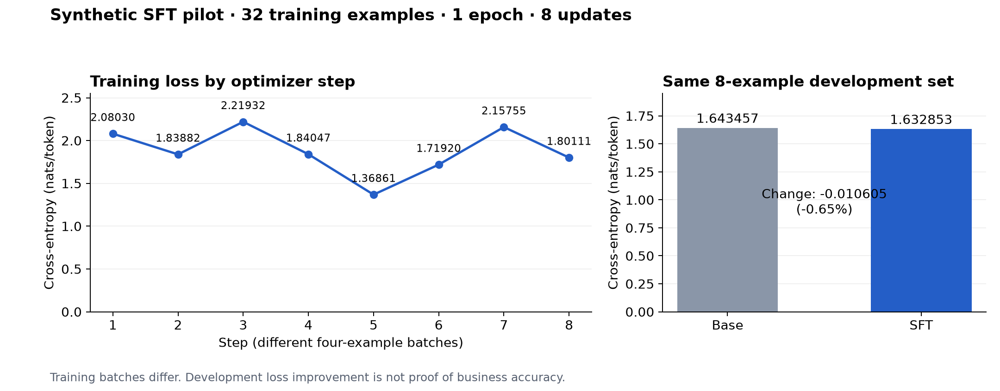

# R10-FIX1 合成实验 SFT：loss、样本与实测数据

本轮用户已明确批准合成实验SFT。数据仍标记为合成、非逐条人工gold；独立业务验收延期。此处只展示本轮实测，不混用R8的旧loss。

## 实际 loss 函数

对第 i 条样本，只在助理回答及聊天模板收尾 token 的位置计算下一 token 交叉熵。输入提示位置在 labels 中为 -100，实际计算时只提取回答位置的 logits；输入仍参与条件概率，但不作为监督目标。包括结束符，以及实际模板保留的尾随空白 token。

\[
L_i(\theta)=-\frac{1}{T_i}\sum_{t\in C_i}\log p_\theta(y_{i,t}\mid x_i,y_{i,<t})
\]

每4条样本累积一次梯度，按回答 token 数加权：

\[
L_B(\theta)=\sum_{i\in B}\frac{T_i}{\sum_{j\in B}T_j}L_i(\theta)
\]

自然对数，单位为 nats/token。没有加入DPO、KL或强化学习损失。AdamW的weight decay是独立的参数衰减，不是写进交叉熵里的L2损失项。

对应执行逻辑：

```python
logits = completion_position_logits(model, row).astype(float32)
targets = input_ids[loss_positions + 1]
loss_i = cross_entropy(logits, targets, reduction="mean")
weight_i = completion_tokens_i / total_batch_completion_tokens
batch_loss = sum(weight_i * loss_i)
grads = sum(weight_i * grad(loss_i))
clip_scale = min(1.0, 1.0 / l2_norm(grads))
optimizer.update(model, grads * clip_scale)
```

上段是阅读用摘写；完整实际源码见训练器链接，原始数据与每步日志可独立核算。

## 训练配置

| 项目 | 本轮配置 |
|---|---|
| 基座 | 本机固定版本 Qwen 27B，MLX 4-bit；从基座新建adapter |
| 数据 | 32条train、8条dev，16/4个场景家族隔离 |
| 保留测试 | 另冻结14个合成组合任务，不进训练；非独立真人业务测试 |
| 遍历次数 | 1次，不重复样本凑步数 |
| 梯度累积 | 4条/更新，共计划8次更新 |
| 学习率 | 0.00001（1e-5），固定 |
| 优化器 | AdamW，β₁=0.9，β₂=0.999，ε=1e-8 |
| Weight decay | 0.01 |
| Bias correction | false，沿用本机已验证配置 |
| 梯度裁剪 | 全局L2范数上限1.0 |
| LoRA | 最后2层，rank=8、scale=2.0、dropout=0 |
| 可训练参数 | 预期713,472；运行时逐项校验实际参数集合 |
| 种子 | 221 |
| 序列上限 | 1024 token，超长拒绝，不截断 |
| 单工作进程限时 | 300秒；保存后必须独立新进程重载 |
| 资源 | 原协调器、原内存/业务让路检查及精确Q8恢复 |

## 当前实测




已记录 **8/8 次参数更新**；训练完成：**True**；独立重载验证：**True**。

| 步骤 | Loss | 回答token数 | 梯度L2（裁剪前） | 裁剪系数 | 本步参数变化L2 |

|---:|---:|---:|---:|---:|---:|

| 1 | 2.08030014 | 132 | 0.12939572 | 1.000000 | 0.01757978 |

| 2 | 1.83881585 | 129 | 0.11655053 | 1.000000 | 0.02338127 |

| 3 | 2.21931550 | 108 | 0.15127911 | 1.000000 | 0.02739097 |

| 4 | 1.84047002 | 160 | 0.12698750 | 1.000000 | 0.03032713 |

| 5 | 1.36861128 | 149 | 0.12541454 | 1.000000 | 0.03291616 |

| 6 | 1.71919672 | 143 | 0.13985334 | 1.000000 | 0.03446360 |

| 7 | 2.15754586 | 124 | 0.25115832 | 1.000000 | 0.03547481 |

| 8 | 1.80110879 | 110 | 0.21626009 | 1.000000 | 0.03679645 |

各步骤使用不同的4条样本，逐步loss不能当作同一测试集的下降曲线。更可比较的是下表同一8条dev的训练前后loss。

| 固定开发集 | 交叉熵（nats/token） | Perplexity | 回答token总数 |

|---|---:|---:|---:|

| 训练前基座 | 1.64345707 | 5.173022 | 270 |

| 训练后adapter | 1.63285257 | 5.118455 | 270 |

开发集loss反映对这些目标答案的概率，不能单独证明事实正确率、自然表达质量或完整Agent任务完成率。

实际可训练参数：713,472；完成训练样本：32；完整参数变化L2：0.21623604；MLX训练峰值内存：14.802 GiB。

## 完整原件与样本

- [40条可读样本](01_SFT首批方案与样本.md)
- [实际train.jsonl](training/data/train.jsonl)
- [实际dev.jsonl](training/data/dev.jsonl)
- [完整参数config.json](training/redacted/config.json)
- [逐步loss与梯度CSV](evidence/training_steps.csv)
- [逐条样本loss CSV](evidence/per_example_losses.csv)
- [原始steps.json](training/run/steps.json)
- [token、labels与loss位置](training/run/tokenized.json)
- [实际训练器](training/source/am-style-r3/training/mlx_synthetic_runtime.py)

本实验直接使用合成事实提示与正文回答训练；它不是生产AM末端表达封装的等价验证。新adapter未合并、未部署，生产Q8不切换。


## 保留任务与产物范围

14个同题对照中7对逐字相同、7对改变；新SFT新增1处检查点遗漏，原有日期改写和超时结果误判仍存在。不能把0.65%的dev loss下降当作业务质量提升。完整28份输出见[同基座对照](04_新SFT与基座完整对照.md)。

实际adapter共18个F32张量、713,472个参数。产物是LoRA adapter及配置，没有保存AdamW优化器状态；不构成可逐步精确恢复的完整训练检查点。
