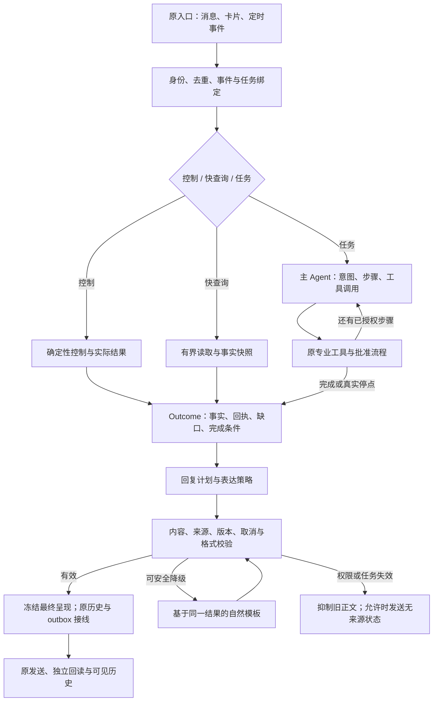
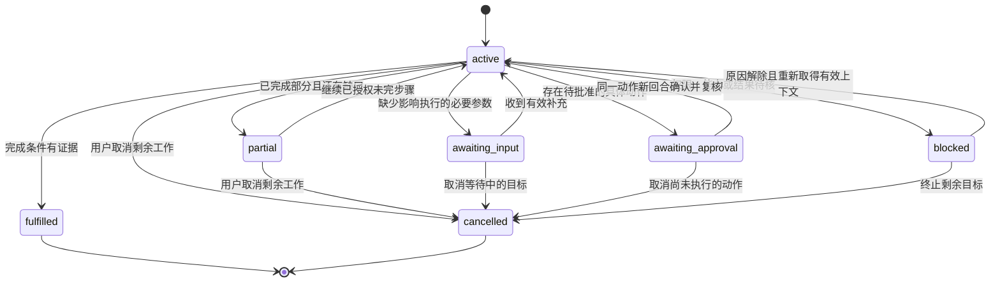

# AM Harness：框架优化与全任务表达设计

版本：v2.0-design.1 · 日期：2026-10-31（Asia/Shanghai）  
任务：AM-HARNESS-20261031-01 / R2-DESIGN  
用途：GPT 的研究、架构与代码设计；供 Codex 在真实项目中接线、验证和回传。

## 0. 结论与设计边界

建议在现有 Python 宿主中增量建立“任务结果 → 回复计划 → 自然表达 → 核验 → 投递”协议，覆盖现有全部任务族。保留原模型协调器、事务、任务 fence、动作预览与批准、幂等占用、outbox 和实际回读。将表达融入主模型最后一次回答；快查询和固定状态回执采用独立预算策略。模型的职责从选择预设句式，扩大到理解用户这一轮的关注点、组织有证据的结果、解释限制和衔接下一步。

拟人化的验收对象是完整办事过程：理解任务、选择正确工具、承接上下文、完成已授权步骤、准确说明结果与未完成项，以及自然表达。仅更换句式、仅增加模型参与次数、仅让回答变长，均不构成成功。

“覆盖所有任务”指覆盖当前机器人已实现、已授权的任务类型及其成功、部分完成、等待输入、等待批准、失败、取消与结果未知分支。证据不足、来源撤权、业务能力缺失或尚未批准时，机器人应准确说明停在哪里。框架不能据此承诺任意任务都能自动完成。

本轮形成可审查设计及独立参考代码，不修改运行服务。参考代码中的模型、权限检查、存储及投递均为端口协议；不把这些端口的定义算作实际集成完成。

## 1. 采用的基线与证据等级

### 1.1 版本

| 对象 | 固定依据 | 本轮用途 |
|---|---|---|
| 原会话 R2 | 源码 `b9b0444edf34aeb962b982fca0501dc7df7d83da`；审核 `e69a76a15dedfd885be0068a378c010195ca0f8f` | 表达设计与失败证据基线 |
| 当前组合 FIX1 | 源码 `d3e40b0d27517d75e850613c4eaecec107efa0ea`；审核 `cd35c28d4524284b52e77763784ac4c2d15cd3e4` | 本轮增量设计起点 |
| DeepSeek Harness | 官方仓库 `deepseek-ai/deepseek-harness`；研究时固定提交 `ce7073d51254c26cd63b22a60835b8f948deb447` | 机制参考，不作为本项目运行依赖 |
| OpenAI | 2026-10-31 实读官方 Agents SDK、结构化输出、延迟、评估与弃用文档 | 机制与协议参考，不切换生产模型 |

FIX1 的入口、差异和 12 个受影响运行源码文件已定向读回，15 个对象的 Git blob SHA 一致。代码中已见 F01—F05 的修复机制。本轮没有连接原机复跑 FIX1，也没有独立复验其 158 份加载文件；这些运行数字仍属于执行报告。[P1](https://github.com/Catcherog/project-workbench-review/blob/cd35c28d4524284b52e77763784ac4c2d15cd3e4/AM-HARNESS-20261031-01/R1-FIX1/00_当前交接.md)[P2](https://github.com/Catcherog/project-workbench-review/blob/cd35c28d4524284b52e77763784ac4c2d15cd3e4/AM-HARNESS-20261031-01/R1-FIX1/FINAL.diff)

上轮 R2 的独立受限复跑为 276 通过、3 跳过；不能拿它证明 FIX1 或本设计已经通过。FIX1 报告的完整工程结果为 611 通过、27 个旧失败，不能改写为全绿。[P1](https://github.com/Catcherog/project-workbench-review/blob/cd35c28d4524284b52e77763784ac4c2d15cd3e4/AM-HARNESS-20261031-01/R1-FIX1/00_当前交接.md)[P3](https://github.com/Catcherog/project-workbench-review/blob/e69a76a15dedfd885be0068a378c010195ca0f8f/AM-CONVERSATION-20261030-01/R2/00_当前交接.md)

### 1.2 不重复列为未修缺陷

以下能力应作为新设计必须保持的基线：本地写入绑定任务版本与实际事务；跨库写入占用与回执；已送达回答以稳定事件/消息 ID 进入历史；快路径与普通会话共用按事件排序的焦点；可选笔记按完整条目裁剪；派发前预算拒绝可安全释放 lane；维护产生的终态持久、幂等同步。[P1](https://github.com/Catcherog/project-workbench-review/blob/cd35c28d4524284b52e77763784ac4c2d15cd3e4/AM-HARNESS-20261031-01/R1-FIX1/00_当前交接.md)[P2](https://github.com/Catcherog/project-workbench-review/blob/cd35c28d4524284b52e77763784ac4c2d15cd3e4/AM-HARNESS-20261031-01/R1-FIX1/FINAL.diff)

### 1.3 不变的现有约束

原 Qwen `qwen3.8:27b-bartowski-q8_0`、原模型协调器、唯一飞书消费者、600 秒身份有效期、`ledger_write=false` 继续作为默认基线。R2 当前有效模式仍为 `off`。本设计没有授予新的同事、群、正式台账、文档发布或挂载操作权限。[P1](https://github.com/Catcherog/project-workbench-review/blob/cd35c28d4524284b52e77763784ac4c2d15cd3e4/AM-HARNESS-20261031-01/R1-FIX1/00_当前交接.md)

## 2. 仍值得优化的结构问题

| 优先级 | 已读事实 / 设计判断 | 直接影响 | 本设计处理 |
|---|---|---|---|
| P0 | 当前 `_run` 的旧 finalizer 只接普通模型回答；本地工具回执、预览、控制、快查询和维护通知有独立出口 | 单独改 finalizer 无法覆盖全任务 | 所有出口归一为 `OutcomeEnvelope`，在各路径首次持久化可见回复之前完成呈现 |
| P0 | R2 真实语料的可生成契约极少；混合来源、身份未核和原文块使大量查询不进入 LLM | 表达成功率的上限受事实建模限制 | 多来源事实投影、原文块、冲突、缺口和来源覆盖共同进入结果协议 |
| P0 | 执行报告出现把跟进保存为工作笔记、首轮取消没有取消业务对象 | 更自然的回复可能包装错误动作 | 显式用户意图约束 + 工具语义说明 + 目标完成条件，执行结果必须匹配请求对象类型 |
| P1 | 旧表达方案在主回答之后再调用原模型；合成事实 11 次模型调用的新增表达中位数约 9.79 秒 | 单 GPU 队列负担和用户等待增加 | 主模型末次直接输出回复提案；快路径最多一次可选表达，不先走完整慢查询再重写 |
| P1 | 来源访问版本目前较粗，报告中仍有 `SOURCE_ACCESS_CHANGED` 中止 | 无关来源变化也可能妨碍本轮完成 | 先记录依赖差异，再引入完整的对象/集合/ACL 依赖校验；完整性未证明前保留旧守卫 |
| P1 | `run.succeeded`、动作执行、文档采用、投递和回读属于不同状态轴 | 容易把“生成好了”描述为“业务完成” | 以证据化完成条件构造 Outcome；分别记录业务结果和回复投递状态 |
| P1 | 事实服务与文档生成仍有独立读取和映射路径 | 同一项目的查询与文档可能采用不同事实口径 | 为两者提供同一版本的 `EvidenceBundle`，文档生成仍保留其模板和审核门 |
| P2 | 当前图是对函数流程的抽象，缺少由接线产生的节点、边与状态目录 | 图与实现容易漂移 | 小型 `NodeSpec` 注册与运行事件，不先另造通用图执行器 |

R2 的 23×4 是契约编译样本，实际 enforce 采用是另一组 7 次请求，二者不能合并成调用成功率。手机两次中止、本人两项偏好和合成事实时延必须保持各自证据口径。[P3](https://github.com/Catcherog/project-workbench-review/blob/e69a76a15dedfd885be0068a378c010195ca0f8f/AM-CONVERSATION-20261030-01/R2/00_当前交接.md)

## 3. 官方框架调研与取舍

### 3.1 OpenAI：采用运行模式，保留本项目的执行权威

OpenAI Agents SDK 将 Agent、工具循环、状态、guardrail 和观测分开。官方建议从单 Agent 开始；当主 Agent 应负责最终答复时，用受限能力或 agents-as-tools，而非无条件把会话交给多个专员。SDK 还区分最终输出、可续接历史、批准中断及恢复状态。[O1](https://developers.openai.com/api/docs/guides/agents/sdk)[O2](https://developers.openai.com/api/docs/guides/agents/orchestration)[O3](https://developers.openai.com/api/docs/guides/agents/results)

对 AM 的借鉴是：一个面向用户的会话负责人，专业模块返回结构化结果；主负责人统一完成任务检查与表达。领域模块无需各自成为一次模型调用。普通确定性查询、执行回执与停止响应仍可由代码完成。

官方说明输入、输出和工具 guardrail 的触发边界不同，副作用应在工具边界校验；仅在最终回答处检查不能保证之前的执行安全。结构化输出保证形状，不保证其中事实正确。[O4](https://developers.openai.com/api/docs/guides/agents/guardrails-approvals)[O5](https://developers.openai.com/api/docs/guides/structured-outputs)

因此：原宿主的权限、版本、事务、预览、幂等和回读继续有效。即使将来试用 SDK，其 runner 也不拥有这些业务表的权威写入。

### 3.2 DeepSeek：已存在官方 Harness，重点借鉴职责和事件边界

DeepSeek 官网直接链接官方开源 Harness 与开发文档，当前标为 public preview。官方设计基于 Cordis，以插件承载模型适配、工具、会话、Agent 循环等能力，区分持久会话事件和运行中的扩展事件。[D1](https://www.deepseek.com/en/harness/)[D2](https://github.com/deepseek-ai/deepseek-harness/blob/ce7073d51254c26cd63b22a60835b8f948deb447/docs/architecture.md)

对 AM 的借鉴是明确端口：工具语义、结果归一、表达、校验、投递、观测各有一个职责清晰的实现。采用可追溯事件记录实际发生的步骤；不让“插件已加载”成为“任务已完成”的证据。

`agent/turn-stopping` 适合作为任务是否还有未完成步骤的检查点。它通过补充输入让循环继续，并非返回一个布尔值就完成业务审查。其触发时助手消息可能已入会话或展示，因此不能照搬为 AM 的投递前事实检查。[D3](https://github.com/deepseek-ai/deepseek-harness/blob/ce7073d51254c26cd63b22a60835b8f948deb447/docs/subsystems/core.md)

### 3.3 适配器必须声明真实能力

DeepSeek 当前 Responses API 与 OpenAI 不能只靠相同的客户端接口判断等价：它是无服务端续接状态的 API，`previous_response_id`、`conversation`、`store` 等不支持；`developer` 被当作 `user`；部分参数会被忽略；流结束由 completed/incomplete/failed 事件表示。[D4](https://api-docs.deepseek.com/guides/responses_api/)

其 thinking tool-use 协议对 `reasoning_content` 的回传也有明确要求。模型内部推理协议状态、用户可见消息、可检索业务记忆必须分开处理；不能把内部推理流当作业务进展或最终回复。[D5](https://api-docs.deepseek.com/guides/thinking_mode/)

本项目仍使用原 Qwen。新增 `ModelCapabilities` 与协议一致性测试，避免未来更换供应商时把“API 能连通”误认为会话、工具及权限语义都正确。云模型对照仅可使用已授权数据和调用条件；不自动上传真实业务语料。

### 3.4 选择表

| 方案 | 本项目判断 | 原因 |
|---|---|---|
| 现有宿主 + 新结果/表达模块 | 本轮采用 | 接口能增量落地，保留已修复的事务与投递行为 |
| 整体改为 OpenAI Agents SDK | 暂不作为本轮实施 | 需要重接身份、业务事务、跨库占用与回执；框架替换本身不提高中文业务表达质量 |
| 整体改为 DeepSeek Harness | 作为将来独立验证选项 | 当前是预览产品；其 Python SDK 也有自身运行载体，并非现有 Python 宿主的同义替换 |
| 为每种任务创建一个 LLM 专员 | 按需使用 | 仅当指令、权限或能力边界显著不同才拆；不把同一模型串行调用扩成多轮队列 |

OpenAI 的延迟建议包括减少请求、减少输出、并行独立工作及不默认调用 LLM；这些原则适合原单模型服务。[O6](https://developers.openai.com/api/docs/guides/latency-optimization) 评估采用本地数据集和事件记录。官方现行弃用表注明 Evals 平台 2026-10-31 转只读、11-30 计划关闭，Agent Builder 亦计划于 11-30 关闭，本设计不新增这两个产品依赖。[O8](https://developers.openai.com/api/docs/deprecations)

## 4. 目标框架

### 4.1 总流程



图中的节点是新增协议映射到旧函数的职责，不要求每个节点都是一个模型或独立线程。降级最多一次，不构成 G→B→G 的无限循环。外部动作的批准在工具执行之前；最终回复校验不替代它。

### 4.2 四类职责

1. **执行与权限**：原 TaskRuntime、LifecycleBinding、Store、Reservations、专业动作与 outbox。
2. **任务语义**：IntentFrame、GoalProgress、ToolOutcome、EvidenceBundle。
3. **表达**：ResponsePolicy、ResponsePlan、SurfaceRealizer、LockedBlockRenderer。
4. **检查与观测**：CompletionCheck、ResponseValidator、DependencyValidator、TraceSink。

每项职责可以是普通 Python 类或函数。模型只参与需要语言理解、分析或自然组织的部分。

### 4.3 节点契约

| ID | 节点 | 主要输入 → 输出 | 副作用 / 恢复条件 |
|---|---|---|---|
| N01 | admit | 原事件 → Scope、EventBinding / RunBinding | 原去重与持久队列 |
| N02 | resolve_intent | 用户原文、已送达上下文 → IntentFrame | 纯推断；显式约束由宿主检查 |
| N03 | plan_steps | 意图、能力目录 → GoalProgress | 只登记任务状态，不创建业务事项 |
| N04 | collect_evidence | 授权查询 → EvidenceBundle | 只读；记录查询和对象依赖 |
| N05 | execute_capability | 已校验调用 → ToolOutcome | 原事务、预览、占用、回执，不自动重放未知动作 |
| N06 | check_completion | 意图、步骤结果 → fulfilled / partial / blocked / awaiting | 代码检查可证明条件；模型不能自封成功 |
| N07 | compile_outcome | 全部结果 → 不可变 OutcomeEnvelope | 保留原文、冲突、缺口、回执和对象版本 |
| N08 | select_response_policy | Outcome、通道、预算 → direct / compose / canonical | 纯策略；不占模型 |
| N09 | realize_response | 已有提案或 Outcome → ResponsePlan | 主循环末次直接生成，或可选一次调用 |
| N10 | validate_response | 提案、Outcome、绑定 → ValidationResult | 硬约束 + 明示边界的语义检查 |
| N11 | freeze_presentation | 核验结果 → PreparedPresentation | 内容 hash、版本、依赖；不发送 |
| N12 | publish_and_verify | 原投递绑定 → DeliveryReceipt | 原发送与回读；未知结果只对账 |
| N13 | continue_or_close | 送达结果、未完步骤 → 下轮目标状态 | 不延长身份有效期，不占住模型等用户 |

`NodeSpec` 至少登记输入/输出版本、调用函数、effects、budget_class、resume_policy 和允许的后继事件。发布的流程图由注册表加实际事件边生成；测试应拒绝未声明的跨阶段副作用。暂不建设可执行任意图的 DSL。

## 5. 状态设计：保持各状态轴独立

### 5.1 状态目录

| 状态轴 | 建议值 / 继承值 | 权威来源 |
|---|---|---|
| GoalProgress | active / awaiting_input / awaiting_approval / partial / fulfilled / blocked / cancelled | 本轮任务目标与可证明完成条件 |
| Harness Run | 保留 queued / running / succeeded / failed / cancelled / expired / unknown，以及原库支持的 waiting_review | 原 TaskRuntime；waiting_review 不能仅因有预览就自动采用 |
| Business action | 保留 draft / approved / executing / succeeded / failed / unknown / cancelled / expired | 原动作与专业业务 Store |
| ExpressionAttempt | not_needed / not_attempted / planned / generating / accepted / rejected / fallback / suppressed | 新表达观测记录；未尝试原因另记 |
| Presentation | prepared / queued / dispatched / verified / suppressed / unknown | 原 outbox 与回读结果的投影 |
| Source validity | current / content_changed / permission_revoked / expired / indeterminate | 来源依赖检查；当前粗守卫不足时使用 indeterminate |
| Provider lane | 保留原 idle / active / quarantined 等真实状态 | 原协调器，表达层不能自行释放 |

`GoalProgress.fulfilled` 不由“LLM 回答完了”推出，也不由“run succeeded”推出。它必须满足用户请求的范围和接受条件：查询所需范围已完整核实；写入有匹配对象/版本的回执；要求发送的动作已有原规则要求的送达核验；要求挂载的文档已有挂载证据。解释了范围限制只能证明答复诚实，不能把“查全部待办但只读到一页”记为目标完成；此时仍为 partial/blocked/awaiting，除非用户原目标就是了解覆盖范围。

### 5.2 目标跨回合续接



等待用户时不持有 GPU lane，也不延长 600 秒身份。用户确认后建立新的有效执行上下文，关联原 goal、action、preview_version。OpenAI SDK 的“同一 run 恢复”是它的逻辑约定；AM 不需要因此合并原来已经安全分开的平台回合或批准事务。[O3](https://developers.openai.com/api/docs/guides/agents/results)[O4](https://developers.openai.com/api/docs/guides/agents/guardrails-approvals)

### 5.3 绑定

快查询和部分控制路径当前没有 durable Run，因此统一接口使用 `BindingToken`，宿主实现为 `RunBinding` 或 `EventBinding`。不得为统一类型伪造 run_id。

RunBinding 继承 scope、run_id、revision、cancel_epoch、generation。EventBinding 继承完整 scope、event_id、事件序号、原身份期限、来源依赖与去重键。最终回复和历史必须关联稳定事件身份；相同正文不代表同一次事件。[P2](https://github.com/Catcherog/project-workbench-review/blob/cd35c28d4524284b52e77763784ac4c2d15cd3e4/AM-HARNESS-20261031-01/R1-FIX1/FINAL.diff)

## 6. 核心数据协议

### 6.1 IntentFrame 与 GoalProgress

`IntentFrame` 包括：用户原始目标、任务族、项目/对象 ID、显式约束、请求的产物或动作、接受条件、必要缺失参数、与上轮目标的关系。用户明确说“跟进事项”时，`worknote` 不能满足该目标；单纯说“记一下”且上下文无执行区别时，使用已有默认方式，必要时只问影响执行的一项。

`GoalProgress` 的每个步骤保存 `step_id`、operation、target、depends_on、completion_predicates、status、receipt_refs。已经成功的步骤不因后续表达失败而重跑。多项目、多事项的部分完成不依赖正则估计“应该有几条”，而依赖请求分解后的明确目标集合。

### 6.2 ToolOutcome

领域工具逐步返回结构化结果：

```python
ToolOutcome(
    operation="followup.resume",
    object_type="followup",
    object_id="synthetic-followup-1",
    status="committed",
    before_version="2",
    after_version="3",
    receipt_id="synthetic-receipt-1",
    verified=True,
    facts=(),
    artifacts=(),
    pending_actions=(),
    gaps=(),
)
```

这是协议示例，不是本项目发生过的业务动作。旧工具的 `message` 可作为兼容呈现字段；新代码不得通过解析“已成功”这类自然文本反推执行成功。需要独立回读的操作，其 verified 必须来自原核验机制。

### 6.3 EvidenceBundle 与 Claim

每条 Claim 至少包含：`claim_id`、subject、predicate、typed_value、polarity、modality、时间基准、来源引用、证据原文或字段指针、来源版本、冲突组、可表达级别。

表达级别建议：

- `exact`：日期、金额、数量、责任人绑定、否定/条件关键句、执行状态等需要保持关键含义的内容。
- `paraphrase`：可在明确事实范围内改述的说明性事实。
- `quote`：尚未结构化、需要保留原文和归属的内容。
- `inference`：有证据支撑的分析判断，必须保持“判断/可能/建议”的性质。

一个 EvidenceBundle 可同时含台账字段、信息服务事件、已核实业务回执、原文和缺口。不因存在额外来源就拒绝整个项目；不因模型无法解析一个原文块就把它当成可自由改述的事实。

冲突不能被自动揉成一致结论。不同来源各自保留时间、角色和可信状态；如果当前规则能确定权威来源，采用规则并记录理由；否则回答中明确冲突。资料中“预计”“待确认”“尚未”“除非”等限定必须与命题一起保存。

### 6.4 覆盖与缺口

覆盖不是一个布尔值。至少记录请求范围、已读范围、分页是否完整、来源集合、未覆盖原因和最近核验时间。`未查到` 只描述本次查询结果，不推出全局不存在。身份未核的人名不能升级成负责人；可以准确回答“当前资料有这个名字，但责任角色尚未核实”。

### 6.5 OutcomeEnvelope

由宿主构建并冻结：schema_version、binding、intent、goal_progress、task_family、completion、facts、receipts、artifacts、pending_actions、gaps、coverage、dependency_manifest、allowed_next_steps、presentation_requirements、outcome_hash。

模型不能修改 completion、receipts、preview版本、权限、时间限额或已完成步骤。哈希需要覆盖嵌套字段、顺序相关内容和版本，序列化禁止 NaN/重复键；仅 frozen dataclass 不代表嵌套 dict 已不可变。

### 6.6 ResponsePlan

ResponsePlan 是表达提案，包含绑定的 outcome_hash、段落块及每块引用的 claim IDs。主要块类型：

| 块 | 责任 | 允许内容 |
|---|---|---|
| fact_text | 模型或自然模板 | 有来源事实的直接答复、摘要、必要解释 |
| analysis_text | 模型 | 明确标为判断/建议的分析，附证据引用 |
| locked_ref | 宿主 | 精确预览、动作回执、金额/身份/状态关键块 |
| quote_ref | 宿主 | 原文及来源归属 |
| question | 模型或宿主 | 影响继续执行的必要问题 |
| next_step | 宿主允许集合 + 模型措辞 | 已有可用能力、有效授权和真实计划支持的下一步 |

不是所有块都必须出现。简单负责人查询可能只有一句；复杂分析可有结论、证据、风险与建议；等待批准必须包含可核对的完整动作预览。

不得让模型生成正式 action_id、receipt_id、文档 URL、@mention token 或批准按钮载荷。通过引用选择，由宿主渲染真实对象。

## 7. 末端表达：从四种策略开始

### 7.1 策略表

| 策略 | 触发 | 模型调用 | 适用示例 |
|---|---|---|---|
| 主模型直接表达 | 当前任务已进入普通模型循环 | 使用最后一次本来就要生成答复的调用；额外表达调用为 0 | 分析、跨来源解释、复杂查询、多步骤总结 |
| 自然模板 | 简单确定结果、控制、短回执、低预算 | 0 | 谁负责、已登记、已取消剩余步骤、等待回读 |
| 单次专门表达 | 没有主模型提案，已具备完整可表达结果，独立路线已验证且预算足够 | 最多 1 次 | 将来的复杂确定性结果摘要；初期关闭 |
| 保护性呈现 | 预览、原文、尚未结构化的专业流程 | 0，或仅已有提案中的外围说明 | 正式预览、逐字引用、遗留卡片 |

原 `handle_fastpath` 明确承诺不等待模型。第一期保留该约束，不在 5 秒只读 runner 内插入 GPU 调用。将来若启用单次表达，应在新的明确模型路线使用原 TaskRuntime admission 与有效绑定；不得通过旧 rewrite 开关把所有单字段问题先送主模型再重写。

### 7.2 主模型最后一次返回结构

当前 `CoordinatorModel` 已在 JSON schema 中区分 `tool_calls` 和 `answer`，可增量把后者升级为 `response_plan`，保持工具分支和原协调器。只在启用新协议的任务族使用新分支；旧协议仍可解码。[P4](https://github.com/Catcherog/project-workbench-review/blob/e69a76a15dedfd885be0068a378c010195ca0f8f/AM-CONVERSATION-20261030-01/R2/source/am-conversation-r1/src/am_conversation/model.py)

示意：

```json
{
  "type": "response_plan",
  "plan": {
    "envelope_fingerprint": "host-supplied-sha256",
    "segments": [
      {
        "kind": "text",
        "intent": "answer",
        "text": "目前最需要先处理的是试样确认。设备调整已有记录，但验收结果还没有回传。",
        "claim_ids": ["c1", "c2"]
      },
      {"kind": "locked", "block_id": "coverage-1"}
    ],
    "omitted_optional_claim_ids": []
  }
}
```

这是合成示例。模型输入包含带 ID 的事实、必要缺口、用户本轮问题、已验证的近期上下文、适用语言风格和允许的下一步。不要把原模型草稿再次当成事实，也不要把整段长期历史无选择地复制到表达模型。

外层 `type/plan` 由 CoordinatorModel 解码；内层 plan 与参考包及 `schema/response_plan.schema.json` 对应。第 6.6 节的 fact_text/analysis_text 等是职责名称：在参考 schema 中映射为 text 段的 intent；quote/preview/receipt 等映射为宿主持有角色的 locked 段。`host-supplied-sha256` 是说明标记，真实请求必须使用当前 Outcome 的 64 位哈希。

完整 schema 应保持紧凑。原模型适配器有输入、输出和 schema 大小上限；不要将全部事实文本、实体枚举和专业工具定义重复写进输出 schema。引用 ID 在宿主核验即可。

### 7.3 表达提示词的结构

稳定前缀保存角色和表达规则；动态尾部保存本轮结果和用户关注点。这与 DeepSeek 的稳定提示段和动态上下文分层一致，但本项目仍使用自己的权限与历史过滤。[D6](https://github.com/deepseek-ai/deepseek-harness/blob/ce7073d51254c26cd63b22a60835b8f948deb447/docs/subsystems/system-prompt.md)

规则要求：先回答当前问题；说明有用的原因与约束；按任务决定长度；沿用用户已明确的术语和称呼；状态改变必须有回执；存在缺口时精确说缺什么；不展示内部模块名与调试错误码；没有真实计划不得承诺以后自动跟进。不能把“语言温柔”设为每条消息的通用目标。

风格默认是工作协作语气：直接、自然、适量解释。一次只展示必要层级，不固定“已完成/待办/风险”三段模板。用户提供的明确纠正可以形成版本化 StyleProfile；风格偏好与业务知识分开保存，不从一次盲评自动推导全部偏好，更不自动修改项目事实。

### 7.4 保真能力的边界

本地代码可以可靠检查：schema、引用是否存在、绑定 hash、必要块是否遗漏、精确字段和保护块是否变化、禁止标记、长度、来源期限与撤权、原动作回执是否匹配。它不能一般性证明任意中文改写与事实完全等义。

因此设置三层控制：

1. **硬控制**：关键预览和执行状态由宿主渲染；实体/日期/数量/限定绑定；任务、身份及来源守卫。失败立即拒绝或抑制。
2. **可解释的语义检查**：受限谓词规则、相互矛盾的状态、时态和模态变化、引用与段落对应关系；不能仅看 ID 列表或关键词命中。无法判定返回 `indeterminate`。
3. **质量与语义评估**：离线配对评估和人工盲评；新任务族先 shadow。独立语义评估器的意见是证据，不是数学保证；同一模型自称“没有幻觉”不能作为通过依据。

首期对 `indeterminate` 的自由事实改述保守降级；允许独立配置已验证任务族的受控采用策略。不能为了提高“LLM采用率”把 unknown 当 pass。也不能把所有内容都重新锁死成预设 variants，再声称实现了自由自然表达。

### 7.5 与“生成更漂亮的文字”不同的完整办事行为

| 任务族 | 合格的办理与回复 | 关键不能丢的条件 |
|---|---|---|
| 人员/进展/日期/待办查询 | 直接答用户关心的项目与字段，必要时补一句缺口 | 角色、项目、预计/实际、覆盖范围 |
| 多来源分析 | 先给判断，再说明依据与尚未证实之处 | 推断不能改写成已确认事实 |
| 跟进 | 建立/恢复/暂停正确的跟进对象并核对版本，回复当前状态和真实下一步 | 工作笔记不能冒充跟进；submitted 不等于 closed |
| 工作笔记 | 保存确切内容，说明属于内部记录 | 不暗示已同步台账或通知同事 |
| 知识候选 | 展示可审核内容和适用范围；批准后才按原规则检索 | candidate / approved / rejected 不混用 |
| 文档生成 | 给产物、用途、缺项与采用状态 | 生成、采用、发布、挂载分别有证据 |
| 预览与确认 | 用自然说明介绍动作，但完整呈现具体对象、载荷和版本 | 不改变确认绑定，不因表达变化绕过重新批准 |
| 外发/挂载 | 依据实际回执说明是否完成，附可核对对象 | sent、verified、unknown 分开 |
| 计划/提醒 | 显示真实计划和触发状态，停止与恢复走原规则 | 未建立持久计划不得说以后会提醒 |
| 更正/取消 | 取消尚未提交部分，说明已经提交的真实部分 | 取消模型任务不等于撤回外部动作 |
| 部分完成 | 逐项说明已办、未办及原因；保留可继续的目标 | 不能用整体成功遮盖漏项 |
| 失败/来源变化/结果未知 | 用业务可理解的语言说明阻塞和下一种允许动作 | 不恢复旧正文，不自动重放未知动作 |

### 7.6 合成表达示例

以下只定义目标风格，不使用真实项目事实。

**查询进展**：“试样已经完成，当前卡在尺寸确认。台账中的交期仍写的是预计周五，尚没有实际交付记录。”这里保留“预计”和证据缺口。

**登记跟进**：“已登记这项跟进，负责人是张工，截止到周四。它现在处于待处理状态。”只有目标对象、责任人和期限均在提交回执中时才允许这样回复；若只有笔记回执，应准确说保存了笔记并标明跟进尚未建立。

**等待批准**：“发送内容已准备好，收件人和正文如下。确认后会按这一版发送。”下方是宿主锁定的完整预览；如果本轮已获有效批准且执行完成，应直接报告真实结果，不重复索要批准。

**部分完成**：“A 项目已登记，B 项目还缺负责人，因此这一项尚未建立。请补充 B 的负责人，我可以接着处理。”不重新登记 A。

**结果未知**：“发送请求已经提交，但我还没有拿到可确认的结果。当前先核对这次请求，避免重复发送。”必须确有已提交证据；若尚未派发，则使用不同表述。

**取消**：“已停止后续处理。刚才已经保存的那条笔记仍然保留。”只在取消与既有提交状态分别核实后使用。

## 8. 关键流程与代码接线

### 8.1 建议模块

| 模块 | 职责 | 不拥有的权力 |
|---|---|---|
| `am_outcome/types.py` | 不可变结果、事实、绑定、回执引用、版本 | 不发请求、不写业务数据 |
| `am_outcome/adapters.py` | 将各任务工具结果映射为标准 Outcome | 不从文本猜成功，不补造事实 |
| `am_outcome/completion.py` | 请求目标与实际结果的匹配 | 不执行工具，不扩大权限 |
| `am_response/policy.py` | 决定直接提案、自然模板或单次表达 | 不解除模型 lane |
| `am_response/schema.py` | 严格解析模型提案 | 不将 schema 通过当语义通过 |
| `am_response/realizer.py` | 主提案/独立生成端口/自然模板 | 不获得业务工具 |
| `am_response/validator.py` | 硬约束及语义判定结果 | 不将无法判定包装为通过 |
| `am_response/pipeline.py` | 一次表达选择、再校验与冻结 | 不入业务事务，不直接发消息 |
| `am_harness/dependencies.py` | 实际来源依赖与完整性检查 | 不删除未知来源的旧全局守卫 |
| `am_harness/recovery.py` | 按对象类型查回执、分发对账 | 不提供无条件 retry-all |
| `am_harness/topology.py` | 节点、事件边、恢复类别目录 | 不替换运行时成为第二个执行器 |

这些是建议正式模块名。包内 `response_reference` 是设计验证用的小型参考实现，类名到正式协议的映射以其 README 为准，不要求直接复制目录覆盖项目。

### 8.2 现有文件的改动表

| 当前文件 / 符号 | 具体改动 |
|---|---|
| `am_conversation/model.py`：`ModelTurn` 对应解码、`_response_schema`、`_parse_turn` | 新增 `response_plan` 分支与协议版本；保持旧 answer 和工具调用兼容；不得增加自动重试 |
| `am_conversation/types.py` | `ModelTurn` 可带提案；`AgentReply` 保留现有字段，新增关联 envelope ID 或独立结果对象；兼容精确字段校验 |
| `am_conversation/engine.py`：`_run` | 从 read/local/external 工具结果收集 Outcome；主末次回答使用新提案；移除同次执行的重复旧重写 |
| 同文件：`_control`、`_preview_reply`、`handle_fastpath` | 生成有实际状态的 Outcome；快路径仍不等模型；预览绑定保持原完整版本 |
| 同文件：`_finish` | 在 `finish_event` 前完成语义最终化；回放已完成 event 时复用已存正文，不用新提示词重新生成 |
| `am_conversation/store.py`：`finish_event` | 同库关联选定 Response 与历史文本；不在事务内调用模型或网络 |
| `am_conversation/legacy.py`：`prepare_reply`、授权及来源检查 | 只做确定性展示和绑定；不得在历史写入后首次改语义正文 |
| `am_harness_host.py`：`_Runner`、`publish` | 保留原 runner，将 PreparedPresentation 关联到现有 outbox 同事务发布 |
| 同文件：`_admit_source`、`failure_notice`、`sync_terminal` | 控制与无来源终态通知适配统一呈现类型，保留 F05 幂等键与期限 |
| `am_conversation/business.py` / `documents.py` / `learning.py` / `capabilities.py` | 返回规范对象类型、状态、回执、缺口与引用，逐项消除仅有 message 的结果 |
| `am_information.py`、`am_info_sync/*` | 给事实与覆盖集合补齐来源、版本、角色与语义限定；保留原文兼容 |
| `fs_agent/document_standards.py` 及调用 `am_doc_engine` 的文档取数入口 | 接入与查询相同的 EvidenceBundle；模板、内容校验和采用 hash 不变 |
| `am_harness/host_context.py` / `host_focus.py` / `history_adapter.py` | 传递新依赖 envelope，保持 FIX1 的稳定 ID、事件顺序、送达核验、期限和任务 fence |

正式实现必须在真实工作树定位符号，不按本设计中的行号机械覆盖。FIX1 中未修改的旧文件可从 R2 参照，但以实际当前树为准。

### 8.3 主模型末次表达的先后关系

1. 读取与工具执行后，宿主从可信结果增量构建 Outcome，先计算该快照的 GoalProgress 和 completion；必要的未完成步骤仍回到工具循环。
2. 在下一次原有模型调用前，冻结包含完成度的 Outcome，把其指纹与精简内容加入动态上下文；该次调用可选继续工具或返回 ResponsePlan。
3. 若模型选择结束，CompletionCheck 复核快照、目标和实际状态是否仍一致。缺少已授权且预算内能完成的步骤，允许一次有明确缺口的任务纠正；不无限自评。事实、完成度或目标发生变化均生成新的 Outcome 版本，旧提案失效，不在原 hash 下把 active 改写成 fulfilled。
4. 对提案校验后生成 PreparedPresentation；随后 `_finish` 保存相同最终语义文本。
5. 宿主在原发布事务中保存投递绑定；发送前和回读时仍按原规则复核。

不能先让模型在没有最新 Outcome 的情况下返回 hash，再由宿主替它补成“已绑定”。如果最后一次执行出现新的真实状态，应渲染当前结果或在预算内执行必要的最终表达，不把旧提案重新贴到新版本上。

### 8.4 参考伪代码

```python
def prepare_presentation(outcome, proposal, policy, ports):
    ports.guard.require_current(outcome.binding, outcome.dependencies)
    outcome.validate_host_invariants()

    if policy.use_existing_proposal and proposal is not None:
        candidate = proposal
    elif policy.allow_one_composition and ports.budget.can_admit():
        # 此端口仅生成；不拥有业务工具；由原协调器处理停止与占用。
        candidate = ports.realizer.compose_once(outcome)
    else:
        candidate = ports.canonical.render(outcome)

    verdict = ports.validator.validate(candidate, outcome)
    if not verdict.accepted:
        ports.guard.require_current(outcome.binding, outcome.dependencies)
        candidate = ports.canonical.render(outcome)
        ports.validator.require_canonical(candidate, outcome)

    ports.guard.require_current(outcome.binding, outcome.dependencies)
    return freeze(candidate, outcome)  # 返回内容，不在这里发送
```

代码没有展示异常处理是有意的：取消、身份失效、来源变更、STOP_UNKNOWN、未知执行必须传播给原宿主处理。只有“表达候选无效或明确未派发的预算拒绝”可以进入自然模板；不能用 `except Exception: return old_text`。

### 8.5 原事务边界

表达发生在业务提交之后时，表达失败不撤销已经提交的业务事项。另一方面，取消先于业务提交仍由 FIX1 的 fence 保证不写。表达模块不得为了获得一句更自然的回复重新执行工具。

原 ConversationStore 与 Harness 发布不是一个跨数据库原子事务。首期继续使用 F02 的投递与历史过滤：已生成但未投递的文本不进入可见助手历史。新表达记录可在各自原事务内写入关联标识，并由幂等对账补齐链接；不能声称新增一张表就实现了跨库 exactly-once。

`legacy_binding.py` 当前对序列化上下文字段有精确匹配。第一期把新协议放到关联 envelope，不随手加字段到旧 AccessContext 序列化。如果升级 context schema，要一并修改编码、验证、旧 outbox 的兼容规则和回滚策略。

## 9. 来源、事实和文档的共同基础

### 9.1 依赖清单

依赖登记发生在真实读取或投影边界，包含：tenant/scope、source/object identity、content version、ACL/access revision、角色/项目映射版本、parser/schema version、核验时间、最早失效时间。集合或负向查询还要保存 query predicate、目录/索引覆盖水位和分页结束证据。

来自已选历史、知识和内部记录的依赖也要传递。模型只在回答中引用少数事实，不代表其生成只受这些事实影响，因此不能由模型自行裁掉依赖集合。

### 9.2 三步替代粗粒度失效

1. **记录**：保持全局 `source_access_version` 原拒绝行为，同时收集实际依赖以及触发变化的原因。
2. **影子比较**：新 DependencyValidator 判断本轮是否仍有效，只记录结果；测出缺失依赖、ACL继承、重命名/移动/删除、查询集合变化等误差。
3. **局部启用**：仅对完整性已证明的任务路径使用精确判断；保留全局紧急撤权 epoch。旧记录、未知来源或不完整集合继续走保守失效。

实际撤权、身份过期或无法确认权限时抑制业务正文。内容变化需重读时，只重做纯读取和纯推理，重新构造结果，不重放已提交/未知动作，不给旧正文套上新权限戳。

### 9.3 事实到文档

查询和文档生成读取同一 EvidenceBundle 版本。文档的每段事实可以追溯到 claim/source，缺项进入缺口列表；补充资料后 revision 改变，旧采用/批准按原规则失效。自然化完成说明只描述实际产物状态，不能越过内容校验、采用或发布/挂载的原审批。

## 10. 性能与中断

### 10.1 分解测量

每次请求至少分开记录：入口/排队、事实读取、主模型、工具执行、额外表达、校验、入队、发送、独立回读。记录实际模型调用数、token、输入字节、schema 字节、queue wait 与终态原因。

R2 的 9.79 秒是 11 次合成事实真实模型调用的表达中位数；不能直接当成全体日常查询的新增时延。FIX1 的多种实际任务还显示工具选择与主模型时延需要分别改进。[P1](https://github.com/Catcherog/project-workbench-review/blob/cd35c28d4524284b52e77763784ac4c2d15cd3e4/AM-HARNESS-20261031-01/R1-FIX1/00_当前交接.md)[P3](https://github.com/Catcherog/project-workbench-review/blob/e69a76a15dedfd885be0068a378c010195ca0f8f/AM-CONVERSATION-20261030-01/R2/00_当前交接.md)

### 10.2 本设计建议的性能门槛

以下是待实测的验收建议，不是当前性能承诺。

| 路径 | 预算策略 / 建议门槛 |
|---|---|
| 停止、状态、简短回执 | 不新增 LLM；目标 p95 ≤ 2 秒，保留排队/发送与 GPU 停止时间的区别 |
| 现有快查询 | 不新增 LLM、不等待 GPU；不放大现有 5 秒只读执行约束；单列请求上下文读取在预算内外的耗时 |
| 已有主模型回答 | 额外表达模型调用数 = 0；任务纠正调用单列，并计入 model_calls_total 和总绝对预算；对同一测试集的总时延中位数不得因表达层显著回退 |
| 单次独立表达 | 初期关闭；开启前单独证明收益与剩余预算，不设置无限重试/排队 |
| 纯代码表达与校验 | 在固定合成规模上测量 p95，建议目标 ≤ 100 毫秒；大文档不与短回复混在一组 |
| 总体时延比较 | 报告配对 p50/p95、超时率、样本数；建议超过基线 p95 的 10% 时说明并阻断全量切换 |

自然度收益和延迟应同时报告。快速、清楚的一句确定性回答可以优于多等十秒的措辞变化。

遥测分别登记 task_model_calls、task_repair_calls、presentation_calls 以及它们的总和。把一次调用改名为“任务修复”不改变总耗时或预算，也不能用于规避“减少额外模型调用”的比较。

### 10.3 安全的加速位置

独立的只读 I/O 在同一有效 scope 和完整依赖记录下可逐项加入并行白名单；初始并发上限建议 2，实际由接口能力与速率限制确定。写入、确认、同对象读取依赖和原模型占用继续按现有规则串行。

稳定提示前缀、工具目录按任务裁剪、完整条目选择、减少重复模型调用和缩短无用输出是优先优化项。缓存 key 至少包含事实/依赖指纹、任务意图、语言与风格版本、scope、到期时间；命中后仍复核来源，不能跨权限复用正文。

### 10.4 中断分类

| 情况 | 允许行为 |
|---|---|
| 表达尚未派发、无剩余预算/模型忙 | 用当前有效 Outcome 的自然模板；记录 not_attempted |
| 候选格式或内容被拒，源与绑定仍有效 | 一次确定性降级；不重跑业务工具 |
| 已派发、模型停止无法证明 | 沿原 STOP_UNKNOWN / lane 隔离处理，不自行释放或换模型重试 |
| 用户取消或 revision/cancel_epoch 改变 | 抑制旧候选；提交过的业务结果继续按原回执保留 |
| 来源权限或 TTL 失效 | 抑制业务正文；身份允许时使用不携带来源数据的状态通知 |
| 外部动作结果未知 | 查原 receipt / message / action；不重发 |

### 10.5 进度反馈

长任务的进度来自已发生事件，例如开始读取、文档生成结束、等待批准或等待回读。每个阶段使用原 outbox 幂等键；默认不逐 token 发送未校验事实，不伪造百分比。短请求不增加“收到，正在处理”的噪音。进度的发送和失败不能触发业务重跑。

## 11. 数据、配置与可恢复性

### 11.1 最小新增存储

建议在原数据库按职责增表，不另开一个总状态数据库：

- 会话侧：Outcome 合同、表达尝试元数据、已选择的最终语义呈现，以及可选的跨回合 GoalProgress。
- 原 gateway/outbox 侧：presentation ID、semantic/rendered hash 与原消息的绑定索引。
- 原事实侧：对象/来源/集合依赖 stamp 与检查完整性标记。

原 action、reservation、outbox、source ACL、会话已送达标志仍是权威。新表中的 delivery 状态只作为可重建投影；冲突时从原回执对账，不反向覆盖原记录。

`schema/migration_reference.sql` 提供会话侧和 gateway 侧分开的 DDL 草案。它不是直接执行的生产迁移；Codex 应复用真实 migration 入口与数据库连接，并检查旧列、索引和文件安装清单。

### 11.2 幂等与重启

`binding_key` 从完整 scope、真实 origin_event_id、engine_event_id、revision/epoch/generation 及消息用途派生，不使用正文 hash 代替事件身份。一个绑定和用途最多选定一个最终呈现；重复事件读取已保存结果。表达风格更新不会让旧 event 再生成。原通道需要多消息展示时，一个逻辑呈现可绑定多个有序 part；只有全部必要 part 符合原回读规则，才投影为 verified。

候选与已选正文分别保存。只有原链路确认送达的最终正文可以成为可见助手历史。表达尝试丢失最多影响诊断，不可导致业务动作重放。若候选已生成但尚未冻结，重启后先检查 Outcome 和绑定是否仍有效；只能重做纯表达，且依旧受本轮调用预算限制。

### 11.3 恢复目录

| 对象 | 允许恢复 | 不自动做的事 |
|---|---|---|
| 纯读取快照 / 表达 | 有效来源、权限和版本下重算或复用 | 给过期事实续期 |
| 已提交本地业务 | 读实际对象、版本、commit receipt | 因回复丢失再建一次 |
| 跨库本地未知 | 沿 FIX1 的本地回执核对 | 没有回执就当失败重放 |
| 外部动作未知 | 核对原执行 ID、目标对象或消息 ID | 自动重发、改载荷再执行 |
| 模型停止未知 | 原 provider/lane 可信停止证明 | 到点即释放 lane |
| 终态通知 | 沿 F05 的幂等状态记录补通知 | 重启旧任务、延长原身份 |

“断点续跑”只对明确标记为纯函数/只读且依赖仍有效的节点成立。不是每条图边都可以按重试按钮再次执行。

### 11.4 配置与降级

建议新总开关为 `AM_RESPONSE_MODE=legacy|canonical|shadow|enforce`，并按任务族、本人范围、协议/提示词/风格版本配置。现有 R2 开关独立保留为 off；同一请求只能选择一条表达 pipeline。

- legacy：原路径。
- canonical：新 Outcome 与自然模板，用于验证全路径归一。
- shadow：记录候选和判定，不改变真实展示；不得把 shadow 纳入采用率。
- enforce：只对通过该任务族门槛的 profile 采用新表达。

开关版本在请求开始时冻结。切回 legacy/canonical 不回滚已提交业务，也不撤回已发消息。旧合同可读取；新字段按 schema_version 处理，遇到未来版本应显式拒绝，不能静默错读。

## 12. 验证设计

### 12.1 分层验证

| 层 | 验证对象 | 所需证据 |
|---|---|---|
| L0 协议参考 | 类型、严格解析、必需块、guard传播、预算分流 | 包内小型纯合同检查；不能代替宿主验证 |
| L1 真实宿主隔离 | 实际 `_finish`、原 store、outbox、取消、重放、批准 | 当前工程集成与故障注入测试 |
| L2 模型离线 | 原 Qwen 的意图/工具选择、自由表达、语义错误、延迟 | 固定脱敏/合成样本、真实模型原始输出与版本 |
| L3 本人范围实测 | 原消费者、原入口、原模型、原回读 | 实际请求与对应业务/消息回执；不等于人工盲评 |
| L4 人工业务验收 | 完成质量、准确性、自然度、手机体验 | 独立盲评记录及真实客户端操作；不由代码测试替代 |

本包的验收种子是待实施的用例设计，不是已执行测试。已有有效回归可复用；新增代码只针对真实风险补验证，不为凑数字扩充镜像断言。

### 12.2 必须覆盖的集成风险

1. 最终正文与保存的回复、之后实际模型输入、平台真实 payload 对应；确定性 display 转换可产生不同 rendered hash，但不得改变语义。
2. 同文不同事件、跨项目追问、旧任务晚到、跨人/跨 thread、过期历史，保持 FIX1 行为。
3. 取消在模型前、模型中、工具提交前、提交后、freeze 后和 dispatch 前发生时，分别得到正确状态。
4. 主模型提案被拒后不重复本地/外部操作；已提交业务不能因为表述失败变成“未执行”。
5. preview/action/version/payload hash 对应；改正文或目标后旧批准不能沿用。
6. failed、unknown、部分完成和覆盖缺口必须出现在必要块中；有合法 claim ID 也不能隐藏失败项。
7. 预派发预算拒绝、已派发超时、STOP_UNKNOWN 分开；表达器不能释放未知 lane。
8. SourceAccessChanged、ACL撤销、对象删除/重挂、集合新增、负向查询、来源恢复、依赖缺失均保留正确拒绝或重读行为。
9. 维护、重启与重复入站不重复通知、不重新生成已冻结正文、不重放动作。
10. 各专业卡片、文档、知识与提醒路径经过原有审核/采用/发送规则；保护性兼容不计为新自然表达已通过。

### 12.3 语义错误集合

定向放入：预计变已完成、可能变确定、建议变承诺、未提交变已通知、负责人角色互换、项目错配、部分成功变全部成功、尚未验证变已验收、缺少记录变不存在、引文被当事实、来源时间差被抹掉、取消被说成撤回、未知被说成失败可重试、按钮与文字批准版本不一致。

对每个错误同时检查宿主硬约束能否拦截、语义评估能否发现、最终是否实际采用。必须保留硬约束无法发现但语义错误存在的对抗用例，防止对 schema 形成错误信任。

### 12.4 指标与分母

| 指标 | 分母与含义 |
|---|---|
| 出口接线覆盖率 | 已登记实际可达出口；是否有 Outcome/Response/原投递对应 |
| 结构化事实覆盖率 | 请求所需事实；每项是否有完整可信合同；quote/缺口单列 |
| 自由表达资格率 | 具有可表达内容且在有效授权内的样本；由预先冻结规则确定 |
| 尝试率 | 符合资格的样本中，实际调用或已有主提案的比例 |
| 候选通过率 | 实际候选中通过具体 validator 的比例 |
| 真实采用率 | 符合资格的样本中，候选最终被宿主选择的比例 |
| 业务完成率 | 同一任务集的目标完成条件，不用 run 成功代替 |
| 送达回读率 | 已选定最终呈现中，经原链路独立确认的比例 |
| 自然度偏好 | 配对盲评中胜/平/负/不可评；不能排除失败样本来改善分母 |
| 时延 | 同路径、同规模、同模型条件的配对 p50/p95 与超时率 |

不把自然模板成功、source projection、未覆盖、shadow、权限中止、候选回退或未读回记作 LLM 表达成功。自然模板的业务体验单列评价，它可能是正确的产品选择，但不是模型采用。

全部指标按 `task_family × response_strategy × outcome_status` 分层，并保存 selected_output 的真实来源。若自由改述全部因 indeterminate 回到 canonical，应判该生成路线尚未验收，不能仅凭所有出口都有 envelope 就宣称全任务拟人化通过。

### 12.5 建议通过标准

这些是本设计提出的验证标准，实施前写入本轮基线，不冒充已取得的成绩。

- 所有当前可达终端出口都在接线矩阵中有明确状态；遗留保护性路径单列，不静默漏掉。
- 所有关键动作回执、预览版本、主体、否定、期限、取消和撤权场景无新增错误；高风险语义错误出现即阻断该 profile 的采用。
- 标注清楚的目标类型测试中不得再用 worknote 结果满足 followup 请求；合成多步骤任务必须报告全部未完成项。
- 对预先冻结的“事实完整、可表达”测试集，建议目标为 ≥90% 可形成新协议候选、≥85% 最终采用；这两个阈值用于暴露仍然像 R2 的覆盖退化，不允许靠缩小样本范围达成。
- 每个拟开放任务族单独报告自然度与事实保持。先做 12 对小样本排除明显退化，再进行 24–48 对分层盲评；随机顺序，允许平局和两者都不合格。建议胜出比例达到 60% 且严重事实错误为 0；分母预先冻结为全部有效可评配对，包含平局、负和两者都不合格，不能仅用胜+负。另列不可评数量和预先定义的原因，不能因结果差事后剔除；同时报告样本数和区间，不把小样本偏好写成统计证明。
- 用户如果不愿增加盲评轮次，报告现有证据边界并保持未验收，不能靠模型评分代替本人业务判断。手机测试先验证来源/身份前置条件，出现同一守卫失败就定位原因，不反复要求用户重试相同失败流程。
- 性能满足第 10 节的配对目标；没有业务完成改善时，不用“语言更自然”掩盖长任务延迟或工具选择错误。

OpenAI 的评估建议支持用明确评分标准、配对比较、随机盲评以及人工校准，并提醒模型评审存在顺序与篇幅偏差。本设计把这些原则落到本地任务集；不依赖云 Evals 产品。[O7](https://developers.openai.com/api/docs/guides/evaluation-best-practices)[O8](https://developers.openai.com/api/docs/deprecations)

## 13. 实施顺序与完成条件

| 阶段 | 可独立完成的工作 | 退出条件 |
|---|---|---|
| A 基线与全出口登记 | 核对当前树、列所有工具/出口、保持 FIX1；增加本地 trace 字段 | 有实际函数映射，原回归未退化 |
| B 结果与模板 | Outcome、必要块、全部任务族 adapter、正确对象与完成检查；兼容原卡片 | 无遗漏出口；状态/回执/历史一致；模板可读 |
| C 主模型直接表达 | 扩展原 schema；read/analysis 自由提案；同次不双重写 | 固定语义错误集与模型离线对照完成，报告覆盖/采用/延迟 |
| D 专业任务与多步续接 | 跟进/笔记/知识/文档/计划/预览/结果未知统一接口；GoalProgress | 各任务族有成功和停点证据，部分完成可续接 |
| E 事实与依赖精度 | 共享 EvidenceBundle、查询与文档同源、依赖影子比较 | 依赖完整性与撤权故障集通过后才局部启用精确判定 |
| F 限定实测与业务验收 | 复用授权范围做真实入口检查，准备一次可操作盲评 | 技术结果、用户偏好、手机状态分别给出，不混算 |

阶段可以在同一执行任务中连续推进，无须每完成一小步重新问用户。实际部署、真实外发或授权范围改变，沿本任务及既有会话有效授权判断；先完成所有可独立准备与验证，缺口仅阻塞对应动作。

本轮不要求为对齐设计回退到旧 R2，不破坏较新的人工修改。若真实工作树已超过 FIX1，Codex 应记录后续差异并增量适配。

## 14. 本轮执行交接

**任务：AM-HARNESS-20261031-01 / R2，要求版本 v2.0-design.1。**

读取本聊天中用户要求“审视这套 harness，参考 OpenAI 和 DeepSeek，特别是末端表达，完成详细框架和代码设计”的消息，以及本设计包。这里没有伪造聊天链接；Codex 使用用户实际指定的当前聊天定位，记录读取截止点和附件身份。当前用户尚未在本聊天触发 Codex，GPT 不自动通知或启动。

执行方首先保存本轮任务原文与输入快照，核对真实项目、分支、未提交/未跟踪修改、FIX1 之后的变化，采用本设计的增量路线。实现与验证在真实源码完成；参考包不是生产补丁。

### 必须继承

原 Qwen、唯一消费者、600 秒身份、ledger_write=false、原业务批准/采用/回执和 FIX1 修复。原 R2 默认 off。普通本地跟进不新增批准步骤。未知结果只对账，不能自动重放。

### 必须实现或明确报告未完成

全任务族 Outcome 适配、主末次直接表达、自然模板、保护块、完整工作单元和缺口、历史/投递一致性、模型预算与停止分类、目标类型和完成条件、事件观测、逐任务族验收。共享事实/文档、精确依赖与恢复的更大改造也按阶段列出，不把“已留接口”算完成。

### 验证与停止点

先完成所有可做的静态、纯协议、真实宿主隔离和合成模型验证。继承有效的本人 AM 私聊限定实测授权；若实际权限、目标或范围改变，具体列出差异。未满足任务族标准时不得为了交差自动全量开启表达。正式业务/手机/独立真人验收状态单列，不用代码通过替代。

### 回传

沿已建立的 `Catcherog/project-workbench-review` 审核通道，在 `AM-HARNESS-20261031-01/R2/00_当前交接.md` 维护一个当前入口。回传范围为必要脱敏源码、FINAL.diff、要求快照、接口/接线矩阵、测试及原始指标、失败清单和模式状态；不上传无关私人聊天、内部原件或凭据。

源码 SHA 与审核 SHA 分别记录。远端固定提交读回后提供入口。包含相关新文件、删除和重命名；不只交摘要。完整套件若仍有旧失败，逐用例对比并保持真实退出码。GPT 后续独立审计之前标为“已实施待审计”。

## 15. 资料与参考代码清单

本设计包包括主报告、Codex 启动交接、基线与官方研究的精简索引、Python 协议参考、迁移 DDL 草案、提示词、节点与边目录以及合成验收种子。

Python 参考包只验证控制流合同，不连接生产模型、飞书、数据库或 outbox。其 guard、SemanticAssessor、模型生成端口等必须由真实工程接线；缺失语义能力不会假装接入成功。最终交付中的 `VALIDATION.md` 记录本轮实际运行了哪些设计检查。

## 16. 来源索引

来源支持“当前事实/官方合同”；所有针对 AM 的新结构、阈值和实施顺序均为本报告的工程设计判断。OpenAI/DeepSeek 文档会更新，Codex 真正实现供应商适配时应再次核对所用协议版本，不自动替换生产模型。

### 项目依据

- [P1：FIX1 当前交接](https://github.com/Catcherog/project-workbench-review/blob/cd35c28d4524284b52e77763784ac4c2d15cd3e4/AM-HARNESS-20261031-01/R1-FIX1/00_当前交接.md)
- [P2：FIX1 最终差异](https://github.com/Catcherog/project-workbench-review/blob/cd35c28d4524284b52e77763784ac4c2d15cd3e4/AM-HARNESS-20261031-01/R1-FIX1/FINAL.diff)
- [P3：R2 固定交接及证据入口](https://github.com/Catcherog/project-workbench-review/blob/e69a76a15dedfd885be0068a378c010195ca0f8f/AM-CONVERSATION-20261030-01/R2/00_当前交接.md)
- [P4：原 CoordinatorModel](https://github.com/Catcherog/project-workbench-review/blob/e69a76a15dedfd885be0068a378c010195ca0f8f/AM-CONVERSATION-20261030-01/R2/source/am-conversation-r1/src/am_conversation/model.py)
- [P5：FIX1 ConversationAgent](https://github.com/Catcherog/project-workbench-review/blob/cd35c28d4524284b52e77763784ac4c2d15cd3e4/AM-HARNESS-20261031-01/R1-FIX1/source/am-conversation-r1/src/am_conversation/engine.py)
- [P6：FIX1 Harness 宿主](https://github.com/Catcherog/project-workbench-review/blob/cd35c28d4524284b52e77763784ac4c2d15cd3e4/AM-HARNESS-20261031-01/R1-FIX1/source/local-qwen3.8/feishu-bridge/am_harness_host.py)

### OpenAI 官方资料

- [O1：Agents SDK](https://developers.openai.com/api/docs/guides/agents/sdk)
- [O2：Orchestration and handoffs](https://developers.openai.com/api/docs/guides/agents/orchestration)
- [O3：Results and state](https://developers.openai.com/api/docs/guides/agents/results)
- [O4：Guardrails and human review](https://developers.openai.com/api/docs/guides/agents/guardrails-approvals)
- [O5：Structured outputs](https://developers.openai.com/api/docs/guides/structured-outputs)
- [O6：Latency optimization](https://developers.openai.com/api/docs/guides/latency-optimization)
- [O7：Evaluation best practices](https://developers.openai.com/api/docs/guides/evaluation-best-practices)
- [O8：Deprecations](https://developers.openai.com/api/docs/deprecations)
- [O9：Running agents](https://developers.openai.com/api/docs/guides/agents/running-agents)
- [O10：Integrations and observability](https://developers.openai.com/api/docs/guides/agents/integrations-observability)

### DeepSeek 官方资料

- [D1：DeepSeek Harness 官网](https://www.deepseek.com/en/harness/)
- [D2：Harness 架构固定源码](https://github.com/deepseek-ai/deepseek-harness/blob/ce7073d51254c26cd63b22a60835b8f948deb447/docs/architecture.md)
- [D3：Agent 生命周期与停止钩子](https://github.com/deepseek-ai/deepseek-harness/blob/ce7073d51254c26cd63b22a60835b8f948deb447/docs/subsystems/core.md)
- [D4：Responses API 兼容合同](https://api-docs.deepseek.com/guides/responses_api/)
- [D5：Thinking mode](https://api-docs.deepseek.com/guides/thinking_mode/)
- [D6：系统提示与动态上下文](https://github.com/deepseek-ai/deepseek-harness/blob/ce7073d51254c26cd63b22a60835b8f948deb447/docs/subsystems/system-prompt.md)
- [D7：工具结果与展示合同](https://github.com/deepseek-ai/deepseek-harness/blob/ce7073d51254c26cd63b22a60835b8f948deb447/docs/subsystems/tools.md)
- [D8：Python SDK](https://github.com/deepseek-ai/deepseek-harness/blob/ce7073d51254c26cd63b22a60835b8f948deb447/python/sdk/README.md)
- [D9：Tool calls](https://api-docs.deepseek.com/guides/tool_calls/)


