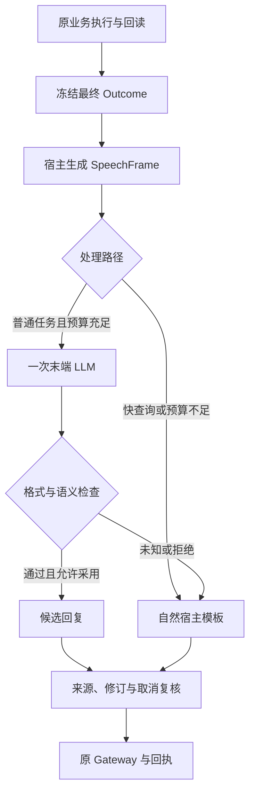

# R3 拟人化表达、评测与训练架构

## 目标与依据

让 AM 先说对方需要知道的结果，再补必要关联信息；信息不足时自然追问，执行后清楚交代成功、失败、部分完成或待核。原业务执行、事实与回执仍由宿主负责。当前交付完成可运行的表达核心、数据准备、模型对照和训练入口；尚未接入原机，也没有新增真实模型效果或训练完成证据。

基线为源码 `aab37396ea86b6e742eed79369583801664d1f35`、[审核提交 R2-FIX2](https://github.com/Catcherog/project-workbench-review/blob/9ef8076b32ecb5800c70a4f531fa2a859fb6c790/AM-HARNESS-20261031-01/R2-FIX2/00_当前交接.md)。旧代码有两个决定性的表达障碍：[校验器](https://github.com/Catcherog/project-workbench-review/blob/9ef8076b32ecb5800c70a4f531fa2a859fb6c790/AM-HARNESS-20261031-01/R2-FIX2/source/am-conversation-r1/src/am_response/semantics.py)要求多数非逐字表达带“根据记录”；[响应管线](https://github.com/Catcherog/project-workbench-review/blob/9ef8076b32ecb5800c70a4f531fa2a859fb6c790/AM-HARNESS-20261031-01/R2-FIX2/source/am-conversation-r1/src/am_response/pipeline.py)把“上述结果已保留；本轮完整目标是否全部满足，仍需核对”等技术文案设为必须原样保留。仅换模型或做微调会继续遭遇这些限制。

## 输出原则

本轮标注已明确：默认直接回答结果，追问时再展示来源；待办分点；缺答案要解释已知原因；缺对象、人员、材料或范围时具体追问；执行动作明确说是否完成；多项结果可以概括，避免机械复述。

内部来源绑定与用户可见来源分开。来源版本、权限、证据对象始终保留，但不要求每句话都带来源前缀。预计、尚未确认、否定、时间和适用范围属于事实本身，不能为自然语气删去。“暂时没有待办”要求完整查询证明为空；读取失败只能说尚未查清。“记下了”需要保存回执，“已安排重试”需要真实调度任务。

集中提出的三个新问题尚无回复，因此“推断显式标注”“先问关键两三项缺口”“复杂任务先给简短反馈”只是可修改的设计默认，不能登记为已确认偏好，更不能直接变成人工训练标签。简短反馈也只能描述宿主已知的处理状态。

## 在线处理链

真正新增的 LLM 在任务结果冻结之后运行，只组织语言，不办理业务。一次表达调用共享原任务预算；失败、未知或超时使用宿主文本。资料失效或已取消则中止，不能用旧回复回退发送。快查询保持零模型调用。

`SpeechFrame` 锁定应传达的语义义务，并提供宿主认可的说法。两个独立成功跟进可合并一句；一条成功、一条未知必须分别表达。同一原生对象、操作或回执不能被包装成两个独立完成。批准正文、真实链接保持精确文本；一般状态不再强制复述旧技术备注。

| 部分 | 责任 | 当前边界 |
| --- | --- | --- |
| `contracts.py`、`render.py` | 冻结绑定，构造事实、动作、缺口与自然回退 | 完整原子事实须由可信宿主提供；未消费的范围等限定明确拒绝 |
| `prompt.py` | 统一推理、合成与训练消息 | bounded 与 free 分属明确配置，不能混用评测口径 |
| `verify.py` | 完整覆盖、限定、精确文本与有限语法检查 | 未识别改写返回未知；不证明通用语义等价 |
| `runtime.py` | 一次生成、预算、守卫、采用记录 | `prepared` 不代表已发送；shadow 保持旧回复 |
| `providers.py` | 原协调器回调、隔离 Qwen、Codex CLI | 真实回调与原机能力证明仍待补齐 |

当前可自动核验的是 **bounded grammar**。free 配置生成更自然的候选，先做 shadow 与人评；句子像人说话不构成事实正确的证据。原机接入、通用事实投影器、专业语义校验均未通用化。

## 模型对照与验收

固定同一个 Outcome、问题、事实、回执、政策与缺口，比较 legacy、canonical、Qwen Prompt、Codex CLI、Qwen SFT、Qwen SFT+DPO。先固定业务结果只换表达处理，再验证完整任务链，避免把执行成功率误算成写作能力。

Codex CLI 自带系统指令、AGENTS 和运行策略，无法等同于裸模型调用。因此这是“模型及其调用通道”的产品效果比较，不能声称所有组的系统上下文相同。保留真实能力清单、版本、配置、调用和退出结果；不能用 Prompt 中“不要用工具”代替宿主限制。

每条记录分别计算生成是否可用、语义检查、采用、人工绝对合格、相对偏好、严重错误、真实投递和时延。缺失候选、拒绝、超时仍留在冻结分母中。建议先从原12类任务中合计选24—48个信息完整的独立场景，每类至少2项，优先覆盖缺口、失败、取消和部分完成。先看差异，再按具体薄弱点增加多轮场景；这是工作量建议，尚未执行，也不保证达到某个分数。

## 数据闭环与训练路线

用户48项评分中，43项是相对选择、4项两者都不合格、1项未评分；43个“更好”不表示43个合格答案。原材料只有10对完整可比候选，私有配对与揭盲键未公开。先校验 dataset hash 并读取原配对，保留缺失与占位，不从字母A/B推断模型胜率。[原构建脚本](https://github.com/Catcherog/project-workbench-review/blob/9ef8076b32ecb5800c70a4f531fa2a859fb6c790/AM-HARNESS-20261031-01/R2-FIX1/scripts/build_blind_review.py)记录了私有文件位置。

包内26条虚构候选来自13个原型，6条构造反例单独用于语义挑战；均未获人工训练批准。当前可训练 SFT 行数与 DPO 对数均为 **0**。

先按独立场景/原型分配 train、dev、test，再生成实体或措辞变体；同原型及近似变体不得跨集合。旧人评用于校准政策后，不再当完全未见测试。每次政策或 Prompt 变更使旧审核失效；样本需绑定具体输入、输出和审核记录。

正式 gold 路线使用人工绝对合格且事实通过的答案。为减轻标注负担，另提供小批人审锚点加双模型筛查的 experimental silver SFT，明确是弱监督；生成与评审必须有真实调用记录。DPO仍使用同一输入下两条事实均通过、人工偏好明确的答案，事实错误反例留在独立挑战集中。详见 [合成训练](silver_training.md)。SFT 可以先规划300—800条、DPO 150—400对，但数量只是预算，质量与独立覆盖决定是否值得训练。DPO 从 SFT 结果起步，reference 固定为同一 SFT 状态，不能训练中漂移或悄悄退回原始基座。

训练使用可核实的原始权重、tokenizer 和 chat template。现有 Ollama 标签不能证明对应 Hugging Face 基座，Mac Studio 内存与可用训练资源也待原机核实。具体 CUDA/MLX 兼容边界、预检和脚本见 [training_research.md](training_research.md)。本轮用户已允许隔离训练尝试，不机械继承旧R1“不训练”的范围；远程付费、生产模型切换和正式启用仍未执行。
