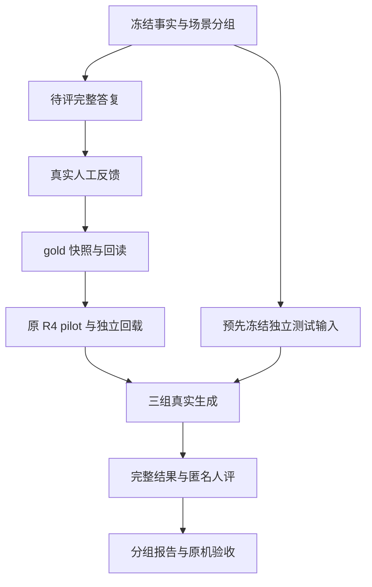

# R5 详细架构设计

## 1. 目标与可验证结果

R4 已证明三项限定宿主修复、真实 Qwen 开发观察以及独立 MLX 的一次参数更新、保存和新进程重载能够闭环。下一步的主要缺口是可训练的人评数据不足，训练证据没有连接到同输入的效果比较，公开开发案例也不足以支持自然度或业务结论。

R5 的工程目标是把这些环节做成一条可重复、可定位失败原因的流水线。一次合格执行应能回答：

- 哪些完整答复得到谁的什么认可，修改后是否重新取得认可？
- 训练实际使用了哪些文件、样本、场景组和版本？
- 选择的 adapter 是否来自同一基座的完整 pilot，保存后能否独立加载？
- 同一个冻结输入在生产 Q8、未训练 MLX 和 SFT MLX 上分别返回什么，失败或未执行的情况有多少？
- 人工认为事实是否正确、表达是否自然、能否直接使用；差异是否来自未参与开发的场景组？
- 宿主状态、权限复查、执行状态表达和重复消息行为是否保持原合同？

R5 不重新设计业务执行器，不把生成模型当作事实来源。模型的输出只承担已冻结事实的表达；实际业务动作、身份、权限、回执和最终发送继续由原宿主控制。

## 2. 总体拓扑

原生产通道继续保持 R4 已审状态。上述链路运行在独立实验目录；只有显式实际运行命令会向已有合成探针队列提交请求或启动一个隔离 MLX worker。生产 Q8 始终使用原消费者；MLX 复用原协调锁，不建立第二套服务。

## 3. 模块及职责

| 模块 | 输入与输出 | 主要规则 |
| --- | --- | --- |
| `common.py` | 严格 JSON、内容哈希、文件读写 | 拒绝重复键和 NaN；新文件独占创建；seal 只表示内容一致性 |
| `scenarios.py` | 22 条虚构开发场景、待评全文、实际 prompt | 15/7 预分组；不是模型观测、不是人工标签、不是独立测试 |
| `dataset.py` | 场景清单→待评批次→反馈导入→gold 快照 | 固定旧 9/1；改稿使反馈失效；回读重放人评合同；跨 split 去重 |
| `pilot.py` | snapshot + 原 mechanics + 原 manifest→计划/预检/argv | 精确原件绑定；训练数据与运行源码检查；只复用已审 trainer |
| `evaluation.py` | 冻结测试输入→三组计划→结果→盲评→报告 | 三组固定分母；相同 MLX 设置；原始工件核对；人评与机器检查分开 |
| `collection.py` | 明确运行目录→已保留的逐条记录→新JSONL | 中断恢复；坏记录、重复和并发变更均拒绝；不推断进程已停 |
| `runners.py` | 真实计划→原 Qwen 队列 / MLX 隔离 worker | 显式执行；原队列及身份校验；原锁；超时停止确认；保存失败 |
| `arms.py` | 原机 manifest + 完整 pilot→实际三组身份 | 从原件生成模型/adapter 身份，不要求手填成功哈希 |
| `cli.py`、`run.py` | 命令行→上述模块 | 路径与导入根明确，默认只准备，输出目录不覆盖 |
| `verify.py` | 本包源码/基线→离线验证报告 | 逐文件基线核对及标准库测试；不加载模型 |

原 `am_style` 继续提供 `SpeechFrame`、`StylePolicy`、prompt、native envelope、有限语义守卫与人工反馈导入。原 `training.mlx_r4` 继续提供训练数值实现和资源控制。重复实现这些已审核心会使 R4 的 mechanics 证据失去直接对应，因此 R5 采用新增编排层。

## 4. 数据对象与不可变关系

### 4.1 场景与表达分离

场景固定 `id/group_id/split/frame/style_policy`，完整候选固定 `candidate_id/text/text_sha256`。事实的主体、时间、范围、否定及 effect 状态来自 frame。`logical_messages` 由固定 R4 builder 构造，`student_wire_messages` 由同版本 `coordinator_messages()` 构造；训练与生成绑定真正的外层单 user envelope。

`facts_for_review` / `review_context` 是人类读取事实的依据。真实数据需要 Codex 保留与实际业务记录的对应来源；虚构开发样例明确标记 synthetic，不能声称读过真实台账。

风格 policy 沿用 `muyi-style/3.0-draft.1`。R5 是流程版本，不能把旧 gold 的 policy 版本直接改成 R5 来绕开训练器的同版本限制。

### 4.2 人工反馈状态

| 当前状态 | 事件 | 下一状态与效果 |
| --- | --- | --- |
| pending | 没有明确判断 / 只能比较谁较好 | 继续 pending，不增加 gold |
| pending | 完整文本的事实、风格、绝对可用均被真实人工认可 | 可导出 SFT；还须通过分组和快照校验 |
| pending | 事实错误、不可采用或无法判断 | 保留拒绝/待修原因，不计可训练行 |
| 已评 | 修改任何候选全文、prompt、事实或 policy | 旧反馈失效，新上下文需要新的认可 |
| 已导出 | 原反馈或训练文件变化 | 回读失败，旧 ready 标记不能继续放行 |

反馈保留 reviewer、时区时间、原始反馈文件 SHA 与完整文本 SHA。Codex 转写人类回复时必须保留真实原文。哈希能够发现后续变动，无法认证一个人是否真实发过这段话；真实性依赖原机执行与人工来源，代码不会把自报字段当作可信身份。

### 4.3 分组与样本数量

旧 9 train / 1 dev 字节保持不变。新增 22 条全待评：5 个新训练组各 3 条，4 个新验证组共 7 条。它们覆盖负责人和阶段范围、估算前提、部分执行与未知结果、起算与时长缺项、取消范围及历史状态，以及冲突记录、同名项目、预览版本变化和未读取来源。

如果全部得到认可，快照可达到 train24/dev8、组14/5。最低门槛不是数据质量证明；同组变体不能被当作完全独立的观察。若某条被拒绝，按反馈修订或新增真正不同的场景，不能复制旧行、移动 dev 或把 pending 改 true。

训练、dev 和独立测试按场景组隔离，并对真实 prompt 做近重复检查。公开的旧测试、公开的新 22 条以及用于调参的材料都属于开发材料。独立测试另取原机未暴露场景，在训练前以 `eval-freeze` 固定。冻结不依赖尚未产生的 adapter，因此不会被迫先训练再选测试集。

## 5. 训练架构

### 5.1 计划绑定

`pilot-plan` 读取真实快照、已审 mechanics-002 原始 result 及其 7 个工件、原 base manifest、选定 Python 与实际源码。R5 固定接续的 mechanics result SHA 为 `bf4ac5775e61e9626fb92460a49b197045a4b2d310090e70a39257e9dda6d7b6`。公开脱敏 request 和没有 adapter 的审核包不满足这个原件图。

数据门槛为 train24–48、dev8–16、场景组至少8/4。配置仅改变数据路径与哈希、stage=pilot、梯度累积4，并引用原 mechanics。保留一遍数据、seed221、最后2层 LoRA rank8/scale2/dropout0、lr1e-5、weight_decay0.01、bias_correction=false 和最长1024 token；超长内容拒绝而不截断事实。

预检在选定 Python 的新进程调用原 R4 合同，检查原源码、依赖元数据和证据，不导入 MLX、不加载权重、不取得协调锁。显式执行时重新预检，原 trainer 在自己的进程再次检查后启动实际训练。

### 5.2 资源与停止

MLX 运行复用原 `model-coordinator.lock`，加载前至少24GiB可用内存，运行中至少5GiB，MLX上限22GiB，单 worker 最长300秒。业务任务到来、临界压力、swap增长超过1GiB或时间耗尽会触发停止；不卸载原 Qwen、不新建消费者、不自动重试。

fit 退出且确认停止后，才允许独立 reload。保存目录使用新标识，adapter、config、request、steps、kernel、fit、reload、result 共同形成证据图。成功更新参数与成功回载证明机制工作，效果仍由后续生成和人评判断。

## 6. 实际生成架构

### 6.1 三组比较

| 组别 | 固定内容 | 实际用途 |
| --- | --- | --- |
| production Q8 | 原模型名、digest、原消费者、原队列、原 schema 与650 token /90秒请求设置 | 原运行系统参照；不作为同权重因果对照 |
| MLX base | 已审官方独立4-bit文本基座、revision、tokenizer、template、无adapter | 训练效果对照 |
| MLX SFT | 同一基座与所有生成设置、经完整pilot回载的adapter | 与MLX base成对比较adapter影响 |

两组 MLX 使用相同 native envelope、greedy sampling、seed221、max_tokens192、max_prompt_tokens1024、enable_thinking=false 和同一 runner 源码。原 Q8 服务的未知默认 temperature 记录为 null；不会谎称其与 MLX 的底层采样和权重等价。

`eval-arms` 从本机原件读取三组身份。真实 runner 在运行前与 worker 内核对 manifest、权重、tokenizer、chat template 和所选完整 pilot。加载 SFT 后核对完整 adapter keyset 与逐张量一致性。独立运行两个 worker，避免 base 意外继承前一个进程加载的 adapter。

### 6.2 原队列

队列路径从已封存的主配置→`poc_config`→`service.root_directory/state/am-conversation-r2` 推导，与传入路径逐值比较。主配置和 poc 配置都必须属于 manifest 中已经保护的文件；不能把任意存在的目录冒充原队列。Codex 还须实读原机进程信息，确认原唯一消费者 PID。

每条请求在提交前保存实际 envelope、原队列 payload 和生成设置，使用独占随机文件名提交。响应核对 label、operation、原模型/digest/PID、synthetic scope 等。这里捕获的是原队列交换；它不是底层 HTTP 报文抓包。

缺失响应、身份不符或无法确认停止时，不提交后续样本；其余计划位置保留 missing。恢复必须先核清原调用状态，不以重复请求掩盖超时。

### 6.3 MLX 子进程

父进程封存计划、运行源码、manifest、选定pilot、case集合和timeout，启动新的 Python worker。worker重新校验后取得原锁，再加载模型并逐token检查资源。父进程超时只结束自己启动的子进程组，保存停止是否确认；不杀原生产消费者。

逐条结果先落盘；一个 worker 失败不会抹去已经完成的原始请求和响应。Codex 汇总完成与失败记录；没有完成记录的计划位置保持 missing，不能伪造 completed。

## 7. 评测与解释规则

`eval-plan` 固定全部 case×arm 分母。真实 sealed_test 必须提供已验证 gold 快照以重新读取 train/dev，检查组与近重复，并附绑定 case manifest 的真实“未用于训练或调参”声明。所选pilot的实际train/dev文件SHA同时进入SFT身份，必须与排除快照逐项一致；worker还会将身份与pilot原request重新核对，避免使用A快照排除而实际在B数据上训练。任何字段重新计算 seal 都不能替代这次回读。

机器层分别统计 schema 与有限事实守卫结果。人工层分别收集事实正确性、自然度1–5、绝对可用性，以及同输入的left/right/tie/both_bad/cannot_judge。匿名选项随机排序；私有映射与评审材料分开。候选若自报模型身份，不能静默改写后继续声称原输出盲评。

报告给出逐组结果、完整状态计数、同代码MLX有效配对数、事实合格及直接采用比例、自然度中位数和相对偏好。无反馈时这些值保持空或0。延迟同时给所有已尝试请求和completed子集的p50/p95/max，失败等待不能被删掉。模型加载与逐请求耗时的范围由运行工件另行说明。

首次pilot属于小样本探索。建议原机在训练前另冻结至少8个新场景组、每组至少2例，覆盖否定、时间、范围、条件、执行状态和冲突信息；这是本轮评测设计目标，不是已经取得的测试数据或统计显著性保证。若不足，仍报告真实数量与结果，不把样本少解释为已证明改善。

本轮不自动计算未经预声明的显著性，不凭NLL、schema或有限规则守卫决定自然度。适配器效果只解释同基座对照，生产Q8差异同时包含量化、运行时、参数等因素。训练资料上更好而独立组上无改善的结果必须保留。

## 8. 故障、证据与交付

| 故障 | 系统行为 | Codex 后续 |
| --- | --- | --- |
| 数据不足或认可不完整 | 阻止pilot，保留pending | 取得真实反馈；继续完成不依赖训练的准备 |
| 原件缺失、源码变化、配置变化 | 输出blocked原因 | 保留原机最新版，定位与审核差异 |
| 队列/模型/消费者身份不一致 | 停止后续生成 | 实读配置及进程，保存证据，禁止猜测 |
| 内存、业务抢占或超时 | 停止worker并记录是否确认 | 停止确认前不开新模型；另定新运行ID |
| 截断、JSON失败、事实不确定 | 保留原文与状态 | 不把它当可采用答复 |
| 人评两者都差或无改善 | 保留真实结论 | 不自动追加训练步数或换模型“救指标” |

文件快照以相对路径保存，原始反馈副本可以随快照迁移；实际运行计划因包含真实原机路径，需要在同一原机目录保持稳定或明确重建计划。审核导出可脱敏，但必须分别保留原件SHA与导出SHA，不能把脱敏副本宣称为可执行原件。

公开回传不包含权重、私有原始反馈、盲评映射或凭据。R5交付时生成逐文件清单，固定GitHub提交后再远端回读；任何自然度或业务结论必须指向该次真实原件、人工判断和对应源代码。

## 9. 固定来源

- [R4 当前交接](https://github.com/Catcherog/project-workbench-review/blob/0641a282584a68f60ddaf198326fc431ba67ee13/AM-HARNESS-20261031-01/R4/00_%E5%BD%93%E5%89%8D%E4%BA%A4%E6%8E%A5.md)
- [R4 原队列宿主探针](https://github.com/Catcherog/project-workbench-review/blob/0641a282584a68f60ddaf198326fc431ba67ee13/AM-HARNESS-20261031-01/R4/scripts/probe_terminal.py)
- [固定 MLX-LM generate.py](https://github.com/ml-explore/mlx-lm/blob/93e6d4a6447b3080861985947f0820e76fcb957d/mlx_lm/generate.py)：`stream_generate`、默认greedy sampler与prompt progress callback的实际接口。
- 本包 `baseline/PROVENANCE.json`：所有复用文件的固定提交与逐文件SHA256。来源快照未经改写。
