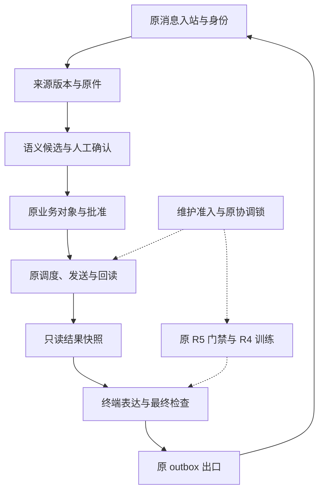

# AM 整体架构与实施计划

## 1. 产品目标和边界

AM 的目标是把“读取资料、判断当前事实、形成可执行跟进、确认外发、关联反馈、核验业务完成、清楚表达结果”接成一条可追溯流程。后训练改善最终表达；通知功能维护业务执行与反馈。表达模型无权创造任务、收件人、批准、送达事实或关闭依据。

本轮把两条主线放回原宿主，共用原来源权限、业务对象、协调器、outbox、scheduler、回执和取消规则。没有新的常驻机器人或独立消费者。所有生产表达开关仍 off；新代码可在原实例中分阶段启用和验证。

## 2. 分层及唯一事实来源

| 层 | 负责内容 | 权威数据／复用对象 | 本轮变化 |
| --- | --- | --- | --- |
| 入站身份 | 应用、租户、用户、会话、线程、原消息、期限 | 原 ingress、`am_inbox`、`am_source_meta` | 增加准确文字命令与原件回读批准 |
| 来源 | 读取授权、来源版本、原文、撤权与过期 | 原 information store、访问 epoch | 保留原 fence；维护期模型提取入口停止新推理 |
| 语义 | 项目归属、执行、验收、否定、转述、条件 | 原候选和 `action_semantics` | 仅修 SEM-01；不扩大 LLM 决策权限 |
| 业务 | 当前事项、负责人、核验人、版本、暂停／取消 | 原 `action_items`、coordinator | 文字 UI 复用原原子业务操作 |
| 执行 | 明确批准、原 request UUID、防重、exact target/body | 原 previews/intents/adoptions、scheduler | 不创建第二条发送通道 |
| 结果 | 准确回执、关联回复、业务核验分别记录 | 原 occurrences、receipts、reply links | 新只读 `FollowupSpeech` 投影 |
| 表达 | 符合事实的文字选择、快路径、候选验证 | 原 `TerminalPresenter`、`SpeechFrame` | 新跟进 family 与真实状态入口；默认 off |
| 训练控制 | 冻结独立材料、资源租约、fit/reload、恢复 | 原 R5 + 原 R4 + 原模型锁 | 增加可恢复维护窗口，不另建 trainer |

新增表仅保存文字预览关联／短期选择、表达输出绑定与指标，均不是新业务事实库：`am_followup_text_actions`、`am_followup_text_choices`、`followup_expression_outputs`。正文与来源派生内容按原期限清理；不可变 UUID、摘要与防重记录保留原语义。原机迁移应使用现有数据库备份流程，禁止替换整库。

## 3. 四类状态必须分别回答

| 维度 | 典型状态 | 可以说什么 | 必要依据 |
| --- | --- | --- | --- |
| 发送 | 未批准、已排队、发送中、结果未知、核实已发出、失败、取消 | “正在等原 AM 执行”“结果尚未核实”“消息记录已核对” | 准确 intent、occurrence、request UUID、正文、对象及回执 |
| 反馈 | 无关联回复、收到回应、自报进展 | “负责人已回应”“自报内容待核对” | 精确关联原发送与当前有权负责人 |
| 业务 | waiting、in_progress、blocked、submitted、closed、cancelled | “尚未核验完成”“已提交待验收” | 原业务状态；closed 需指定核验人与依据 |
| 表达 | off、shadow、enforce；未尝试、拒绝、采用、回退 | 内部指标说明本次如何生成 | 同一结果快照、候选验证、最终出口检查 |

“已发出”不代表“已收到反馈”；“收到”不代表“工作做完”；“我做完了”不代表核验通过。模型生成的肯定语气不能改变任何一项原生状态。

unknown 默认表达为“发送结果尚未核实，暂时不会重发”。只有原 scheduler 中仍存在未过期、未耗尽、同 occurrence／request／target／body／message 的只读回读任务，才允许“我确定一下”或“已安排核对”。这只是说明真实已安排的工作，不承诺会成功核实。

## 4. 纯文字交互

### 4.1 查看与反馈

- “我的跟进”：每页最多 3 项，以稳定短序号选择；可切换待处理、待反馈、已关闭。当前只展示已登记事项，明确不代表所有来源已同步。
- “查看跟进 1”：完整事项、负责人、要求、业务状态和下一步。若列表缩短标题，明确可在详情看完整内容。
- “跟进状态 1”：默认 off 仍显示原完整详情；显式启用后通过同一原生快照、prepare/enqueue 和原出口显示发送／反馈／业务三种状态。此导航固定 fastpath，不调用模型，不会在资源维护时唤醒 Q8。
- “跟进反馈 1”：一页展示一条完整原话与归属、时间和待核对提示，按原文保留期限处理。过长内容明确阻塞／分步展示，不截掉确认所依据的正文。

文字列表是交互投影，不是自动采纳模型候选。选择会话及线程范围内的序号不能跨会话使用；源权限和期限仍在实际读取时核验。

### 4.2 准备、修改与批准

“群聊跟进 1”或“私聊跟进 1”产生完整文字预览。预览包含实际目标与全部外发正文，不经过表达模型改写。确认只对应这一版正文和对象。

用户可直接引用该条预览回复“确认发送”，或发送带该预览短码的“确认发送 XXXXXXXX”。“好”“收到”“发吧”等不会被解释成批准；单独的“确认发送”缺少准确引用也不批准。

修改正文、目标、依据或版本后，旧预览 superseded。修改后的完整正文必须形成新预览。取消只取消所绑定操作，不扩大取消其他事项；若已经进入不可确定的发送状态，沿用原 unknown／核实流程，不伪称已撤回外部消息。

确认时独立读回平台入站原件与已送达完整预览，核验 sender、app/tenant、chat、原文 fingerprint、消息时间、准确父消息、正文哈希和有效期。真实飞书可能在引用回复时新建 thread；仅经平台原件证明准确 parent，才可把同一四元身份范围的新线程关联回原预览。不能只信本地 parent 字段，也不能全局移除线程隔离。

批准后继续调用原 `approve_batch → adopt → scheduler`。来源、对象及版本在批准和真正发出前分别检查。历史卡片回调仍按原协议处理；文字预览禁止被伪装成卡片回调批准。

## 5. 原生结果进入终端表达

`FollowupSpeech` 保存规范化 JSON 及摘要，字段包括：

- 请求 binding：原 turn、四元身份范围、source revision、item version、semantic version、cancel epoch、owner/requester。
- 业务快照：事项标题、原状态、暂停、核验人、关闭人、关闭依据摘要。
- 发送证据：原 occurrence、intent、request UUID、message ID、body/target SHA256 和 exact receipt。
- 反馈：只使用精确关联的消息 ID、actor、kind，不把原始业务私文塞进风格提示。
- 回读任务：可选，仅由原 scheduler 真实排队状态投影；不新建任务。

生成过程在 AM mutex 和信息事务外进行。`prepare` 前取得事实快照；生成期间 guard 重读；`enqueue` 在原状态事务下再次比对并写入原 outbox；原 gateway 真正发出前再次核验权限、期限、快照、正文及运输类型。任何变化拒绝旧候选，不用旧详情作为兜底发送。

`TerminalPresenter` 继续支持 off、shadow、enforce；采用候选须通过原 schema、语义与时限检查。新入口初始 fastpath，为连接验证提供确定性状态文字。真实影子候选须先把 `CoordinatorProvider(original_invoke)` 注入 `TerminalPresenter(mode="shadow", wall_clock=host.s.clock)`，再将 presenter 传给 `NativeFollowupExpression`；其中 `original_invoke` 必须接原协调器。调用同一 `prepare` API 时显式设 `fastpath=False` 和 `deadline=原任务共享monotonic截止时间`。默认 `fastpath=True` 始终不调用模型，不能拿快路径结果声称已进行模型对照。禁止另起模型、另发消息或扩大任务时限。

影子模式候选应存于原私有实验区，只展示原确定性内容；真实生产是否启用 enforce 是单独宿主接入结论。本轮不自动启用。

### 指标必须分开

表达表记录 frame hash、metrics、快路径／候选采用原因及输出摘要。`native_sent` 仅表示原发送回调给出 message ID，不冒充独立平台 readback。普通 legacy 输出通道的零表达调用指标不能覆盖这张绑定表中的实际表达指标。

分开统计：事实合同通过率、真实模型语义错误、unknown／重复发送、真实送达、回复关联、人评偏好、宿主时延、业务关闭。不得把单元检查数、被门禁拒绝的样本数或候选数解释为模型准确率。

## 6. 资源窗口与业务并行

训练和 Q8 推理共享原机内存。窗口需要同时解决内存释放与业务一致性：

1. `resource_window_owner` 在原 Store 事务内 CAS 占有，不覆盖其他窗口。Store、DurableStore、AM、Harness、普通聊天及信息模型入口在原 claim／执行边界检查它。
2. 已开始的业务可以继续完整结束；新模型业务留在原 received/queued，attempts 不增加，不变成 failed/unknown。只有真正排空后才写原 `provider_pause`。
3. 元数据、消息入站、准确取消／更正、原回读以及纯文字查询继续；新业务出现仍计入原 R4 pending，触发原训练让路。
4. 原协调锁内维护并卸载精确 Q8；随后释放这段锁，持有准入维护标记，重新进入原 R5。原 R4 取得同一原锁后执行自己的 24 GiB 检查。
5. 退出确认所有训练工作者停止，重新取得原锁恢复同 Q8，再验证模型及服务配置后开放准入。停止或恢复不确定时留具体 blocker 和 journal，不自动放开、不自动续训。

现有导出包含原协调器和客户端，没有实际 llama.cpp proxy/manager 控制实现。控制算法及注入端口已完成；Codex 必须用原机真实管理器接上 `read_observation`、`suspend/restore` 和 worker 停止证明。接口若不存在或无法安全恢复，准确保留该端口阻塞。

## 7. 后训练数据与效果路径

原 24/8 gold 和三轮反馈继续使用，不重开同一轮认可内容。新开发文本、语义回归、已发表案例及合成状态样本统一列入 `DEVELOPMENT_EXPOSURE.json`，不得进入独立测试。

独立测试在任何训练前冻结：真实原件、来源和权限、case-bound 未用于调参声明、场景与期望、计划及材料绑定遵循原 R5。缺材料不影响准备、检查、纯文字工程或资源诊断；但不能启动训练。

真实门禁成立后沿用原 R4 参数运行受控 pilot；原 Q8 与候选使用同一冻结输入及一致执行条件对照。硬事实错误与缺义务先作为失败，风格好听不能抵消；人评只评价真实新增候选，不重评已经认可的 gold。模型输出进入原宿主前，还须验证最终事实绑定、超时／取消、unknown、原唯一消费者和回退路径。

通知抽取模型的项目、转述、条件与分类问题属于另一类能力缺口。当前终端表达训练不能自动解决它们；保留真实逐例结果，按数据、提取器、分类校验分别定位，不能混用风格训练结果替其验收。

## 8. 实施顺序与完成标准

| 阶段 | 具体工作 | 完成标准 | 不满足时 |
| --- | --- | --- | --- |
| A：当前树合入 | before/after 检查、保留本机后续修改、增量迁移 | 实际源码 SHA、差异、相关回归，无新增失败 | 留具体冲突，不覆盖有效代码 |
| B：文字及事实路径 | 真实手机、完整预览、准确引用、取消、防重、回读、期限 | 平台原件与本地绑定一致，业务状态独立 | 保持原生产关闭项，修复可复现问题 |
| C：资源诊断 | 精确模型映射、维护排空、临时卸载、实测、恢复 | 诊断 trainer=0，同模型恢复，实际可用量及压力明确 | 记录资源／端口／运行窗口阻塞 |
| D：独立材料 | 授权范围候选检查、原件及声明绑定、训练前冻结 | 原 R5 fresh gate 全部通过 | 保留材料 blocker，继续 A/B/C |
| E：pilot | 原 R5 再验→原 R4 fit/reload→停止证明→Q8恢复 | 真实训练日志、产物、资源与恢复证据 | 不伪造成功，不自动重试 |
| F：效果与宿主 | 原 Q8／候选对照、增量人评、影子运行、接入回归 | 效果、人评、宿主各自明确结论 | 保持生产表达 off |
| G：业务验收 | 独立工程师完整闭环 | 按用户恢复验收后的实际业务依据 | 当前按用户决定暂缓 |

回退以当前原机备份及实际差异为准。不得删除收到的任务、既有反馈、历史 request UUID 或 unknown 记录；不得通过清库、重复发送、改阈值或更换原模型把检查改成通过。
