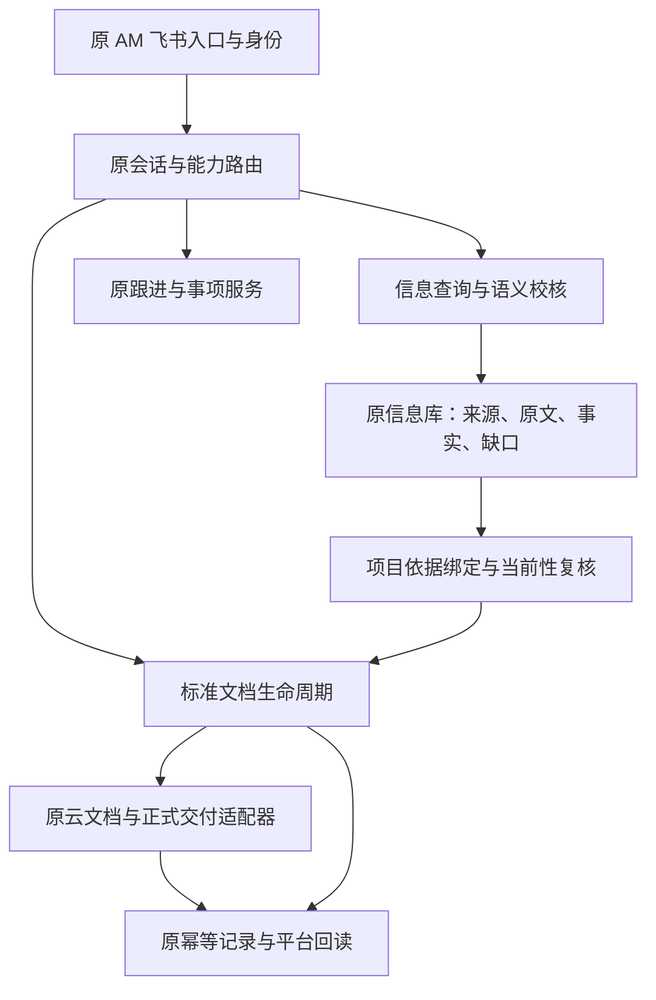
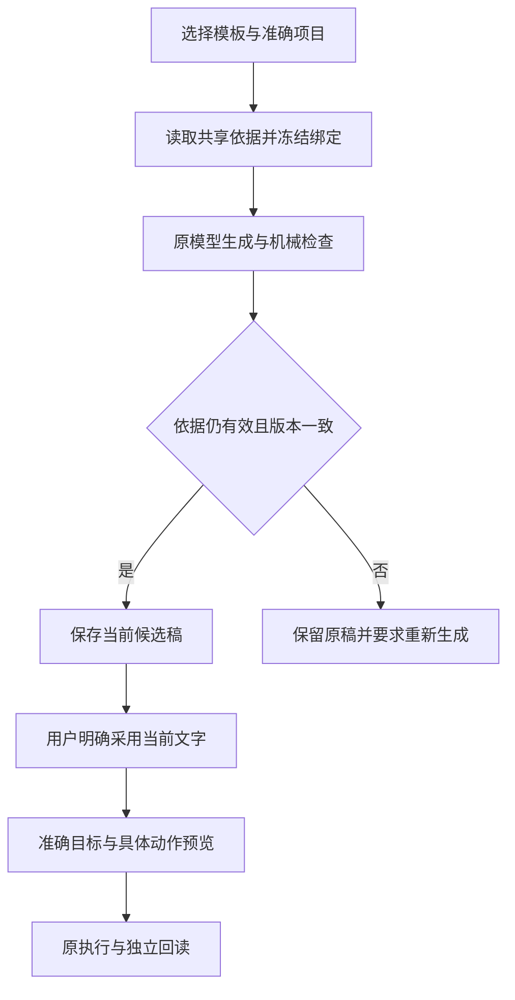

# AM-HARNESS-20261031-01 / R9 详细架构与实现设计

版本：R9 implementation v1.0。日期：2026-11-03。状态：代码候选与离线验证；原机安装、真实模型/平台验收由 Codex 执行。

## 1. 本轮目标、依据和范围

用户决定：“可以，你完成详细的架构设计和代码开发，codex实际验收”。本轮把既有 AM 的信息理解、共享项目依据、标准文档、自然对话和表达评测串成有明确接口及失效规则的可审查增量。已有跟进、模型协调、身份、出站 journal 和回执流程继续复用。

依据为审核仓 `Catcherog/project-workbench-review` 的固定提交 `13c653263e58de81f3cd4ae44269008c4b82e13d`，按各轮覆盖关系重建所需源码。该审核提交所记录的 R8 业务源码提交为 `444ae89eb1be794bebb868bcfe5b097720c5962d`。两者属于不同对象，不能互换。`provenance/RETRIEVED_SOURCE.json` 逐文件记录来源路径、Git blob SHA、SHA-256 和覆盖层。这里提供的是经过校验的相关源码集合，不是原机完整安装备份，也不是整个业务仓的最新工作树。

用户最新本机 R8 代评回填作为已报告事实保留：11 个输出、7 段不同文字，场景 2 两版可原样采用，其余需精简或澄清；评价身份为“牧翊授权的 GPT 代评”，新增真人评分仍为 0，无输出位置未评分。该新回填尚未在本轮云端取得原件，代码只提供准确映射导入能力，不伪造已导入结果。

### 实现边界

| 领域 | 本轮实现 | 沿用的原机制 |
| --- | --- | --- |
| 信息理解 | 真实项目目录契约、项目/转述/条件作用域校核、完整且有界的信息投影 | 原来源 ACL、有限候选抽取、FactEngine、可见缺口 |
| 项目依据 | 单个 SQLite 视图中的项目事实与文档依赖绑定、最短原文期限、纯本地当前性检查 | 原 information.sqlite3、全局 access epoch、原完整台账快照 |
| 文档 | 来源与限定保真、缓存/生成/采用/保存/投递的统一复核、正式目标只读发现 | 原模板、原文档生命周期、原云文档 publisher、原 Meegle 绑定和幂等回执 |
| 自然对话 | 正式目标发现入口，旧依据拒绝正文复用，冲突/缺口/待确认的分页展示 | 原会话授权、能力选择、预览与用户明确批准 |
| 表达评测 | 原格式只读诊断、完整分母、配对身份验证、GPT/真人/机器分别统计 | 原冻结计划、原候选、原机器守卫、原训练门禁 |
| 跟进 | 对关键既有流程回归核验 | 原事项、反馈、导航、唯一消费者及发送路径 |

当前批准配置仍为原 Qwen、唯一消费者、`identity_cache_seconds=600`、`ledger_write=false`、`response=legacy`、终端新表达和 rewrite 关闭。本轮没有训练、生产切换、真实消息发送或正式业务写入。

## 2. 体系结构



表达诊断是离线读者：读取原冻结 plan/results/pilot 与准确评价数组，输出新报告。它不进入消息消费、模型推理或训练循环。

### 为什么保持原宿主

新逻辑依赖原可信身份和业务范围。增加第二个消费进程、第二套事实存储或单独的“文档机器人”会引入双重发送、事实漂移和授权不一致。本轮直接在原信息接口、证据契约及文档守卫上扩展；没有建立新的事实主库，也不从用户文字中接受 Principal、用户身份、群公开范围或审批结论。

## 3. 信息理解：从来源到候选事实

### 3.1 项目目录与作用域

实际 `EntityCatalog` 返回 `name / aliases / resolved`。原提取器部分路径仅认 `title`，会把真实已登记项目当成缺少目录。本轮优先读取真实 `name`，同时兼容原 `title`，仅使用目录显式登记的别名，不自动推测缩写。

对话 hint 可以缩小本次生成提示，但语义校核仍使用完整、已经授权的项目目录。hint 既不能扩大权限，也不能把明确属于另一项目的原句改写成当前项目。遇到跨项目句子、重复原句、多处相同引用或无法确定的主语，保留缺口，要求澄清。

### 3.2 语义校核

新增边界覆盖：逗号后出现明确新项目、同段多个项目、无项目裸句、引语重复出现、跨句主语误继承、肯定转述连续分句，以及转折/否定/条件/新发言切断转述作用域。

“没有开测记录”在 R6 已有处理，本轮补的是更复杂的名词结构，例如“没有开测的相关记录”“未开始测试的有效证据”。缺少记录不自动推出业务没有执行；“尚未开测”这种直接否定仍保留其业务含义。否定、预测、计划、条件与实际结果分别处理。

校核失败时沿原机制拒绝整个抽取候选批次并形成可见 gap，避免先插入一半错误事实。候选仍为 `unconfirmed`、`protected=False`；本轮没有确认事实或升级业务状态的新写入口。`BoundedCoordinatorExtractor.version` 为 `am-native-bounded-v5`，覆盖规则版本为 `source_span_coverage_v3`。

### 3.3 自然对话投影

`read_information` 继续只读取宿主已授权的结果。投影保留 authority、protected、stale、否定/时间/条件/归因/冲突信息，并显式提供 `conflicts / incomplete_reasons / pending_confirmation / effective`。

原工具结果有长度上限，不能把完整状态无界塞入一条响应。小集合直接展开，大集合提供总数、返回数、未展开状态和后续读取参数。复用 `section` 的 `@conflicts / @incomplete_reasons / @pending_confirmation / @effective` 页，不增加权限。

某条事实的限定信息过长时，不输出去掉限定后的裸结论。原句仅在上游确认可读、原文期限已知且能覆盖当前对话记录的保留窗口时透传；否则显式说明未展开原因，不从 derived value 重建 quote。`complete_response` 只表示本次投影是否完整，不表示业务信息已完整、正确或批准。

## 4. 项目依据快照与版本契约

### 4.1 原子读取

`InformationService.query(..., connection=...)` 允许在调用者已有的本 Store 事务中读取事实和 coverage；`Store.read_in_transaction` 继续校验连接归属及已开启事务。文档快照调用原 `Store.transaction()`，在同一个 SQLite 视图里读取来源、当前对象、事实、冲突、待处理作业和缺口。

该事务沿用 `BEGIN IMMEDIATE`；读取不产生数据库内容更改，但会短暂占用本地写锁。身份、平台读取及模型调用均在外部完成。没有把网络请求放进这段新事务。

### 4.2 绑定结构

以下为结构示意，不是真实项目数据：

```json
{
  "schema": "am-document-evidence-binding/1",
  "project_id": "原项目稳定键",
  "project_code": "准确业务项目编号",
  "scope": ["tenant", "app", "user", "chat", ""],
  "expires": 0,
  "access_version": "原全局权限epoch",
  "state_hash": "64位SHA256",
  "dependencies": [
    {"source_id": "来源", "object_id": "对象", "version": "准确版本", "raw_expires_at_ms": 0}
  ],
  "ledger_evidence": {
    "source_id": "th2-ledger",
    "object_id": "原项目稳定键",
    "version": "准确台账对象版本",
    "raw_available": true,
    "raw_expires_at_ms": 0
  }
}
```

绑定不保存原文、候选正文或凭据。其 hash 包括稳定项目身份/字段、来源策略与可用性、当前对象版本和可读性、完整事实内容与 authority、有效项/冲突/待确认，以及稳定的 gap/job 状态。单纯轮询时间和心跳不参与业务版本，但从新鲜转为 stale 会改变质量状态。

### 4.3 变更如何使旧稿失效

| 变化 | 行为 |
| --- | --- |
| 相关事实、引用对象、来源版本、authority、冲突或缺口改变 | 旧绑定失效，要求重新读取并生成 |
| 相关新消息尚未提取成事实 | 由对象集合/待处理作业捕获，不等到 fact_id 出现才失效 |
| 新增明确映射到本项目的来源 | 来源集合变化，旧绑定失效 |
| 无关来源仅内容更新 | 不进入本项目依赖集合；不因此失效 |
| 同一台账另一明确项目的 pending/gap 改变，当前项目版本不变 | 按 ledger object_id 隔离，不因此失效 |
| 台账来源级错误、全表修订导致本项目对象版本变化 | 保守失效 |
| 普通聊天来源里归属尚未解析的新对象 | 按整源保守失效，不能把未知消息先排除 |
| 任一来源 ACL 引起原全局 access epoch 改变 | 保留原全局撤权保护，仍拒绝旧绑定 |
| 原文到期、删除、清理、当前对象冲突或台账不可读 | 旧绑定失效；必需台账不可读时拒绝新绑定，其他失效原句不再映射并保留缺口 |

这里的“当前”指本机已成功读取、当前仍可读的视图。它不是对远端实时状态的无条件证明；轮询间隔、stale 和来源读取错误仍按原约束显示。

### 4.4 台账原文不能从缓存复活

每个共享标准文档必须有唯一的 `th2-ledger` 当前项目对象，来源须可读，记录须 active、未删除、complete、未 purge 且原文未过期。title、四个台账字段、source_revision 以及非空嵌套 `project.fields` 必须与该原始记录一致。

绑定到期取原请求期限、草稿期限及所有实际使用原文期限的最小值。台账原文期限单独入账，不能只看派生 facts。`EvidenceBundle.build` 的绑定文档路径再核对 `ledger_evidence`；缺失或不一致时不生成台账原文 claim，并保留缺口。无绑定的旧只读查询合同保持，但不能被共享文档入口补签为有效新绑定。

### 4.5 纯本地当前性检查

`AMInformation.document_evidence_current` 验证 scope、原期限和权限 epoch，强制走原 `query_grant(... _direct_return=True)` 分支，执行本地 deny 和既有身份 lease 检查，不触发续期。随后只复制 `snapshots.latest` 中已有的完整快照，按原项目范围过滤，再读取本地信息事务并对比 state_hash。

它不会调用 `snapshots.get` 或 `query_projects`，也不会调用平台或模型。缓存缺失/过期、完整快照缺失均明确拒绝。非事务交互入口通过 shared_evidence_authorize 调用原 query_grant 正常核验，采用、目标选择、挂载及标准模块 live authorize 均先完成该步骤；最终提交和投递守卫仍不续期。来源刷新须在事务外沿原路径完成。当前生产约定的缓存为 600 秒；严格零缓存安装无法提供这份本地 lease，本增量会拒绝共享文档提交，不会悄悄改成 600 秒或伪造授权。Codex 必须核对既有配置。

## 5. 标准文档与自然交付

### 5.1 证据保真

原代码已经接入 `logic.shared_evidence`，因此本轮补的是来源保真与生命周期边界。`EvidenceBundle.document_source` 保留真实 source_id、object_id、版本、locator、逐字 quote，以及 modality、authority、business_state、否定、时间、条件、转述、冲突和 stale。

`am_doc_engine.Evidence.qualifiers` 为可选扩展，参与新快照内容指纹。用户上传材料不能通过自带元数据声明自己是可信共享来源。`source_confirmed` 只表示来源记录的权威程度；业务状态只有同时具有明确可信权威与明确 `approved / accepted / verified / confirmed` 才映射为已确认。上游没有业务状态字段时保留 unconfirmed，不能靠模型补成已批准。

过期/缺失原句、身份不全或跨项目的片段不进入可映射字段，留下可见缺口。资料不完整可以继续形成 `draft_with_gaps`，原“保存不完整草稿”流程仍存在；保存成功不代表业务验收通过。

### 5.2 生命周期守卫



生成前后、缓存复用、最终落库、正文/审核展示、文字采用、云端保存/更新、正式挂载和实际附件出站均复核当前依据。队列投递时 `LogicService.valid_job` 从真实 tasks 行重新取得身份和期限；调用者只给 task_id 时也不能跳过。已过期 context、缺失标准模块、旧无绑定标准稿均拒绝回退到普通 legacy 文档流程。

草稿、amdoc_context、amdoc_results、run binding 及返回给原任务完成路径的 expires 都收缩到最早证据期限。已有历史回执保持，结果未知仍只对本次幂等键对账，不盲目重发。

对重新生成的 collecting 状态，只核对目标身份后取得新依据；不会先要求旧失效 binding 通过，从而把修复路径堵死。ready 稿的复用和发布继续严格检查。

### 5.3 正式目标发现

新增自然能力 `read_document_delivery`，例如用户说“这份稿能挂到哪里”“还差什么才能交付”。它只读取原 `business.settings.targets`，调用原 `resolve / document_identity` 核对准确项目和 charter/change/closure 文种。

返回四类状态：available、ambiguous、not_configured、unresolved。多个准确目标保留选择问题；没有目标时明确缺口。展示优先使用已读业务名称，缺名时用“已配置的项目章程/变更申请/结项报告正式目标”。平台 ID 留在内部结构，不要求用户背命令或 ID。查询不会创建目标、代为选择目标、采用文字、保存云文档或挂载。

文字采用、云文档保存和业务挂载继续是不同动作。真正外部动作仍走原具体预览、明确用户批准、准确内容 hash、目标修订、幂等 journal 和平台回读；“问能否交付”本身不授予外发权限。

## 6. 表达诊断与学习闭环

新增 `am_acceptance.diagnostics` 提供 `native-r5`、`r8-public` 和版本化 `diagnose` 三条只读入口。

`native-r5` 复用原冻结计划/请求/响应封签与模型身份校验，在内存重验，不改原文件，不调用模型。比较字段包含输入、不可变基座版本、tokenizer、生成设置、runner、模型清单和选定 adapter。Q8 始终是外部参考，不能与 MLX SFT 的差异直接归因为训练效果。

完整分母来自全部冻结场景与组别。R8 为 12 个位置、11 个输出、7 段不同文本、1 个无输出未评分。相同正文仍分别保留原候选位置，并另报去重文本数。GPT 代评、真人评分和机器结果各自计数，不覆盖机器守卫。无评分保持空值；无输出候选不能被打质量分。

公开 R8 元数据缺少逐位置 input hash，因此公开适配报告会记录不能独立确认可比；这不否定 R8 原机已有的核对。Codex 应用原 plan/results 自动验证，不手填缺失绑定来凑“通过”。旧公开报告的 GPT 代评导入数为 0 仅表示该报告未导入本机新回填。

文本相同不证明 adapter 未加载；reload 差为 0 也不证明基座/SFT 分布相同。没有真实同输入、同前缀探针时，分布差异保持未知。本轮没有新增训练、没有新的表达改善证据，也不授予生产表达启用。

## 7. 迁移、兼容和回退

不新增生产库、不改原候选、不重置原事实或业务记录。本轮主要为读取合同扩展和守卫；新增 qualifiers 与绑定只影响新结果。旧标准稿无绑定时沿原修订/重新生成路径处理，不重签历史 hash。

补丁按逐文件 before/after SHA-256 对照。若原机文件已在 R8 之后变化，Codex 必须在当前树中合并差异，不能用本包 baseline 覆盖生产。包内工具只能校验、对比和生成全新的隔离源码目录，不能直接修改现有安装。

回退按本轮代码增量执行，保留有效后续反馈、原代评、模型候选、原 journal 与真实回执。若已有新版绑定记录，回退前暂停受影响标准文档入口，避免旧代码把新稿按旧规则发送；不能用整库恢复清除发生过的业务历史。

## 8. 验证与验收完成条件

本轮开发检查使用合成资料、原 SQLite/核心类、离线平台替身及公开评测摘要。实际结果与每条命令记录在 `verification/verification.json`，人工可读说明见 `04_本轮验证.md`。这些用例已经用于开发，不能算独立 holdout、真人评分或真实模型质量提升。

Codex 原机验收必须完成：当前源码/配置/唯一消费者核对；补丁合并与测试；真实 Qwen 对复杂语义和文档连续流程的运行；真实身份/来源/原文过期的守卫；本人自然对话和手机体验；已授权准确目标的保存与挂载回读；本机 R8 GPT 代评原件映射导入。实际不能做的项逐项保留 blocked/not_run，不以隔离替身冒充已验收。

独立工程师业务验收仍按用户决定暂缓。跨 24 小时原机运行如本次尚未观察，保持待观察。只有已取得证据的功能被标为通过；不能把本包代码完成等同整个 AM 已完成生产验收。

## 9. 已知限制

1. 有限语义校核不能覆盖所有嵌套转述、隐含主语或复杂反事实；未通过的输入继续形成可见缺口。真实模型的候选数/token 预算未在本轮扩展。
2. 普通映射聊天来源的新消息可能保守地使文档失效。台账全表修订也可能改变多个项目的来源版本。保持准确来源优先，不能承诺所有无关变更均完全隔离。
3. 纯本地守卫依赖当前 600 秒身份 lease 和已读取完整快照。它不主动修复来源断连，也不声称即时感知尚未轮询到的远端变化。
4. 本轮没有自动将历史事实重新校核/确认的迁移。既有未确认记录、gap、原文到期和人工复核按原流程保留。
5. 原机私有模板、配置、模型文件、最新代评、完整业务源码和真实平台连接未包含在本包。真实集成结论由 Codex 回读证据决定。
