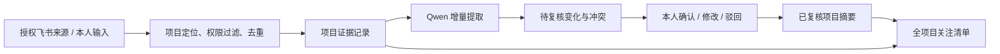

# 项目记忆设计与 Qwen 用量试验

2026.10.30。用户已明确：先完成设计和 Qwen 用量测试，暂不开启监控。本轮没有新建信息采集订阅、定时监控、项目群监听或 Codex CLI 调用。

## 目标与使用方式

台账是正式整理结果之一，更新可能晚于消息、会议、报告和本人输入。项目记忆应同时展示“台账记录”和“新收到、尚待核对的信息”，保留各自时间与出处，不能将后者静默覆盖成已确认状态。

拟定工作流：授权来源出现新增信息 → 代码定位项目和来源权限、去重 → Qwen 仅分析该项目的增量与必要上下文 → 生成待复核变化、冲突和跟进建议 → 本人逐项确认、修改或驳回 → 更新已复核摘要。提醒、审批、验收和正式台账写回继续各自的明确规则，确认文字不自动完成业务动作。

## 每个项目的五类记忆

| 层 | 保存什么 | 更新条件 |
| --- | --- | --- |
| 身份和规则 | 稳定项目 ID、可信别名、项目类型、范围、来源清单、可见人群 | 来源核实；编号变更或项目合并需明确映射，不能凭名称相似合并 |
| 原始证据 | 原消息、文档版本、附件引用、人工输入；来源发生时间与采集时间 | 只追加新版本；重复事件不续期，删除、撤回和不可访问的来源留下失效状态 |
| 当前摘要 | 进度、问题、下一步、要求；批准基线与当前预计分别保存 | 每项绑定证据；台账状态、报告人自报、本人复核、专业验收分别标识 |
| 决定与承诺 | 谁在何时确认了什么范围、日期、责任和条件；旧决定的替代关系 | 确认精确对象与版本；不将“提出、预计、申请”升级为批准 |
| 待复核与关注 | 新进展、来源冲突、重要缺口、计划风险、需要本人推动的动作 | AI 提议；冲突并列。无批准基准不能直接宣称延期，正常等待不自动判异常 |

会话记忆只负责“它指哪个项目、用户刚看哪页”，不能当作项目事实。项目记忆按稳定项目 ID 管理，全项目视图只聚合各项目的有来源摘要，不每次把全台账和所有聊天送给模型。

## 不同类型的关注重点

| 类型 | 重点字段与判定边界 |
| --- | --- |
| 需求评估 | 范围、评估结论、责任人、预计安排、变更决定；材料附件只是输入，不能代表评估通过 |
| 开发 / 升级量产 | 批准基线、当前预测、依赖条件、验证结果、交付与验收；制作、测试、验收、量产放行分别记录 |
| 认证 | 型号与标准、整改证据、草本与正式证书、认证结论；认证项目与量产项目独立，只建立明确关联 |
| 质量 / 8D / 供应商验证 | 问题范围、临时措施、原因证据、纠正措施、有效性验证；供应商报告不替代公司验证，部分型号不代表全范围 |
| 未分类项目 | 先按进度、问题、下一步、要求整理；分类不明时待核，不猜测流程阶段 |

项目类型模板可共用；事实、决定、事件游标和上下文按项目隔离。一条消息涉及多个项目时，应拆分证据片段并显示关联，不能把项目 B 的状态写成项目 A 的状态。项目定位不唯一时进入待归属队列。

## 权限、时效与复核

证据同时具有项目范围和来源可见范围。本人私聊输入不能因为提到了某项目就向同事公开；群内获得的信息也不能自动出现在其他群。查询时先过滤当前人的项目资格和来源可见范围，再组织回答。

每项显示来源发生时间、采集时间、复核时间与来源版本。晚采集的旧消息不能覆盖较新的证据。只有明确替代、撤回或确认关系才能关闭旧说法；日期、型号、数量、人员与验收条件有冲突时并列待核。

原聊天绝对 24 小时规则继续保持。离线原型同样不延长原始证据有效期。正式项目知识若需跨月保留，应另定义项目档案的范围、保存期限、来源撤回和清理规则；当前尚未批准或启用长期保存。

本人复核页面拟显示：原始片段、AI 解释、原摘要与拟变更、相关项目、影响字段、未决冲突。按版本确认，旧页面和重复点击不重复生效。“表述已核对”与“测试已验收/已批准”是不同操作，后者必须另有专业证据。

## 执行与用量控制

不变的信息由代码去重，不调用模型。按项目汇集新增事件，必要时带入少量已复核上下文；查询目录、翻页、确定字段提取仍然零模型调用。全项目关注清单先由代码汇集，再按需做一次简短归纳。

后续试运行应记录每日新增有效事件数、每批输入/输出 token、耗时、缓存命中、人工修正比例和冲突误报率，设置可调整的日预算与批次上限。达到预算则暂停新分析并保留待复核队列，不能丢信息或静默换模型。后台分析复用现有唯一 Qwen 通道，让明确项目查询继续走代码快路径。

## 本轮真实 Qwen 测量

原模型 `qwen3.8:27b-bartowski-q8_0`、Ollama `0.40.5`，复用原模型协调锁。四组为合成业务证据上的真实推理；没有向飞书发送测试分析内容。

| 样本 | 来源片段 | 输入 token | 输出 token | 墙钟秒 |
| --- | ---: | ---: | ---: | ---: |
| 开发项目整批 | 12 | 727 | 247 | 45.285 |
| 开发项目增量 | 1 | 192 | 273 | 18.056 |
| 认证边界 | 1 | 177 | 224 | 14.937 |
| 质量验证边界 | 1 | 182 | 265 | 17.611 |

合计输入 1,278、输出 1,009，共 2,287 token。增量样本相对整批样本输入减少 73.6%，输入加输出减少 52.3%；两者信息量不同，这只说明该样本的压缩收益。首组包含 26.84 秒模型加载，不能把整段时间差都归功于增量设计。后三组热模型墙钟约 14.94～18.06 秒。

原始数据见 [Qwen 测量记录](evidence/qwen-memory-tokens.json)。token 来自 Ollama 响应计数，不用字符数估算；[官方字段说明](https://docs.ollama.com/api/chat)区分输入与生成 token。

四组共 15 条建议的引用均可在对应原文中找到，但这不是语义质量验收。分类较粗：例如开发样本将依赖、未验收状态都分到“进度”；认证样本提到了相关的量产项目 B，必须作为跨项目关系待核，不能合入 A 的事实。引用有效不代表解释、归属和状态转换正确，人工复核仍有实际必要。

本地离线原型提供项目隔离、来源去重、原时间保留、逐字证据校验、待复核队列、版本确认与过期清理；不接在线 AM，不创建监控任务。它不构成长期项目档案或生产权限系统的完整验收。

## 是否切换 Codex CLI

这四个小样本的 token 数量不大，值得继续观察真实日用量；尚无真实每日新增量、长文档样本或 Codex 对照，不能据此判断“长期用量可控”或决定切换。

后续若明确要比较，可在隔离环境对同组材料测试质量、输入/输出 token、耗时、失败恢复和实际账号用量。Codex 非交互 JSON 输出提供结束事件的 usage；但其上下文、工具提示和分词方式不同，Qwen token 不能直接换算为 Codex 费用或订阅占用。[官方非交互说明](https://learn.chatgpt.com/docs/non-interactive-mode)

当前只保留这份设计、原型和测量结果。原 Qwen、唯一模型通道、信息采集范围与 `ledger_write=false` 均保持。
