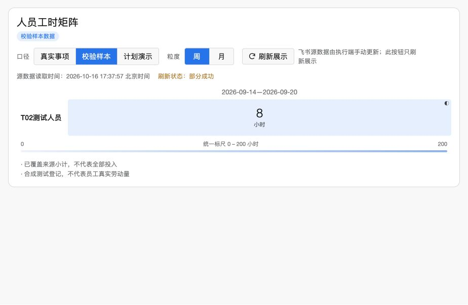

# MATRIX-TH2-UAT-01：可体验副本与手动接入

日期：2026-10-16。FS-LIGHTWORK-20261015-01。本轮状态：**限定8小时样本的源读取→TH2测试表更新→原矩阵副本显示→重复刷新已通过；真实16条需求体验已建立。待GPT复审与用户直接体验验收。** 正式流程、原矩阵和既有分享范围未改，副本未发布，没有常驻同步。

实现提交：`065e61af679623e79787972b109433c95ecb1cdf`；继承实现：`4b90532d95b3b1f4bf61c83317fb652bc3e18d06`。上一轮固定审核提交为`ffdafdf531274472d77fd4078858cfe940335538`。本目录为新轮增量，不覆盖前轮。

## 用户实际入口

已交付两个可登录打开的飞书链接：固定16条真实需求的测试列表、原矩阵的TH2隔离预览。因本仓库公开，内部链接和真实事项标题仅保留用户当前聊天及本机交接，不在此发布；公开图片来自真实页面的矩阵区域直接截图，无生成或改画。原始界面、配置与源身份仅本机保存。

## 这轮做了什么

用户明确允许简化测试流程与登记、创建副本及最小测试派生数据接入，并选择原清单16条未完成事项做体验，43条完成历史留原清单。用户不需要的业务状态、产品/型号、是否挂起列未进入新列表；保留源优先级文字。

测试事项主要走待处理→处理中→完成；新建默认直接处理中，负责人默认创建人。“需要独立验证”打开才出现待验证节点。“全部任务”冗余卡片隐藏，创建页6个不必要项目仅移除显示，未删除底层字段。来源链接与编号/分类/部门/审批号集中到选填“问题说明与来源”。完成意见仍选填，未增加强制验收规则。用户将直接体验完善具体设计。

原Tasks只读，16条复制到既有测试类型，测试负责人为当前操作者；没有派给原任务成员，没有复制或推算实际工时。新视图固定16条，重开确认“指定成员”；这不等于完整验证了底层工作项权限。后续原清单新增1条，本轮没有自动扩入：最终原清单60条、17未完成、43完成，最初59条标题和完成状态均未变。

## 三段真实对账

| 层次 | 本轮证据与结果 |
|---|---|
| 源读取 | 官方CLI重新读取T02同一行的人员、周期、8小时和标识；源累计值仅对账。最末来源时间17:37:57北京时间。|
| 目标更新 | 两个不同运行批次均更新原周/月记录，record ID不变；各8小时。真实范围状态行也更新同一ID。全表3条：sample 2条、real scope 1条。|
| 页面显示 | 最终云端修改完成后再次真实更新，未告知AI新时间；仅点击“刷新展示”从17:30:24变17:37:57。周2026-09-14—09-20为8小时，9月仍8；展开明细运行标识与写回一致。|
| 真实事项 | 读取16个体验副本，实际明细父字段未返回。scope行人员/周期/小时为null，页面显示16项待登记或核对；不采用累计公式0，不套用8。17:38:39刷新后仍16项。|
| 原功能 | 副本计划演示的人员/月筛选、色块明细、项目搜索同步与清除已操作回归。甲11月168小时；换软件项目后总览55%、10/23测试评审；清除不残留旧总览。周计划明确提示未提供。|

对应文件：`evidence/sample-final-console.json`、`sample-confirm-console.json`、`real-confirm-console.json`、`target-after-final.json`、`repeat-update-checks.json`、`refresh-confirm-before.txt`、`refresh-confirm-after.txt`、`th2-week-confirm-detail.txt`及三张TH2截图。记录ID使用同一稳定别名替换，时点/数值保留。




## 代码与复跑

- 原聚合器默认严格规则不变；real路径显式启用完整原生行定位键作为缺少技术登记标识时的对账依据，工程师不需手填技术ID。未知原生行、真正冲突和跨周待分配仍保留缺口。
- `sync-once.mjs`只更新样本；`sync-real-once.mjs`只读取授权16个测试副本并维护real数据集；导入账本保证同一选定事项不会重复创建。
- 写入前校验当前身份、宿主、目标字段和已持有记录；新建结果不明立即停止，不盲目重试；各步落回执并做目标读回。
- `projectReal`输出仅允许当前测试操作者，别名不构成展示授权。表中不保存真实人员ID、任务标题或原始响应。

在本目录运行：

```sh
npm test
node review/replay-uat.mjs
```

59项离线测试全部通过（原26+GPT7+FIX1守卫11+目标6+登记/身份9）；脱敏现场源快照重放周/月各8。包内复跑也通过，日志见`evidence/package-tests.tap`和`evidence/replay-result.json`。这不等于59项真实UI测试。线上脚本依赖私有scope/映射和原CLI登录，公开包不提供这些材料；不要当作已部署服务运行。既有`replay.mjs`、`verify-evidence.mjs`是继承的FIX1工具，依赖旧轮证据目录；本轮使用上面的重放入口。

## 不变性与证据边界

原项目表8条、原矩阵27条规范化JSON前后SHA-256相同，三张原表版本26/3/5不变。T02同一明细、累计及已读开始时间一致。原发布页仍原v6资产。此前GPT证据包24项校验匹配，仅说明包的完整性，未冒称重新执行全部旧轮现场验收。

副本继承原Base组织内链接阅读范围，并非个人私有；本轮仅使用测试别名与最小校验数据。没有将真实全员工时接到原分享页面，也未验证跨用户展示权限。新项目视图可见性不能替代底层权限。云端AI源码尚未导出；`cloud/`记录真实提交的脱敏修改指令，不能替代源码diff或独立构建验证。

真实非空工时、真实项目类型非空来源、源行修改/删除传播、多用户授权和生产运行仍未验证。样本8小时是合成测试登记，不是员工真实劳动量证明。R1不自动升级为全通过。停止于本轮交付，待GPT复审和用户体验，不自动发布、扩权、同步或进入下一轮。
