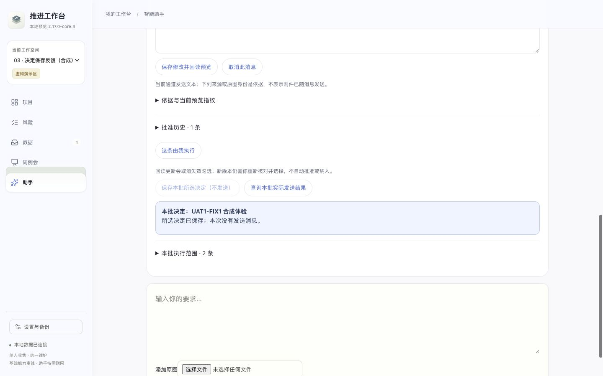

# UAT1-FIX1 验证与截图索引

下表对应本轮真实页面场景，不是对前轮截图的重新背书。截图中均为合成对象；16 张截图为 13 张自动浏览器场景、3 张应用内实际代操作画面，没有复制 UAT1 原图。

| 修复目标 | 页面与持久链证据 |
|---|---|
| 同 ID / 不同 ID 切区；五个旧动作不可用；历史导航 | `U01-navigation`，新区完整合成状态前后相等，POST 增量 0；[同 ID 新区](screenshots/u01-same-id-workspace-clean.png) |
| 撤销后切区再回原事项，持久回执仍撤销 | `U01-undo`；[原区撤销回执重入](screenshots/u01-durable-undone-reentry.png) |
| 正常“目前都待定”仍可操作 | `U01-pending-valid`，检查 / 完成均明确待定，连续点击写入 1 次 |
| 处理请求迟到，不填入新区 | `U01-late-job`，原区保存 1 次，新区草稿保留、业务状态不变 |
| 查询原撤销 / 待定请求途中切区 | `U01-inflight-undo/pending`，仅原请求查询，后续业务 POST 0，两个工作区状态不变 |
| A→B→A 的迟到回读 | `U01-late-refresh`，新输入未关闭 / 未覆盖，原保存只有 1 次 |
| 当前区持久回执缺失 | `U01-missing`；[待核实且没有关联按钮](screenshots/u01-missing-durable-receipt.png)。删除的是一次性合成场景中的回执，以测试缺失路径，不删除用户记录 |
| 1024×768 / 1440×900 字段错误 | `U02-field-*`，错误字段关联 / 聚焦、文本保留、无效 POST 0，补齐后保存 1 次；[小窗口](screenshots/u02-field-1024x768.png) · [大窗口](screenshots/u02-field-1440x900.png) |
| 保存决定且不发送 | `U02-save-*`，重复点击仅一次写入，批准一条、另一条待决定；[小窗口反馈](screenshots/u02-save-1024x768.png) · [大窗口反馈](screenshots/u02-save-1440x900.png) |
| 保存明确拒绝 | `U02-rejected-*`，本地草稿保留，持久状态不变，错误在消息操作附近；[小窗口](screenshots/u02-rejected-1024x768.png) · [大窗口](screenshots/u02-rejected-1440x900.png) |
| 操作返回但显示回读失败 | `U02-readback-*`，已批准事实与显示失败并存；只重读不重提，批准历史 1 条；[小窗口](screenshots/u02-readback-1024x768.png) · [大窗口](screenshots/u02-readback-1440x900.png) |
| 响应丢失、结果未知 | `U02-unknown-*`，没有自动重试或成功文案；手动重读后原请求核实入口保留，续办同 requestId/body，持久批准仍 1 次；[小窗口](screenshots/u02-unknown-1024x768.png) · [大窗口](screenshots/u02-unknown-1440x900.png) |
| 操作完成后卡片退出当前筛选 | `U02-filter`，被取消卡片退出“待决定”，反馈保留在原批次且在视口内 |

全部场景、视口矩形、实际请求和代码指纹见 [本轮浏览器结果](evidence/browser-results.json)。测试源见 [定向浏览器脚本](source/scripts/test-integration-uat1-fix1-browser.mjs)。

新增契约核对：持久身份、跨区同操作 ID、无工作区绑定、缺回执、错事项 / 操作、已归档事项、旧缓存遇到已撤销、重复图片、已结束 / 较新安排以及历史键过滤。见 [8 项契约](evidence/contracts-new.log)与[脚本](source/scripts/test-integration-uat1-fix1-contracts.mjs)。

相关原回归详见 [DEV1 13 场景](evidence/regression-dev1-results.json)与 [DEV1-FIX1 10 场景](evidence/regression-dev1-fix1-results.json)。沿用其既有脚本，没有将这些脚本复制成新实现；原范围包含纯 / 多图、保存失败、显示失败、分析未完、手选时间与分析竞态、预览冲突、原发送结果核实、作用域，以及选择退场与只读草稿本地放弃。旧 A1 未重跑。

应用内浏览器补充：

- [1024×768 字段错误](screenshots/iab-field-1024x768.png)：实际填写文本、选择空日期并提交，错误就在日期字段下。
- [撤销后切到同 ID 的新区](screenshots/iab-cross-workspace-clean.png)：等页面连接完成后截图，没有旧回执；后台新区 revision 0。
- [1440×900 决定保存反馈](screenshots/iab-decision-feedback-1440x900.png)：真实勾选、保存，提示在按钮附近，模拟发送仍 0。

这是执行端真实操作与页面判断，操作者已熟悉产品；没有测量人类新手成功率或平均耗时，不据此代替用户本人验收。真实模型语义质量、同事收发、持续运行均未验证。
